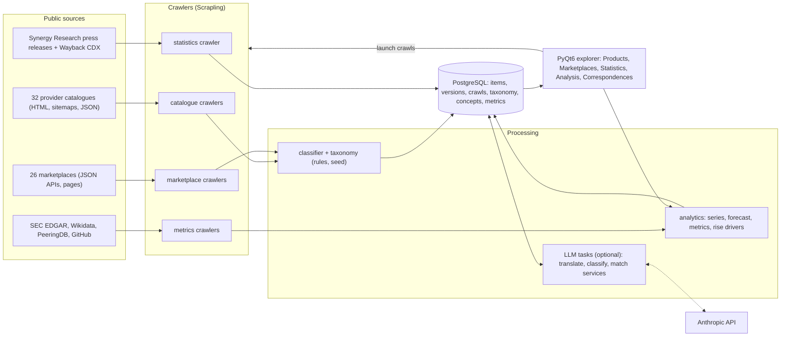
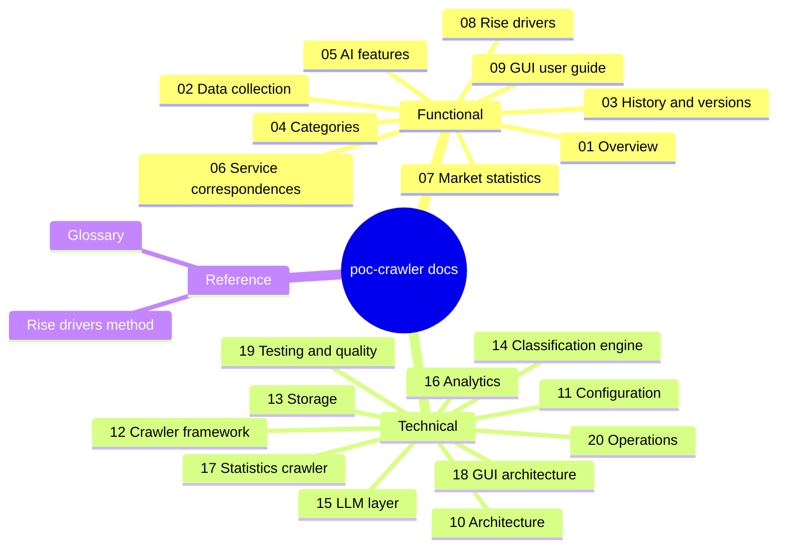
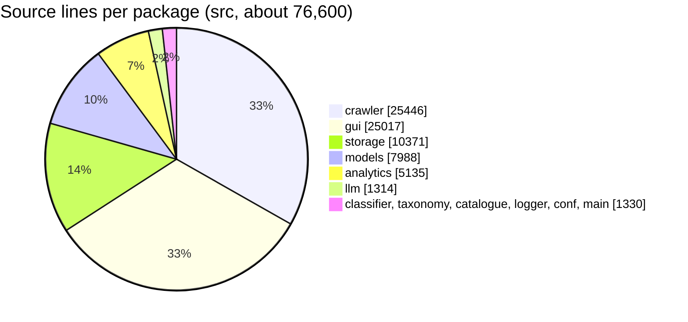

# poc-crawler documentation

poc-crawler tracks the cloud market from public sources:
- **Catalogues.** It crawls the product catalogues of **32 cloud providers in 11 countries**.
- **Marketplaces.** It crawls their software marketplaces, about 115,000 listings.
- **Market shares.** It reads the cloud market shares published by
  [Synergy Research Group](https://www.srgresearch.com/articles).
- **Provider facts.** It collects public facts about the providers: capex, age, employees, network presence and
  developer adoption.

Everything goes into PostgreSQL. A rules engine and an optional language model file every item in one unified
taxonomy. A PyQt6 desktop explorer lets an analyst compare providers, blocs and categories over time, map the
equivalent services of the providers, and measure which criteria drive the rise of a provider.

This folder documents the project for two audiences:
- **Functional** chapters (01–09) explain what the tool collects, how it categorizes, and how to use the explorer.
  They are written for analysts and product owners.
- **Technical** chapters (10–20) explain how it is built: packages, crawler framework, storage, classification, LLM
  layer, analytics, GUI threading, tests and operations. They are written for developers and maintainers.

Diagrams and charts are embedded as [Mermaid](https://mermaid.js.org/) blocks. GitHub and GitLab render them
natively. In VS Code, install
[Markdown Preview Mermaid Support](https://marketplace.visualstudio.com/items?itemName=bierner.markdown-mermaid)
(`bierner.markdown-mermaid`) and open the Markdown preview (`Ctrl+Shift+V`). The links to source files point to
`../src/…` with line anchors, and open the file at the right line in VS Code and on GitHub.

## Contents

- [System at a glance](#system-at-a-glance)
- [Documentation map](#documentation-map)
- [Functional documentation](#functional-documentation)
- [Technical documentation](#technical-documentation)
- [Reference](#reference)
- [Quick start](#quick-start)
- [Key figures](#key-figures)
- [Conventions of these pages](#conventions-of-these-pages)

## System at a glance



## Documentation map



## Functional documentation

| # | Chapter | What you will find |
|---|---|---|
| 01 | [Overview](functional/01-overview.md) | What questions the tool answers, the providers by country and bloc, the capability map. |
| 02 | [Data collection](functional/02-data-collection.md) | What is crawled from catalogues and marketplaces, politeness, parallelism, the run modes. |
| 03 | [History and versions](functional/03-history-and-versions.md) | Added, updated and deleted dates, website or crawl dates, versions, partial crawls. |
| 04 | [Categories](functional/04-categories.md) | The unified taxonomy, audiences, delivery methods, source labels, how an item gets its categories. |
| 05 | [AI features](functional/05-ai-features.md) | Label translation, classification of unclassified items, the budget, when the tasks run. |
| 06 | [Service correspondences](functional/06-service-correspondences.md) | Equivalent services across providers: concepts, classes, the diagram, the coverage matrix, editing. |
| 07 | [Market statistics](functional/07-market-statistics.md) | Synergy market shares and sizes, regions, segments, computed others, methodology break. |
| 08 | [Rise drivers](functional/08-rise-drivers.md) | The Analysis tab's driver analysis, for users. |
| 09 | [GUI user guide](functional/09-gui-user-guide.md) | Every tab, filter, chart, zoom gesture, selection, export, editing and shortcut. |

## Technical documentation

| # | Chapter | What you will find |
|---|---|---|
| 10 | [Architecture](technical/10-architecture.md) | Packages and their dependencies, runtime threads, technology stack, code size. |
| 11 | [Configuration](technical/11-configuration.md) | Entry points, `CRAWLER_SOURCE` dispatch, every environment variable and YAML file. |
| 12 | [Crawler framework](technical/12-crawler-framework.md) | Crawler hierarchy, factory, fetchers, robots.txt, dedup, CA bundle, adding a provider. |
| 13 | [Storage](technical/13-storage.md) | Data model (ER diagram), progressive writer, advisory locks, repositories, migrations. |
| 14 | [Classification engine](technical/14-classification-engine.md) | The categories cascade, rules, label normalization and status, taxonomy seeding. |
| 15 | [LLM layer](technical/15-llm-layer.md) | Model factory, routing profiles, budget metering, the three AI tasks and their locking. |
| 16 | [Analytics](technical/16-analytics.md) | Chart pipeline, forecaster, axis rules, metrics pipeline, driver statistics. |
| 17 | [Statistics crawler](technical/17-statistics-crawler.md) | The Synergy crawler: sources, extraction, plausibility, merging, persistence. |
| 18 | [GUI architecture](technical/18-gui-architecture.md) | Storage thread bridge, polling, crawl thread, paged tables, chart widgets. |
| 19 | [Testing and quality](technical/19-testing-and-quality.md) | Test layout, markers, database fixture, snapshots, convention tests, ruff and mypy. |
| 20 | [Operations](technical/20-operations.md) | install-stack, Compose services, migrations, logging, troubleshooting, known gaps. |

## Reference

| Document | Content |
|---|---|
| [Glossary](glossary.md) | Every term of the domain and the code, linked to its chapter. |
| [What drives the rise of a cloud provider](analysis/rise-drivers.md) | The method, criteria, data gaps and first findings behind the driver analysis. |
| [Leaders of digital infrastructure, 1964–2026](analysis/leaders-chronology.md) | Who led each segment of computing since 1964, and the dated notable events, generated from the chronology drawn in the Analysis tab. |
| [Market shares and stock values of the leaders](analysis/market-shares-and-stocks.md) | The sources (with their terms and robots status), the method, the limits and the coverage of the market shares and stock values, worldwide and by area, and their correlation. |
| [Computing leaders dossier](analysis/sources/computing-leaders-1964-2026.md) | The source dossier: market shares, valuations, regulation and adoption criteria, 1964–2026. |
| [Project README](../README.md) | The original single-page description of the project. |

## Quick start

```bash
uv sync
uv run patchright install chromium                          # the stealth browser
uv run install-stack                                        # PostgreSQL (Docker Compose) + migrations + taxonomy seed
CRAWLER_TARGET=scaleway uv run python src/main.py           # crawl one catalogue
CRAWLER_SOURCE=marketplace CRAWLER_TARGET=civo uv run python src/main.py
CRAWLER_SOURCE=statistics uv run python src/main.py         # Synergy market shares
uv run python -m gui.window.app                             # open the explorer
```

Details: [11-configuration.md](technical/11-configuration.md) and [20-operations.md](technical/20-operations.md).

## Key figures

| Figure | Value |
|---|---|
| Providers | 32, in 11 countries and 5 blocs |
| Catalogue crawlers / marketplace crawlers | 32 / 26 |
| Statistics and metrics crawlers | 1 (Synergy) / 4 (EDGAR, Wikidata, PeeringDB, GitHub) |
| Unified taxonomy | 29 domains, 224 nodes |
| Database tables / migrations | 17 / 8 (0001–0008) |
| Provider metric definitions | 32, in 12 families |
| Source code | 611 Python modules, about 76,600 lines in `src/` |
| Tests | 206 test files, about 38,300 lines |



## Conventions of these pages

- Every page starts with a link back to this index and ends with Previous / Next links, in the order of the tables
  above.
- Code names link to their source file and line, e.g.
  [`CatalogueRunner`](../src/crawler/runner.py#L49). The line anchors were taken from the working tree when the docs
  were written. If a link lands a few lines off, search the file for the class name.
- Library, standard and data-source names link to their official documentation.
- Figures quoted as "today" (product counts, listings) come from the crawls of October 2026 and change with every
  crawl.

[Next →](functional/01-overview.md)
