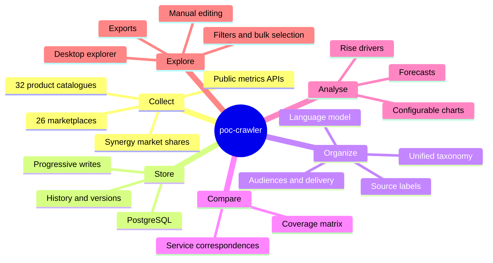
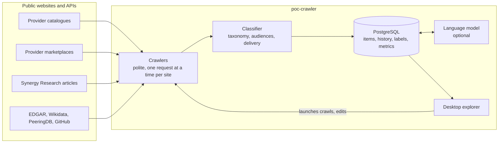
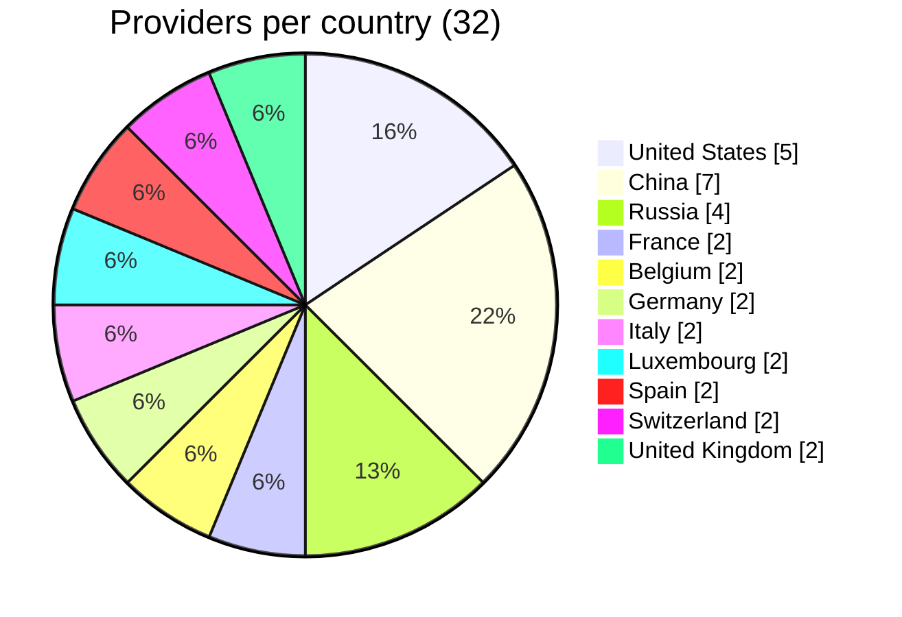
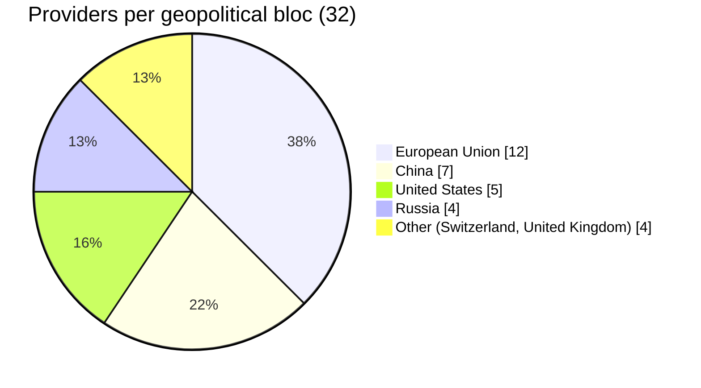
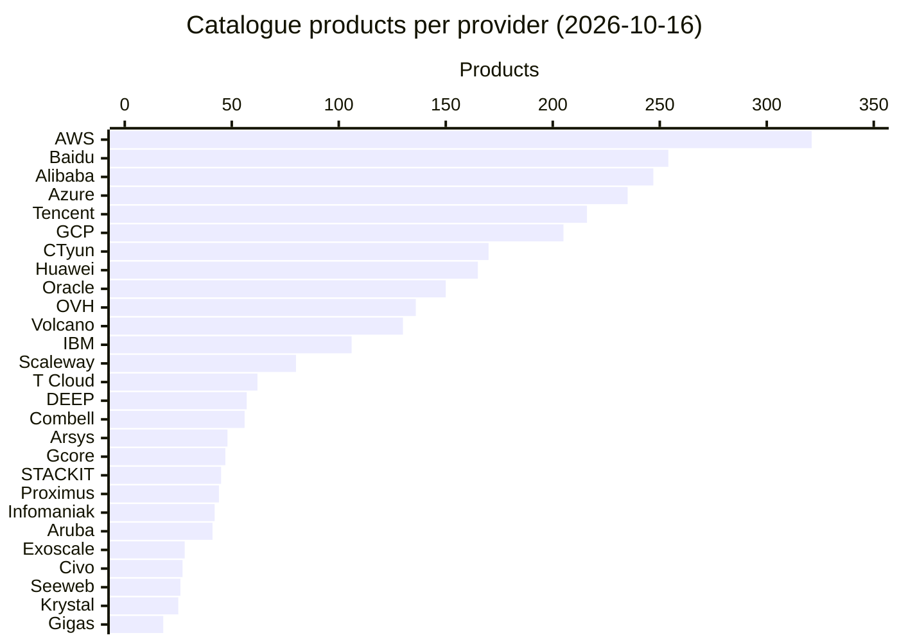

[↑ Docs index](../README.md) · Functional

# 01 — Overview

poc-crawler builds a comparable picture of the cloud market. It reads the public **product catalogues** and
**marketplaces** of 32 cloud providers in 11 countries, the **market shares** that
[Synergy Research Group](https://www.srgresearch.com/articles) publishes, and a few **public company metrics**
(SEC filings, Wikidata, PeeringDB, GitHub). It files every product and every marketplace listing in one shared
taxonomy, keeps the history of each one, matches equivalent services across providers, and shows all of it in a
desktop explorer built for competitive analysis, forecasting and geopolitics.

## Contents

- [The questions it answers](#the-questions-it-answers)
- [Who uses it](#who-uses-it)
- [Capability map](#capability-map)
- [The end-to-end picture](#the-end-to-end-picture)
- [The providers](#the-providers)
- [Providers per country and per bloc](#providers-per-country-and-per-bloc)
- [Catalogue sizes](#catalogue-sizes)
- [Marketplaces](#marketplaces)
- [What the product does not do](#what-the-product-does-not-do)
- [See also](#see-also)

## The questions it answers

| Family | Typical question | Where to look |
|---|---|---|
| Competitive analysis | Which provider offers the broadest catalogue? Who has a managed Kubernetes, an object storage, a GPU offer? Which services does provider A lack compared with provider B? | Products tab, [Service correspondences](06-service-correspondences.md), Analysis tab |
| Ecosystem | How large is each marketplace? Who publishes there? Which share is SaaS, virtual-machine images, AI models? Developer tools or end-user software? | Marketplaces tab, [Categories](04-categories.md) |
| Market | What are the market shares of AWS, Azure and Google Cloud, quarter by quarter? How large and how fast-growing is the market? | Statistics tab, [Market statistics](07-market-statistics.md) |
| Geopolitics | How do the US, EU, Chinese and Russian blocs compare in breadth, in listings, in launches? | Charts grouped by **bloc**, the geopolitics chart views |
| Dynamics | Which services were launched, changed or withdrawn, and when? | [History and versions](03-history-and-versions.md), the trend charts |
| Forecast and drivers | Where are the trends heading? Which criteria go with the rise of a provider? | Forecast option of the charts, [Rise drivers](08-rise-drivers.md) |

## Who uses it

| User | Needs | Main features |
|---|---|---|
| Market analyst | Comparable figures, exports, charts | Configurable charts, CSV/PNG export, bulk selection and export |
| Product or strategy team | Service parity against competitors | Correspondences diagram and coverage matrix |
| Data curator | Clean, well-filed data | Categories manager, manual editing, bulk edit, AI translation and classification |
| Operator | Fresh data | Crawl actions of the toolbar, [`CRAWLER_SOURCE`](02-data-collection.md) modes |

## Capability map

## The end-to-end picture

The crawlers read the public pages and APIs, the classifier files each item, PostgreSQL keeps everything with its
history, the optional language model translates labels, files the leftovers and matches equivalent services, and the
explorer reads the database every 2 seconds. The technical view of the same picture is in
[10 — Architecture](../technical/10-architecture.md).

## The providers

The value in the `CRAWLER_TARGET` column is what the command line and the GUI use to name a provider. The product
counts are those of the README (catalogue crawls of 2026-10-16). The Russian providers were added after that
snapshot, and China Mobile Cloud is rate-limited (see [Data collection](02-data-collection.md)).

| Country | Provider | `CRAWLER_TARGET` | Products (2026-10-16) | Marketplace |
|---|---|---|---|---|
| United States | [Amazon Web Services](https://aws.amazon.com/products/) | `amazon-web-services` | 321 | yes |
| | [Microsoft Azure](https://azure.microsoft.com/en-us/products/) | `microsoft-azure` | 235 | yes |
| | [Google Cloud Platform](https://cloud.google.com/products) | `google-cloud-platform` | 205 | yes |
| | [IBM Cloud](https://cloud.ibm.com/catalog) | `ibm-cloud` | 106 | yes |
| | [Oracle Cloud](https://www.oracle.com/cloud/) | `oracle-cloud` | 150 | yes |
| France | [OVHcloud](https://www.ovhcloud.com/en-gb/public-cloud/) | `ovh-cloud` | 136 | yes |
| | [Scaleway](https://www.scaleway.com/en/all-products/) | `scaleway` | 80 | yes |
| Belgium | [Combell](https://www.combell.com/en/) | `combell` | 56 | one-click apps |
| | [Proximus NXT](https://www.proximus.be/en/id_catl_itservices/companies-and-public-sector/ict-for-large-companies.html) | `proximus-nxt` | 44 | no |
| Germany | [STACKIT](https://stackit.com/en/products) | `stackit` | 45 | yes |
| | [T Cloud Public](https://www.t-cloud-public.com/en/products-services/core-services) (ex Open Telekom Cloud) | `t-cloud-public` | 62 | yes |
| Italy | [Aruba Cloud](https://www.arubacloud.com/) | `aruba-cloud` | 41 | one-click apps |
| | [Seeweb](https://www.seeweb.it/en) | `seeweb` | 26 | no |
| Luxembourg | [Gcore](https://gcore.com/) | `gcore` | 47 | one-click apps |
| | [DEEP (POST Luxembourg)](https://www.deep.eu/en/accueil/services/cloud) | `deep-post-luxembourg` | 57 | no |
| Spain | [Arsys](https://www.arsys.net/) | `arsys` | 48 | no |
| | [Gigas](https://gigas.com/en/) | `gigas` | 18 | no |
| Switzerland | [Exoscale](https://www.exoscale.com/products/) | `exoscale` | 28 | yes |
| | [Infomaniak](https://www.infomaniak.com/en) | `infomaniak` | 42 | one-click apps |
| United Kingdom | [Civo](https://www.civo.com/public-cloud) | `civo` | 27 | yes |
| | [Krystal](https://krystal.io/cloud/products) (incl. Katapult) | `krystal` | 25 | one-click apps |
| China | [Alibaba Cloud](https://www.alibabacloud.com/en/product) (international site) | `alibaba-cloud` | 247 | yes |
| | [Huawei Cloud](https://www.huaweicloud.com/intl/en-us/product/) (international site) | `huawei-cloud` | 165 | yes |
| | [Tencent Cloud](https://www.tencentcloud.com/) (international site) | `tencent-cloud` | 216 | yes |
| | [Baidu AI Cloud](https://cloud.baidu.com/products/index.html) (Chinese) | `baidu-ai-cloud` | 254 | yes |
| | [Volcano Engine](https://www.volcengine.com/product/list) (Chinese) | `volcano-engine` | 130 | yes |
| | [China Telecom Cloud / Tianyi](https://www.ctyun.cn/products/) (Chinese) | `china-telecom-cloud` | 170 | yes |
| | [China Mobile Cloud](https://ecloud.10086.cn/) (Chinese) | `china-mobile-cloud` | — | no |
| Russia | [Yandex Cloud](https://yandex.cloud/en/services) | `yandex-cloud` | — | yes |
| | [VK Cloud](https://cloud.vk.ru/cloud-platform/) (ex Mail.ru Cloud Solutions) | `vk-cloud` | — | yes |
| | [Cloud.ru](https://cloud.ru/products) (ex SberCloud) | `cloud-ru` | — | yes |
| | [Selectel](https://selectel.ru/services/) | `selectel` | — | yes |

The list is the `CloudProvider` enumeration of
[`src/models/cloud/enums.py`](../../src/models/cloud/enums.py#L69), and the country of each provider is in its
`PROVIDER_COUNTRIES` table ([line 350](../../src/models/cloud/enums.py#L350)).

## Providers per country and per bloc

Every country belongs to a **geopolitical bloc** ([`COUNTRY_BLOCS`](../../src/models/cloud/enums.py#L392)): the
United States, the European Union, China, Russia, or *other*. Switzerland and the United Kingdom, outside the EU, are
in *other*. The bloc is the main lens of the geopolitics charts.

## Catalogue sizes

The products found per provider in the catalogue crawls of 2026-10-16 (2,981 products over 27 providers). The whole
catalogue of each provider is read, hosting, domains, e-mail and office products included, which is why some
regional providers with a broad hosting offer list many products.

The live figures are always on the **Dashboard** of the Products tab, which counts the stored products per provider
(see [GUI user guide](09-gui-user-guide.md)).

## Marketplaces

26 providers have a crawler for their marketplace or, for five of them (Gcore, Aruba, Krystal, Combell, Infomaniak),
for their list of one-click applications. Six providers have neither: Proximus NXT, Seeweb, DEEP, Arsys, Gigas and
China Mobile Cloud. Marketplaces are about 115,000 listings in total, dominated by Microsoft's (see
[Data collection](02-data-collection.md)).

## What the product does not do

- It reads public pages only: no account, no login, no private API.
- It does not collect prices yet (`pricing_policy` stays empty).
- It does not schedule crawls: a crawl is launched from the command line or the GUI.
- It does not predict: the forecasts are least-squares trends of the last points, shown as such.

## See also

- [02 — Data collection](02-data-collection.md): how each source is read.
- [04 — Categories](04-categories.md): the unified taxonomy.
- [09 — GUI user guide](09-gui-user-guide.md): the explorer.
- [10 — Architecture](../technical/10-architecture.md): the technical view.
- [Glossary](../glossary.md).

[← Previous](../README.md) · [Next →](02-data-collection.md)
