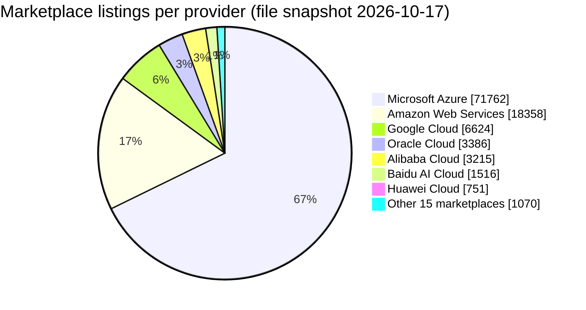
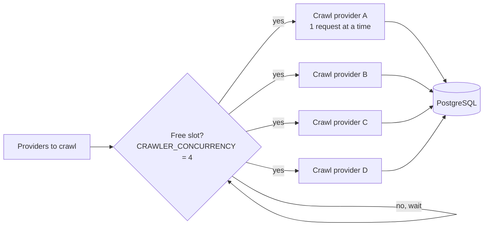
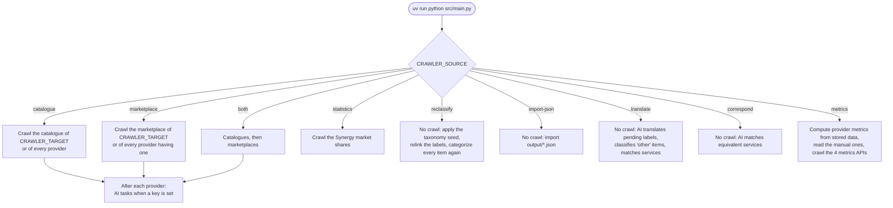
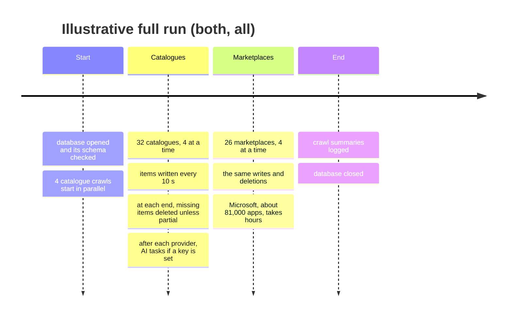

[↑ Docs index](../README.md) · Functional

# 02 — Data collection

This chapter describes **what** is collected and **how the crawls behave** from a user's point of view: the four
kinds of sources (catalogues, marketplaces, market statistics, provider metrics), the rules that keep the crawls
polite, how several providers are crawled at once, how a running crawl fills the database, and the nine modes of
`CRAWLER_SOURCE`. The crawler internals are in [12 — Crawler framework](../technical/12-crawler-framework.md).

## Contents

- [The four kinds of sources](#the-four-kinds-of-sources)
- [Catalogues](#catalogues)
- [Catalogue sources per provider](#catalogue-sources-per-provider)
- [Marketplaces](#marketplaces)
- [Marketplace sizes](#marketplace-sizes)
- [Market statistics and provider metrics](#market-statistics-and-provider-metrics)
- [Politeness](#politeness)
- [Parallel crawls](#parallel-crawls)
- [Progressive storage](#progressive-storage)
- [Run modes: CRAWLER_SOURCE](#run-modes-crawler_source)
- [A full run, step by step](#a-full-run-step-by-step)
- [Special cases](#special-cases)
- [See also](#see-also)

## The four kinds of sources

| Kind | What is collected | Providers | Code |
|---|---|---|---|
| **Catalogue** | Every product of the provider: name, description, page, categories, dates when published | 32 | [`src/crawler/cloud/<package>/crawler.py`](../../src/crawler/cloud/aws/crawler.py) |
| **Marketplace** | Every software listing: name, publisher, description, delivery method, marketplace categories, dates when published | 26 | [`src/crawler/cloud/<package>/marketplace.py`](../../src/crawler/cloud/aws/marketplace.py) |
| **Market statistics** | Synergy Research market shares, market size and growth | 1 source | [`src/crawler/stats/`](../../src/crawler/stats/synergy.py) |
| **Provider metrics** | Capex (SEC EDGAR), founding date and employees (Wikidata), networks and facilities (PeeringDB), SDK stars (GitHub) | 4 APIs | [`src/crawler/metrics/`](../../src/crawler/metrics/base.py) |

Two crawling techniques are used, both from the [Scrapling](https://github.com/D4Vinci/Scrapling) library:

- a **stealth Chromium browser** ([Patchright](https://github.com/Kaliiiiiiiiii-Vinyzu/patchright)) for the pages
  that need JavaScript or face anti-bot checks (Cloudflare, Akamai, EdgeOne). It runs **visibly**: a browser window
  opens during the crawls that need it;
- a **browser-impersonating HTTP client** for the JSON APIs of the marketplaces and the metrics sources.

## Catalogues

The **whole catalogue** of each provider is extracted, including hosting, domains, e-mail and office products.

- **Main listing first.** Each crawler reads the provider's main product listing (a products page, a navigation
  menu, a directory API…).
- **Complementary sources.** It then reads complementary sources (menus, sitemaps, documentation directories, JSON
  APIs) and adds **only the products not found yet**.
- **Duplicates.** Products are compared by **normalized name** (case, brand prefixes such as "Amazon " or "AWS ",
  notes in ASCII or full-width parentheses and punctuation ignored, in any script) and by **URL** (host without
  `www.` and path, without the scheme, query or trailing slash). A product listed under several categories is
  merged into one product carrying every category.
- **Product pages.** When a listing only gives names, each product page is read for its description (usually its
  meta description).
- **Languages.**
  - The four **Chinese-only** catalogues (Baidu, Volcano Engine, China Telecom, China Mobile) keep their names and
    descriptions in Chinese.
  - The **Russian** providers keep names, descriptions and categories as their websites give them, in Russian when
    the English site is missing or poorer (VK Cloud, Selectel, Cloud.ru).
  - Their categories are translated later, as [source labels](04-categories.md).
- **Validation.** Every product is checked by a Pydantic model before it is stored; an invalid entry is logged and
  skipped.

## Catalogue sources per provider

Each crawler describes its sources in its class docstring. In short:

| Provider | Main source | Complements |
|---|---|---|
| AWS | JSON directory API behind the products page | documentation home page |
| Azure | product cards of the products page | Microsoft Learn directory |
| Google Cloud | catalogue category pages (embedded data) | products menu |
| IBM Cloud | IBM Cloud catalogue (embedded state), IBM-made services only | "IBM Cloud" product search of ibm.com |
| Oracle | services panel of the cloud home page, then each product page | infrastructure documentation table of contents |
| OVHcloud | main menu | sitemap |
| Scaleway | Next.js data of the "All products" page | header menu |
| Combell | main menu | managed services page |
| Proximus NXT | ICT, network and telephony pages for large companies | — |
| STACKIT | product tiles of the products page | English sitemap |
| T Cloud Public | core services table | sitemap |
| Aruba Cloud | menu | pricing page, Italian descriptions re-read in English |
| Seeweb | products menu, then the product pages | — |
| Gcore | products menu of the home page | main sitemap |
| DEEP | services menu | service pages |
| Arsys | main menu of the home page | — |
| Gigas | main menu | add-ons page |
| Exoscale | menu | sitemap |
| Infomaniak | products menu of the home page (no catalogue page) | — |
| Civo | hubs, pricing navigation, JSON-LD | footer |
| Krystal | cloud products page | HTML and XML sitemaps, footer |
| Alibaba Cloud | product tree of the navigation menu (JSON) | "All products" cards, documentation home, sitemap |
| Huawei Cloud | product cards of the products page | documentation catalogue JSON |
| Tencent Cloud | product cards of the products page (EdgeOne challenge) | documentation home, product documentation |
| Baidu AI Cloud | Next.js data of the products page | product pages |
| Volcano Engine | product cards of the products list (only source) | — |
| China Telecom Cloud | category sections of the products page | home page product tabs |
| China Mobile Cloud | product menu tree API | product page templates |
| Yandex Cloud | server-rendered state of the services page | — |
| VK Cloud | Russian catalogue page (Next.js flight data) | header products menu |
| Cloud.ru | services catalogue page (Next.js flight data) | product pages |
| Selectel | header menu dropdowns | — |

## Marketplaces

For the providers having one, the software of their marketplace is extracted. Five providers have no marketplace but
offer **one-click applications**, and those lists are extracted instead: Gcore, Aruba, Krystal, Combell and
Infomaniak.

- **Excluded:** professional or consulting services, datasets, hardware and courses.
- **Classification:** each software is filed in the [unified taxonomy](04-categories.md), and gets:
  - its **audiences**: `developer-tool` and/or `end-user-software`;
  - its **delivery method**: `saas`, `virtual-machine`, `container`, `kubernetes`, `api`, `ai-model`,
    `one-click-app`, `download` or `other`.
- **Marketplace categories,** kept in two forms:
  - `marketplace_categories`: the flat labels, read by the classifier;
  - `marketplace_category_paths` (optional): each category in the marketplace's own taxonomy, with its parents and
    the marketplace identifier, e.g. `{"path": ["AI Agents & Tools", "Content Creation"], "id": "…"}`.
    - It is `null` when the marketplace shows no category (Gcore).
    - A software found under several categories (GCP and Azure query each category) keeps every path, the parents of
      a deeper path being dropped.
    - GCP's "Managed Services" and "Other" categories are recorded as paths only, never as flat labels, because they
      say nothing about the software.
- **Identity.** A software is identified by its page URL, or by its name and publisher when it has no URL.

| Provider | Marketplace source (examples) |
|---|---|
| AWS | [AWS Marketplace](https://aws.amazon.com/marketplace) discovery API |
| Azure | [Microsoft Marketplace](https://marketplace.microsoft.com/) tile data API, one query per category |
| Google Cloud | [Google Cloud Marketplace](https://console.cloud.google.com/marketplace) entity service, one query per category |
| Oracle | [OCI Marketplace](https://cloudmarketplace.oracle.com/) public API |
| Alibaba | [Alibaba Cloud Marketplace](https://marketplace.alibabacloud.com/) search, without professional services |
| Huawei | KooGallery (international) search API |
| STACKIT, T Cloud Public, Volcano Engine | their catalogue APIs |
| OVHcloud, Scaleway, Exoscale, Civo | their marketplace pages |
| Gcore, Aruba, Krystal, Combell, Infomaniak | their one-click application pages |
| Yandex, VK Cloud, Cloud.ru, Selectel | their marketplace pages or APIs |

## Marketplace sizes

About **115,000 listings** in total. A full run takes several hours, mostly Microsoft (about 81,000 apps, with a 2 s
crawl delay), Baidu and Oracle.

The chart below gives the proportions of the last file snapshot (`output/marketplaces/*.json`, 2026-10-17, 22
marketplaces and 106,682 listings, before the four Russian marketplaces were added). The live counts are in the
**Marketplaces** menu of the GUI, next to each marketplace.



## Market statistics and provider metrics

- **Market statistics** come from the press releases of [Synergy Research Group](https://www.srgresearch.com/articles):
  the articles listing (2023 onwards) plus the older articles known to the
  [Wayback Machine](https://web.archive.org/). See [07 — Market statistics](07-market-statistics.md).
- **Provider metrics** come from public APIs. See [08 — Rise drivers](08-rise-drivers.md).

| Source | What | Needs |
|---|---|---|
| [SEC EDGAR](https://www.sec.gov/search-filings/edgar-application-programming-interfaces) `companyfacts` | quarterly capex of the listed groups | `CRAWLER_SEC_USER_AGENT` naming a contact (SEC asks for one) |
| [Wikidata](https://www.wikidata.org/) entity data | founding date, employee count | — |
| [PeeringDB](https://www.peeringdb.com/apidocs/) | networks, internet exchanges, facilities | optional `PEERINGDB_API_KEY` (anonymous queries are throttled) |
| [GitHub REST API](https://docs.github.com/en/rest) | SDK repository stars | optional `GITHUB_TOKEN` (60 requests an hour without it) |

The crawlers only stream the facts as the sources state them; the computation into quarterly provider metrics is
done afterwards. A source yielding nothing is skipped, and its stored values are kept.

## Politeness

- **`robots.txt`** (including `Crawl-delay` and `Request-rate`) is obeyed everywhere, the disallowed pages are never
  requested ([RFC 9309](https://www.rfc-editor.org/rfc/rfc9309)).
- **One request at a time** per crawler, **1 s apart** by default
  ([`download_delay`](../../src/crawler/cloud/base.py#L109)); the effective delay is the largest of the crawler's
  delay and the website's `Crawl-delay`.
- **Slower sites:** China Mobile Cloud waits 3 s ([its crawler](../../src/crawler/cloud/ecloud/crawler.py#L97)),
  Synergy Research 1.5 s ([its crawler](../../src/crawler/stats/synergy.py#L249)).
- **Retries:** a failed page is retried a few times before it is logged as failed.

## Parallel crawls

Several providers are crawled at the same time, **4 by default**. Set it with `CRAWLER_CONCURRENCY`, or with the
"Parallel crawls" box of the GUI toolbar. Each website still sees **one request at a time**: the parallelism is
across providers, never within one.



A provider that fails does not stop the others: its error is logged and the run goes on.

## Progressive storage

A running crawl does not wait for its end to store what it found:

- **While a crawl runs:** every **10 s** (or every batch of **2,000** items), the new and changed items crawled so
  far are written. Unchanged items are not written at all. The dataset is marked *in progress*, and nothing is
  marked deleted.
- **Once it is over:** the stored items the crawl did not find are marked deleted, unless the crawl looks partial
  (see [History and versions](03-history-and-versions.md)).
- **Empty or failed crawl:** the items written so far are kept, and nothing is marked deleted.
- **One crawl per dataset:** a catalogue or marketplace is written by a single crawl at a time. A second crawl of the
  same dataset is refused while the first one runs.

The GUI reads the state of the datasets every 2 s, so products and software appear in the tables every few seconds
during a crawl, and the sidebar marks the catalogue being crawled.

## Run modes: CRAWLER_SOURCE

The command line is `uv run python src/main.py`, driven by two environment variables:

- `CRAWLER_SOURCE`: what to do (default `catalogue`);
- `CRAWLER_TARGET`: a provider (`CRAWLER_TARGET` value of the [provider table](01-overview.md)) or `all`. It is only
  needed by `catalogue`, `marketplace` and `both`.



| `CRAWLER_SOURCE` | Crawls? | Effect |
|---|---|---|
| `catalogue` (default) | yes | catalogue of one provider, or of every provider with `all` |
| `marketplace` | yes | marketplace of one provider, or of every provider having one |
| `both` | yes | everything: catalogues then marketplaces |
| `statistics` | yes | the Synergy market shares |
| `reclassify` | no | applies the taxonomy seed, links the source labels again with the current rules, then files every stored software and product again. About 5 minutes for 110,000 software. Use it after editing `src/conf/classification.yaml` |
| `import-json` | no | imports the JSON files of the former file storage from `CRAWLER_IMPORT_DIR` (`output` by default), replacing the stored datasets when `CRAWLER_IMPORT_REPLACE=1` |
| `translate` | no | the language model translates the pending labels, categorizes the unclassified items, then matches the equivalent services |
| `correspond` | no | the equivalent services only |
| `metrics` | partly | computes the provider metrics again from the stored datasets, reads the manual ones, and crawls the 4 metrics APIs |

Examples:

```bash
CRAWLER_TARGET=scaleway uv run python src/main.py                            # one catalogue
CRAWLER_TARGET=all uv run python src/main.py                                 # every catalogue
CRAWLER_SOURCE=marketplace CRAWLER_TARGET=civo uv run python src/main.py     # one marketplace
CRAWLER_SOURCE=both CRAWLER_TARGET=all uv run python src/main.py             # everything
CRAWLER_SOURCE=statistics uv run python src/main.py                          # the market statistics
```

The same actions are available from the GUI toolbar (see [GUI user guide](09-gui-user-guide.md)) and from the
VS Code launch configuration "Crawler: run target", which asks for the target and the source.

## A full run, step by step

An illustrative sequence of `CRAWLER_SOURCE=both CRAWLER_TARGET=all` (the order of the providers depends on the
free slots; only the Microsoft duration is a figure from the README):



## Special cases

- **China Mobile Cloud** bans the clients sending more than about one request per second. Its crawler is slow
  (3 s between requests) and retries for minutes. Run it **on its own** if a ban is active.
- **Yandex Cloud** sends browsers to a captcha: it is read over plain HTTP, with a user agent naming the crawler.
- **Tencent Cloud** serves every page, `robots.txt` included, as a JavaScript challenge, which the stealth browser
  passes.
- **Oracle** is behind Akamai, which only lets a real browser through.
- **HTTPS certificates.** The HTTP sessions trust [certifi](https://pypi.org/project/certifi/)'s authorities merged
  with the bundle named by `REQUESTS_CA_BUNDLE`, `CURL_CA_BUNDLE` or `SSL_CERT_FILE` (for example a company proxy
  authority). The merged file is `~/.cache/poc-crawler/ca-bundle.pem`. Without the merge, an outdated system bundle
  lacks recent roots, such as the Sectigo root of scaleway.com.
- **Logs.** Everything is logged to the console and to `logs/poc-crawler.log`: every product, every skipped entry,
  and an ERROR before every raised exception.

## See also

- [03 — History and versions](03-history-and-versions.md): what a crawl changes in the stored items.
- [04 — Categories](04-categories.md): how the crawled items are filed.
- [11 — Configuration](../technical/11-configuration.md): every environment variable.
- [12 — Crawler framework](../technical/12-crawler-framework.md): adding a provider.
- [20 — Operations](../technical/20-operations.md): troubleshooting crawls.

[← Previous](01-overview.md) · [Next →](03-history-and-versions.md)
