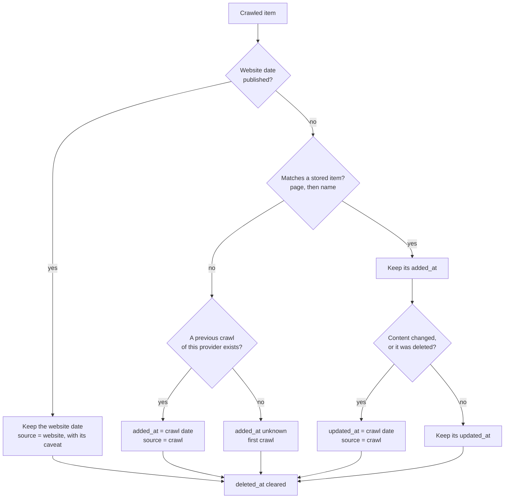
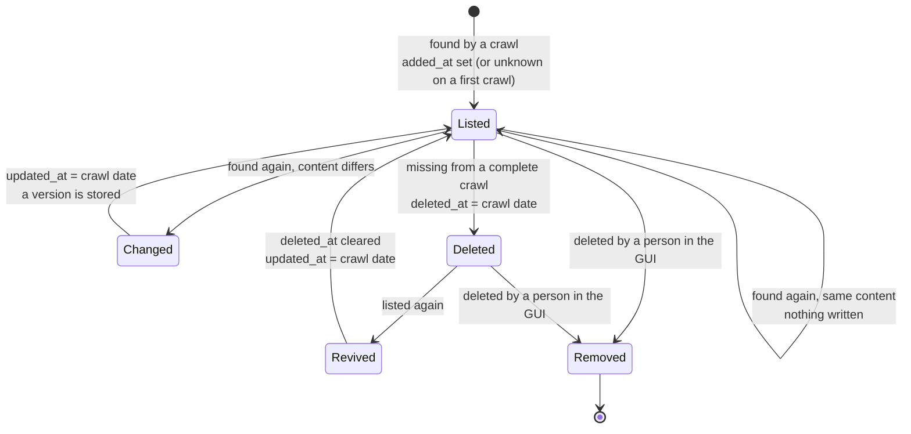
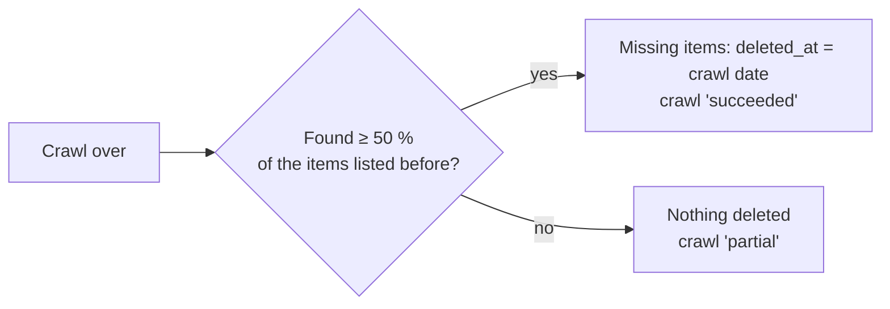

[↑ Docs index](../README.md) · Functional

# 03 — History and versions

Every product and every marketplace software keeps **when it appeared, when it last changed and when it
disappeared**, and a copy of its content each time a crawl found it new or changed. This chapter explains where
those dates come from, how a crawl decides that an item is new, changed or gone, and how the explorer shows it.

## Contents

- [The three dates](#the-three-dates)
- [Website dates and crawl dates](#website-dates-and-crawl-dates)
- [Which providers publish dates](#which-providers-publish-dates)
- [Approximate dates: caveats](#approximate-dates-caveats)
- [How a crawl dates an item](#how-a-crawl-dates-an-item)
- [The life of an item](#the-life-of-an-item)
- [Deleted items and partial crawls](#deleted-items-and-partial-crawls)
- [Versions](#versions)
- [What the history feeds](#what-the-history-feeds)
- [See also](#see-also)

## The three dates

Every item has three optional dates, `null` (shown empty) when unknown:

| Field | Meaning | Source (`added_from` / `updated_from`) |
|---|---|---|
| `added_at` | when it appeared | `website` when the provider publishes it, else `crawl`: the first crawl that found it |
| `updated_at` | when it last changed | `website` when the provider publishes it, else `crawl`: the first crawl that saw its content change |
| `deleted_at` | when it disappeared | always observed by a crawl |

What counts as a **change of content** (the item's *fingerprint*):

| Item | Content fields |
|---|---|
| Catalogue product | name, description, pricing policy, page URL ([`CloudProduct.CONTENT_FIELDS`](../../src/models/cloud/products/product.py#L38)) |
| Marketplace software | name, description, publisher, page URL, delivery method, marketplace categories ([`MarketplaceSoftware.CONTENT_FIELDS`](../../src/models/cloud/software/marketplace_software.py#L37)) |

The categories computed by the classifier are not part of the content: re-filing an item never makes it "updated".

## Website dates and crawl dates

- **Website dates** are read from the provider's pages or APIs. They always win over observed dates, with their
  caveat (see below).
- **Observed dates** come from comparing each crawl with the stored items:
  - items are recognized by their **page**, then their **name** (software: page, then name and publisher);
  - the **first crawl** of a provider has nothing to compare with, so its observed dates stay unknown. From the
    second crawl on, every newly listed item gets the crawl date as `added_at`.

## Which providers publish dates

| Dataset | Providers | Dates |
|---|---|---|
| Catalogues | AWS | added (launch year or card publication) and updated |
| | Scaleway, IBM, Oracle (documentation pages) | updated |
| | STACKIT, T Cloud Public, OVHcloud (from their sitemap, for the products found through it) | updated |
| Marketplaces | Oracle, OVHcloud, Huawei | added and updated |
| | IBM | updated |
| | T Cloud Public, Volcano Engine, Tencent | added (Tencent's comes from its product identifiers, read in China's timezone) |
| Other sources | — | no date published |

## Approximate dates: caveats

A website date is not always the date of the product itself. Each date may carry a **caveat**
([`DateCaveat`](../../src/models/cloud/enums.py#L241)), shown in the tooltip of the table cell and in the details
panel, and filterable in "More filters":

| Caveat | Meaning |
|---|---|
| `page-modified` | when the web page was last modified, which may be a change of the page only |
| `page-published` | when the web page was published, which may differ from the launch |
| `catalogue-entry` | when the catalogue or directory entry was published or edited |
| `website-record` | when the page record was created in the website, often by a website migration, long after the launch |
| `assumed-timezone` | read from an identifier without timezone, China's timezone assumed (a few hours of uncertainty) |
| `year-only` | only the year is published, the date is the 1st of January of that year |
| `oldest-version` | the release of the oldest version still listed, older versions may have been removed |

## How a crawl dates an item

The rules are those of [`ItemHistory.date`](../../src/catalogue/history/item_history.py#L90):

## The life of an item

"Deleted" means **gone from the website**: the item stays stored with its `deleted_at`. "Removed" means a person
deleted it and its history from the database (see [GUI user guide](09-gui-user-guide.md)).

## Deleted items and partial crawls

- Deleted items **stay stored** with their `deleted_at`, and **come back to life** if they are listed again.
- A crawl finding **less than half** of the previously listed items is presumably partial (a site down, a ban, a
  changed page layout): **nothing is marked deleted** then
  ([`DELETION_RATIO = 0.5`](../../src/catalogue/history/item_history.py#L35),
  [`deletes`](../../src/catalogue/history/item_history.py#L132)). The crawl is recorded as `partial`.
- An **empty** or **failed** crawl keeps the items written so far and deletes nothing.
- A crawl still running deletes nothing: deletions happen once, at its end.
- The GUI hides the deleted items. The **"Show deleted"** checkbox shows them, struck through.

Each crawl is recorded with its status: `running`, `succeeded`, `partial`, `empty`, `failed`, `abandoned` (a crawl
left running by a process that died) or `imported` (from the former JSON files).

## Versions

A **version** of an item (its content without the dates) is stored for **each crawl that found it new or changed**,
in `product_versions` and `software_versions`. An item that changed and changed back within the same crawl keeps no
version for that crawl. Unchanged items cost nothing: they are not written at all.

## What the history feeds

- The **Added**, **Updated** and **Deleted** columns of the tables, with the origin of each date in its tooltip.
- The date-range filters and the "where the dates come from" filters of "More filters".
- The trend charts: items **added**, **deleted** and **listed** (running total) per year, quarter or month; items
  without a published date are dated by the crawl that first found them, and the chart footnote says so.
- The "launch velocity" criteria of the [rise drivers](08-rise-drivers.md).

## See also

- [02 — Data collection](02-data-collection.md): progressive writes during a crawl.
- [13 — Storage](../technical/13-storage.md): the writer and the versions tables.
- [09 — GUI user guide](09-gui-user-guide.md): showing deleted items and filtering by date.

[← Previous](02-data-collection.md) · [Next →](04-categories.md)
