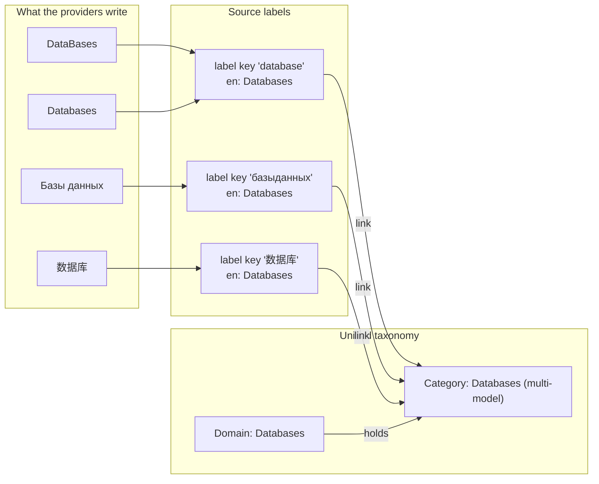
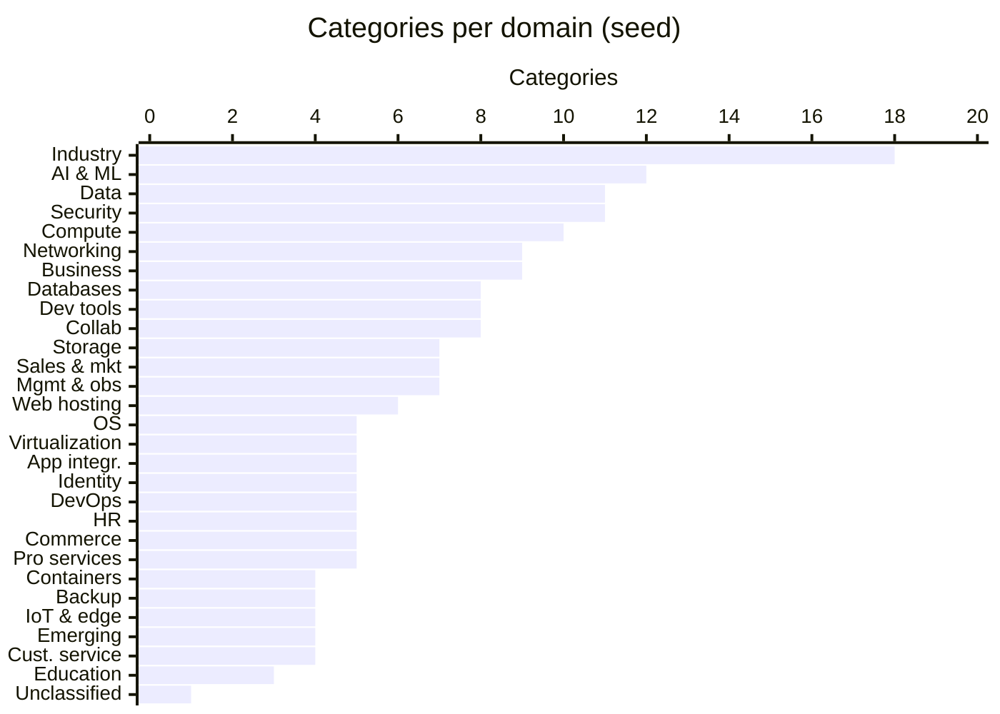
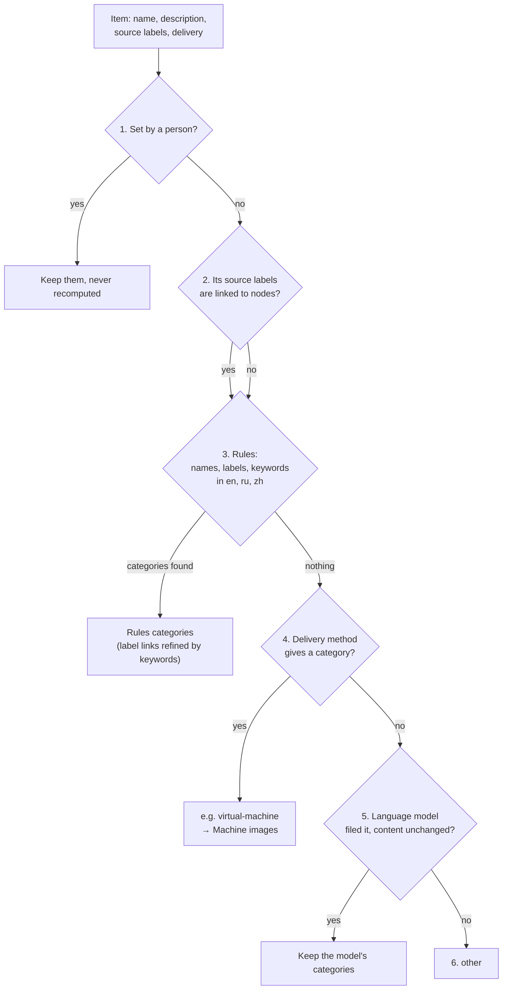
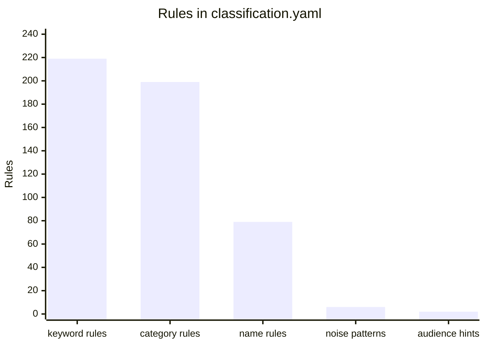
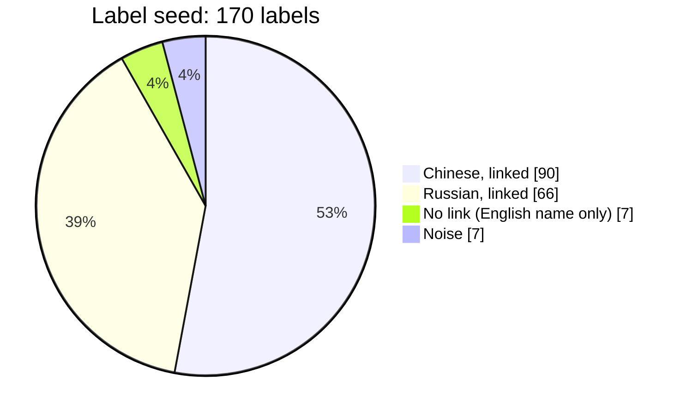

[↑ Docs index](../README.md) · Functional

# 04 — Categories

Every provider files its products and listings its own way, in its own language. poc-crawler files all of them in
**one English taxonomy** of domains and categories, shared by the catalogues and the marketplaces, so that the
providers can be filtered, counted and charted side by side. This chapter explains the taxonomy, the audiences and
delivery methods, the providers' own categories (the *source labels*), the order in which an item gets its
categories, and what a person can change. The engine is described in
[14 — Classification engine](../technical/14-classification-engine.md).

## Contents

- [Two layers: categories and source labels](#two-layers-categories-and-source-labels)
- [The unified taxonomy](#the-unified-taxonomy)
- [Audiences](#audiences)
- [Delivery methods](#delivery-methods)
- [Source labels and aliases](#source-labels-and-aliases)
- [How an item gets its categories](#how-an-item-gets-its-categories)
- [The rules file](#the-rules-file)
- [The label seed](#the-label-seed)
- [When the categories are computed again](#when-the-categories-are-computed-again)
- [What a person can change](#what-a-person-can-change)
- [See also](#see-also)

## Two layers: categories and source labels

1. **Categories** (`service_categories` and `service_domains` on each item): the curated taxonomy. They are what the
   filters, counts and charts of both views use.
2. **Source labels** (`source_label_ids`): the categories of the providers, **as they write them, in any language**.
   Each label is stored once per normalized key and has an English name. Labels sharing an English name are
   **aliases** and count together.

## The unified taxonomy

The taxonomy is **Domain > Category**, with **29 domains and 195 categories (224 nodes)**. One domain,
*Unclassified*, holds the single category `other`, a hidden last resort. An item may belong to **several
categories**, of several domains. Every node has English, Russian and Chinese names, a one-line description (shown in
the pickers and given to the language model) and audiences. The seed is
[`src/conf/taxonomy/taxonomy.yaml`](../../src/conf/taxonomy/taxonomy.yaml); after that, the database is the source of
truth, edited in the Categories manager.

| Domain | Categories | Default audience |
|---|---|---|
| Compute | 10 | developer tool |
| Containers & Kubernetes | 4 | developer tool |
| Operating Systems & Desktops | 5 | developer tool |
| Virtualization & Private Cloud | 5 | developer tool |
| Storage | 7 | developer tool |
| Backup & Resilience | 4 | developer tool |
| Networking | 9 | developer tool |
| Domains, Web & Hosting | 6 | both |
| Databases | 8 | developer tool |
| Data Platforms & Analytics | 11 | developer tool |
| Application Integration | 5 | developer tool |
| AI & Machine Learning | 12 | both |
| Security | 11 | developer tool |
| Identity & Access | 5 | developer tool |
| Developer Tools | 8 | developer tool |
| DevOps & Automation | 5 | developer tool |
| Management & Observability | 7 | developer tool |
| IoT & Edge | 4 | developer tool |
| Emerging Technologies | 4 | developer tool |
| Business Applications | 9 | end-user software |
| Human Capital | 5 | end-user software |
| Sales & Marketing | 7 | end-user software |
| Commerce & Payments | 5 | end-user software |
| Customer Service & Engagement | 4 | end-user software |
| Collaboration & Productivity | 8 | end-user software |
| Education & Training | 3 | end-user software |
| Industry Solutions | 18 | end-user software |
| Professional & Managed Services | 5 | both |
| Unclassified (hidden) | 1 (`other`) | — |

**Umbrella categories.** 13 categories are the generic category of their domain (for example *Container platforms*,
*Operating systems*, *Storage solutions*, *Databases (multi-model)*, *Machine learning platforms*, *Security
suites*). An umbrella category is dropped when a more
specific category of the same domain applies: an item is "Managed Kubernetes", not also "Container platforms".

## Audiences

Each item is for **developers** (`developer-tool`), for **business users** (`end-user-software`), or for both.

- The audiences of an item are those of its categories (a category inherits its domain's audiences unless it names
  its own), plus hints found in its labels (e.g. "developer", "DevOps", "企业应用").
- When nothing gives an audience: a software takes the audience of its **delivery method**, and a catalogue product is
  a `developer-tool` (a cloud service is built on by developers).
- The charts put each item in one **audience class**: developer tool only, end-user software only, or both, so that
  the shares add up to 100 % and the items meant for both are shown apart.

## Delivery methods

How a marketplace software is delivered. The delivery method gives the audience and, when nothing else does, the
category of a software ([`classification.yaml`](../../src/conf/classification.yaml)):

| Delivery | Audience when unknown | Category when nothing else applies |
|---|---|---|
| `saas` | end-user software | — |
| `one-click-app` | end-user software | One-click applications |
| `download` | end-user software | Software licenses |
| `virtual-machine` | developer tool | Machine images & templates |
| `container` | developer tool | Container platforms |
| `kubernetes` | developer tool | Managed Kubernetes |
| `api` | developer tool | SDKs & APIs |
| `ai-model` | developer tool | AI models & algorithms |
| `other` | end-user software | — |

Catalogue products have no delivery method.

## Source labels and aliases

- **One label per normalized key.** Case, spacing, punctuation, plurals and Latin look-alike letters in Cyrillic words
  are ignored: `Databases`, `DataBases` and `DATABASE` are one label.
- **English name.** An English label is its own English name. A Russian or Chinese label gets its English name from the
  [label seed](#the-label-seed), from the language model, or from a person. Until then it is **pending**.
- **Aliases.** Labels sharing an English name count together: "Базы данных" (translated "Databases") counts with
  "Databases" in the filters and counts.
- **Links.** A label is linked to taxonomy nodes, a category or only a domain (e.g. "Data platform" → the *Data
  Platforms & Analytics* domain). Links come from the rules, the seed, the language model or a person.
- **Noise.** Labels such as "Products", "Featured", "Other", "Продукты" or "其他" say nothing about an item: they are
  marked as noise and ignored.
- **Where seen.** Each label remembers the providers and datasets it was seen in.

A crawl stores the labels it has never seen at once, with the links the rules give them. Parallel crawls store each
new label once.

## How an item gets its categories

The first answer wins:

1. **A person set them** (`categories_source = user`): they are kept as they are.
2. **The taxonomy nodes linked to its source labels** (a label may link a domain only).
3. **The rules** of [`src/conf/classification.yaml`](../../src/conf/classification.yaml): well-known names, label rules,
   name and description keywords in English, Russian and Chinese. Packaging suffixes such as "on Ubuntu 24.04" or
   " Virtual Machine" are ignored, so "Grafana on Ubuntu 24.04" is filed as Grafana, not as an operating system.
4. **Its delivery method** (a virtual-machine image of nothing else is a machine image).
5. **The language model**, when configured. Its answer is kept until the content of the item changes.
6. **`other`**.

Within the rules (rung 3), the order is:

1. **Name rules:** well-known products, matched on the name (Odoo is an ERP whatever its labels).
2. **Over-ticked listings:** when the labels give more than 2 categories, only those confirmed by a keyword are kept.
3. **Label categories** together with the keyword categories of the name.
4. **Description keywords**, within the domains the labels name when they only name domains.

## The rules file

[`src/conf/classification.yaml`](../../src/conf/classification.yaml) holds (case-insensitive regular expressions):

| Section | Role |
|---|---|
| `name_rules` | well-known products by name |
| `category_rules` | the nodes a source label links to when it is first seen |
| `keyword_rules` | categories given by keywords of the name or description |
| `noise_labels` | labels that are not categories |
| `audience_hints` | audiences given by label words |
| `delivery_audiences`, `delivery_categories`, `product_audiences` | the fallbacks by delivery method |
| `packaging_suffix` | the operating system or hypervisor suffix ignored in names |

After editing it, run `CRAWLER_SOURCE=reclassify` (or "Recompute the categories" in the GUI).

## The label seed

[`src/conf/taxonomy/label-seed.yaml`](../../src/conf/taxonomy/label-seed.yaml) translates and links the known
Russian and Chinese labels, and marks the noise, so that they need no language model.

By language: 97 Chinese labels (90 linked, 4 without link, 3 noise) and 73 Russian labels (66 linked, 3 without
link, 4 noise).

## When the categories are computed again

- **During a crawl:** each item is filed as it is written. When the taxonomy changes while a crawl runs, the items of
  the crawled provider are filed again once it is over.
- **Seed applied:** the seed files (`taxonomy.yaml`, `label-seed.yaml`, `classification.yaml`) are applied after
  `migrate-db upgrade`, by `migrate-db seed`, by `CRAWLER_SOURCE=reclassify`, and before the first write after the
  files changed. **It never overwrites what a person edited.**
- **On demand:** `CRAWLER_SOURCE=reclassify` or "Recompute the categories" (Taxonomy menu) file every stored item
  again: about 5 minutes for 110,000 software.
- **After a translation:** the items carrying newly translated labels are filed again.

## What a person can change

All of it from the **Categories manager** (Taxonomy menu, Ctrl+Shift+T), see
[GUI user guide](09-gui-user-guide.md):

| Change | Effect | Survives |
|---|---|---|
| Rename, add, move, merge, hide a domain or category | the node is marked edited | every seed application |
| Translate a label, link or unlink it, mark it noise, merge it into another label | `user` name and links | every recomputation, the model never overwrites them |
| Exclude a node from a label | the exclusion | every recomputation |
| Set the categories of an item (edit dialog, "Assign categories…") | `categories_source = user` | every recomputation |

## See also

- [05 — AI features](05-ai-features.md): the language model rung.
- [14 — Classification engine](../technical/14-classification-engine.md): the engine and its tables.
- [09 — GUI user guide](09-gui-user-guide.md): category filters and the Categories manager.

[← Previous](03-history-and-versions.md) · [Next →](05-ai-features.md)
