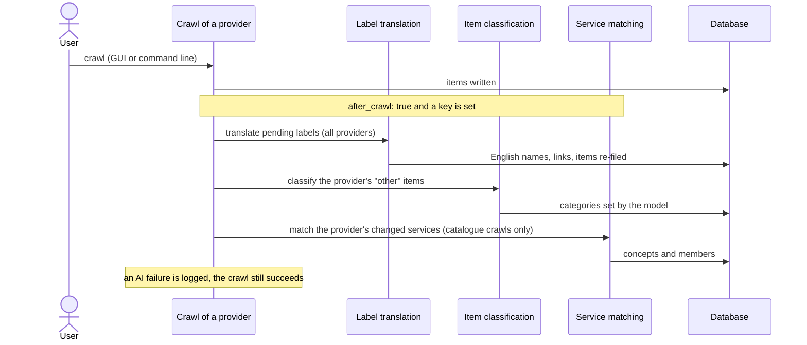

[↑ Docs index](../README.md) · Functional

# 05 — AI features

A language model (Claude by default) takes over three chores that the rules cannot finish: it **translates** the
Russian and Chinese source labels nobody has translated yet, it **files the items left under `other`**, and it
**matches equivalent services** across providers. All three are **optional**: without an API key nothing is ever
sent, and the product works on its rules alone. Every call is metered against a **cost ceiling**. The technical
design is in [15 — LLM layer](../technical/15-llm-layer.md).

## Contents

- [The three tasks](#the-three-tasks)
- [Turning it on](#turning-it-on)
- [Which model does what](#which-model-does-what)
- [The budget](#the-budget)
- [When the tasks run](#when-the-tasks-run)
- [What the model may and may not change](#what-the-model-may-and-may-not-change)
- [Failures and retries](#failures-and-retries)
- [See also](#see-also)

## The three tasks

| Task | Input | Output | Where the result shows |
|---|---|---|---|
| **Label translation** (`label_translation`) | pending source labels (non-English, no English name), 50 per call | English name, taxonomy links, or "noise" | Categories manager, source label filters; the items carrying the label are filed again |
| **Item classification** (`item_classification`) | items filed under `other`, with their name, description and labels, 50 per call | taxonomy categories (existing ones only) | category filters, counts and charts |
| **Service correspondence** (`service_correspondence`) | the catalogue services of one taxonomy category across providers | service concepts and their members, with a confidence | [Correspondences tab](06-service-correspondences.md) |

## Turning it on

The settings are in [`src/conf/llm.yaml`](../../src/conf/llm.yaml), or in the file named by `CRAWLER_LLM_CONFIG`.
`api_key` holds the **name** of the environment variable carrying the key, never the key itself:

```bash
export ANTHROPIC_API_KEY=...                               # enables the three tasks
CRAWLER_SOURCE=translate uv run python src/main.py         # translate, classify "other", then match services
CRAWLER_SOURCE=correspond uv run python src/main.py        # match the equivalent services only
```

An `openai` profile reads `OPENAI_API_KEY` instead. Without a key, the pending labels wait in the Categories manager,
the leftover items stay `other`, and the Correspondences tab shows the taxonomy categories as rows with no AI
concepts. The AI buttons of the Categories manager are shown only when a key is set, and "Match with AI"
explains that no model is configured.

## Which model does what

`llm_routing` defines three **profiles** and binds each task to one, with its own reasoning effort and output limit:

| Profile | Model | Input / output price (USD per million tokens) |
|---|---|---|
| `precise` | [Claude Opus 5.5](https://docs.anthropic.com/en/docs/about-claude/models) (`claude-opus-5-5`) | 4.00 / 20.00 |
| `balanced` (default) | Claude Sonnet 5.5 (`claude-sonnet-5-5`) | 2.00 / 10.00 |
| `fast` | Claude Haiku 5.5 (`claude-haiku-5-5`) | 0.10 / 0.50 |

| Task | Profile | Effort | Max output tokens |
|---|---|---|---|
| `label_translation` | fast | low | 8,192 |
| `item_classification` | balanced | low | 8,192 |
| `service_correspondence` | balanced | medium | 16,384 |

```mermaid
xychart-beta
    title "Price per profile (USD per million tokens, from llm.yaml)"
    x-axis ["fast (Haiku)", "balanced (Sonnet)", "precise (Opus)"]
    y-axis "USD" 0 --> 22
    bar [0.5, 10, 20]
    bar [0.1, 2, 4]
```



The taller bar of each pair is the output price, the shorter one the input price. The prices are those written in
`llm.yaml`, used to compute the recorded costs; edit them there if the list prices change.

## The budget

- `llm_budget.ceiling`: **10 USD** by default, `enforce: true`.
- Every call is recorded in the `llm_usage` table with its task, model, tokens (input, output, cache reads and
  writes) and cost.
- Before each batch, what was spent so far is summed: **no call is sent once the ceiling is reached**. With
  `enforce: false`, a warning is logged instead.
- The Categories manager shows what was spent of the budget.
- The system prompts are cached by the provider, so repeated batches pay less for their instructions.

## When the tasks run



| Trigger | Translation | Classification | Matching |
|---|---|---|---|
| After each crawl of a provider (`after_crawl: true`) | all pending labels | that provider's `other` items | that provider's new or changed services (catalogue crawls only) |
| `CRAWLER_SOURCE=translate` | all | all providers | all categories |
| `CRAWLER_SOURCE=correspond` | — | — | all categories |
| Categories manager: "Translate pending labels" | all | — | — |
| Categories manager: "Classify unclassified items" | — | all providers | — |
| Correspondences tab: "Match with AI", or Taxonomy menu: "Match services with AI" | — | — | all waiting services |
| Concept details: "Match the category again with AI" | — | — | one category |

Several runs may work at the same time (two crawls ending together, the GUI and the command line): they never take
the same labels, and never match the same category at once.

## What the model may and may not change

- It **never overwrites** what a person set: a label name or link set by hand, an exclusion, an item's categories set
  by hand, a service a person removed from a concept or added to one.
- Only **existing taxonomy slugs** are kept from its answers; anything else is dropped.
- An item it filed keeps the model's categories **until its content changes**; it is then filed again by the rules,
  and by the model if the rules still give `other`.
- A label it translated gets its rule links recomputed from the new English name, then the items carrying it are
  filed again.

## Failures and retries

- A batch whose call fails (network, API error, invalid answer) is **left for a later run**. For labels and services,
  the error is recorded with the attempt.
- A label or a service is tried **three times at most**; after that it waits for a person (pending labels in the
  Categories manager, services in the Correspondences tab).
- A label claimed by a run that died is released after an hour.
- An AI failure after a crawl is logged; the crawl itself is never marked failed.

## See also

- [04 — Categories](04-categories.md): where the model sits in the cascade.
- [06 — Service correspondences](06-service-correspondences.md): what the matching produces.
- [15 — LLM layer](../technical/15-llm-layer.md): routing, metering, locking.
- [Anthropic API documentation](https://docs.anthropic.com/).

[← Previous](04-categories.md) · [Next →](06-service-correspondences.md)
