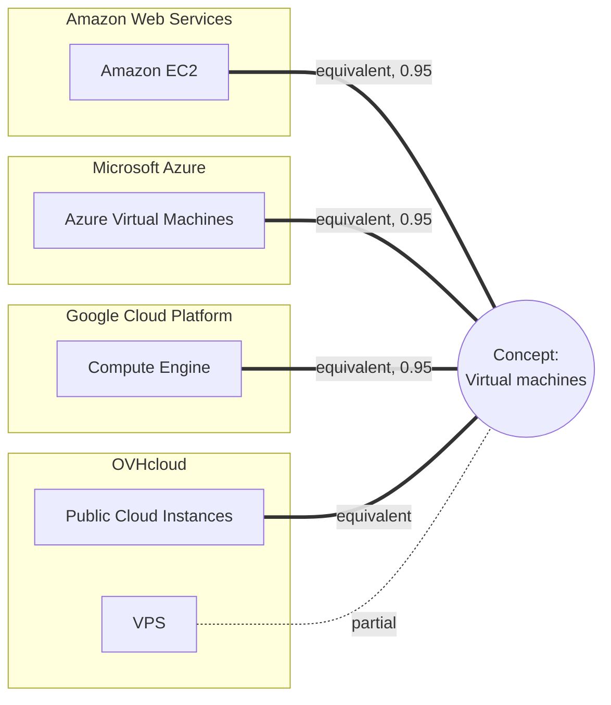
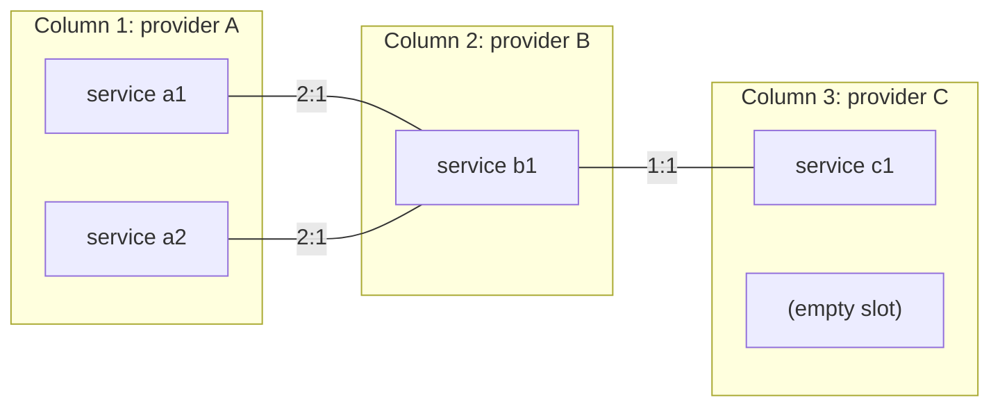
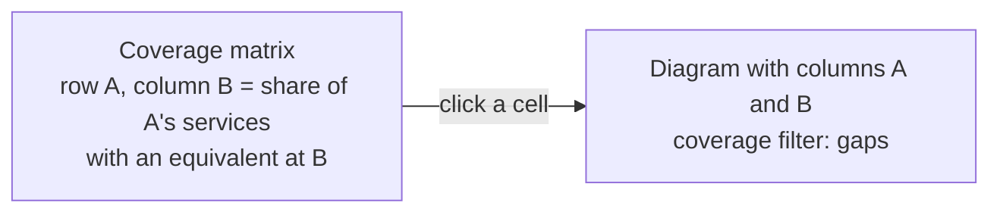
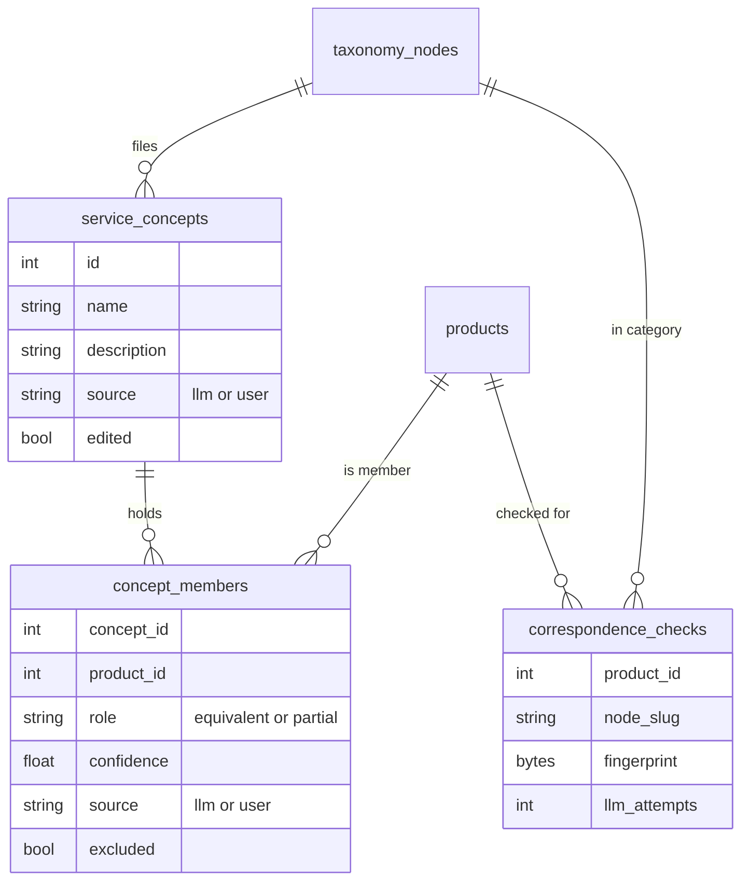

[↑ Docs index](../README.md) · Functional

# 06 — Service correspondences

Amazon EC2, Azure Virtual Machines and Google Compute Engine are the same service under three names. The
**Correspondences** tab maps such equivalent catalogue services across providers, so that offers can be compared
service by service, gaps found, and parity measured. The matching is done by the language model, category by
category, and a person can correct every part of it.

## Contents

- [Service concepts](#service-concepts)
- [Correspondence classes](#correspondence-classes)
- [The diagram](#the-diagram)
- [Rows: concepts or categories](#rows-concepts-or-categories)
- [Filters](#filters)
- [Coverage matrix](#coverage-matrix)
- [Editing](#editing)
- [How the matching stays up to date](#how-the-matching-stays-up-to-date)
- [What is stored](#what-is-stored)
- [See also](#see-also)

## Service concepts

The services are grouped into **concepts** shared by the providers ("Managed Kubernetes", "Object storage"…),
**category by category** of the [unified taxonomy](04-categories.md).

- A concept may hold **several services of one provider** (a 2:1 or 3:1 correspondence).
- A service may belong to **two concepts**.
- A service matching part of a concept only (or more than it) is **partial**; otherwise it is **equivalent**.
- Every service filed by the model carries its **confidence**.

An illustrative concept (names only, not a stored result):

## Correspondence classes

Between two adjacent provider columns, a concept falls in one class:

| Class | Meaning |
|---|---|
| `1:1` | one service on each side |
| `2:1` | two services on one side (one or two on the other) |
| `3:1` | three services on one side |
| `n:1` | four services or more on one side |
| missing | one of the providers has no service of the concept |

## The diagram

- **Columns:** one per chosen provider, **2 to 6**. Add them one by one ("+ Provider"), take "All providers", or a
  **preset** ("Presets ▾"): the largest catalogues, the leader of each bloc, or the largest providers of one bloc
  (5 providers per preset).
- **Rows:** one per concept, grouped by taxonomy domain.
- **Curves:** the services of adjacent columns are joined by curves **coloured by class** (1:1, 2:1, 3:1, n:1),
  **dashed when partial**, **thicker when the model is surer**.
- **Empty slot:** a provider without a service of the concept.
- **Interaction:** hovering a row dims the others, Ctrl + wheel zooms, clicking a concept or a service shows it in the
  details panel.
- **Export:** "Export ▾" saves the diagram as **PNG** or its data as **CSV**.

## Rows: concepts or categories

| View | Rows | Source | Editable |
|---|---|---|---|
| **Concepts** | the service concepts matched by the model | AI plus people | yes |
| **Categories** | the taxonomy categories: the services of each provider filed under the same category | the classifier, no AI | read-only (a coarser alignment) |

Before any AI matching, the tab says so and shows the categories.

## Filters

| Filter | Choices |
|---|---|
| Taxonomy categories | any categories or whole domains |
| Text | "Search a concept or a service…" |
| Correspondence classes | 1:1, 2:1, 3:1, n:1 |
| Coverage | all, offered by every column (complete), missing in a column (gaps), unique to one column |
| Match strength | equivalent services only, or equivalent and partial |
| AI confidence | the lowest confidence shown |
| Origin | set by the AI or by hand |
| Audience | developer tool, end-user software, both |
| Deleted services | "Show deleted" |

"Reset" clears them.

## Coverage matrix

For each **pair of providers**, the share of the services of one with an equivalent at the other. Clicking a cell
compares the two providers in the diagram, **their gaps first**.

## Editing

The details panel of a concept offers:

| Action | Effect |
|---|---|
| "Rename…" | renames the concept |
| "Merge into…" | merges it into another concept |
| "Delete" | deletes the concept |
| "Add a service…" | adds a service of any provider |
| mark a member equivalent or partial | changes its role |
| remove a member | excludes the service: the model never files it there again |
| "Match the category again with AI" | re-runs the matching of its category |

**What a person sets is never changed by the model.**

## How the matching stays up to date

A listed catalogue product is matched again when it is **new**, when its **content changes**, or when it **moves to
another category**:

- after each catalogue crawl, for the crawled provider (when a key is set);
- with `CRAWLER_SOURCE=correspond`, or `translate` as its third step;
- with "Match with AI" in the tab (or "Match services with AI" in the Taxonomy menu).

Only categories holding services of **two providers or more** are matched. Two runs never match the same category at
once. A failed call is tried again by a later run, **three times at most**.

## What is stored

- `service_concepts`: the concepts, in their taxonomy category.
- `concept_members`: the services of each concept, with their role, confidence and origin, and `excluded` for those a
  person removed.
- `correspondence_checks`: the content fingerprint each service was matched for, so that unchanged services are not
  sent again.

## See also

- [05 — AI features](05-ai-features.md): the model, budget and triggers.
- [08 — Rise drivers](08-rise-drivers.md): parity as a criterion.
- [13 — Storage](../technical/13-storage.md): the full schema.
- [18 — GUI architecture](../technical/18-gui-architecture.md): how the diagram is drawn.

[← Previous](05-ai-features.md) · [Next →](07-market-statistics.md)
