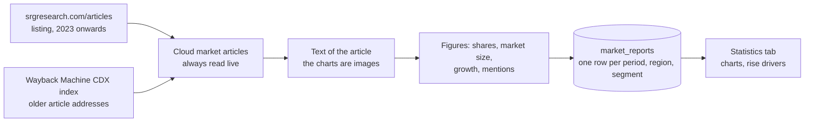
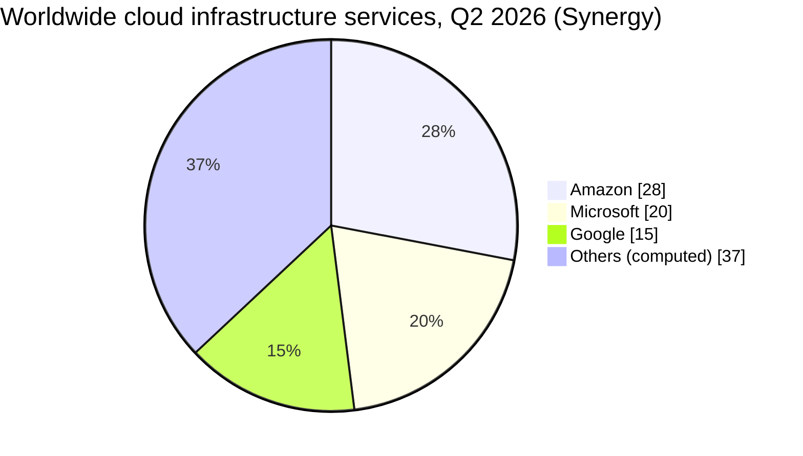

[↑ Docs index](../README.md) · Functional

# 07 — Market statistics

The catalogues and marketplaces tell what providers **offer**; the market statistics tell what customers **buy**.
They come from the quarterly press releases of [Synergy Research Group](https://www.srgresearch.com/articles), the
reference used by most of the press, and they feed the **Statistics** tab, the market-share charts, and the economic
targets of the [rise drivers](08-rise-drivers.md). The crawler is described in
[17 — Statistics crawler](../technical/17-statistics-crawler.md).

## Contents

- [Where the figures come from](#where-the-figures-come-from)
- [What is extracted](#what-is-extracted)
- [Others (computed)](#others-computed)
- [Methodology break](#methodology-break)
- [An example quarter](#an-example-quarter)
- [The Statistics tab](#the-statistics-tab)
- [Refreshing the statistics](#refreshing-the-statistics)
- [Limits](#limits)
- [See also](#see-also)

## Where the figures come from

- **Sources:** the [`/articles`](https://www.srgresearch.com/articles) listing (2023 onwards), plus the older article
  addresses known to the [Wayback Machine](https://web.archive.org/) (its
  [CDX API](https://github.com/internetarchive/wayback/tree/master/wayback-cdx-server)). The articles themselves are
  always read on the live website, each once.
- **Figures:** they are read from the **text** of the articles, the charts being images.
- **Period:** the quarter before the publication date (an article of July reports Q2). Periods before 2021 are
  dropped.
- **Checks:** the three leading shares must be in decreasing order and add up to a plausible total (55 % to 75 %);
  otherwise those shares are dropped (and logged).
- **Merging:** when several articles report the same period, region and segment, the most complete report wins and
  the others fill its gaps.

## What is extracted

| Region | Segment | Figures | Currency |
|---|---|---|---|
| Worldwide | Cloud infrastructure services (IaaS, PaaS and hosted private cloud) | quarterly shares of Amazon, Microsoft and Google, market size, 12-month market size, year-on-year growth | USD |
| Worldwide | Public IaaS and PaaS | combined share of the top three, growth | USD |
| Europe | Cloud infrastructure services | share of the big three, of the European providers, of SAP and of Deutsche Telekom, market size, for the years or half-years Synergy publishes | EUR |

The players Synergy quantifies are the `MarketPlayer` values: Amazon, Microsoft, Google, the big three together,
the European providers, SAP, Deutsche Telekom, the neoclouds, and the others.

Besides the shares, each report keeps the providers that Synergy only **names or ranks** ("fourth-placed Alibaba"):
they are listed under the charts, and counted as *mentions* in the rise drivers.

## Others (computed)

Synergy only quantifies a few players. The rest of the market is shown as **"Others (computed)"**: 100 % minus the
named shares, so that the shares of a period always add up to 100 %.

## Methodology break

Synergy reclassified some revenues in **Q3 2024**, which lowered Microsoft's share. The report of that quarter
carries a `methodology_break` flag, and the trend chart marks it with a vertical line so that the drop is not read
as a market move.

## An example quarter

The Q2 2026 article ("Q2 Cloud Market Passes $143 Billion", published 30 July 2026, kept as a test fixture) states:
worldwide shares of 28 % (Amazon), 20 % (Microsoft) and 15 % (Google), quarterly revenues of $143.4 billion, a
year-on-year growth of 43 %, and 67 % of public IaaS and PaaS held by the top three. The share chart of that quarter
is therefore:

## The Statistics tab

The checkboxes of the **perimeter panel** select what is shown:

| Box | Choices |
|---|---|
| Region | worldwide and/or Europe |
| Segment | cloud infrastructure services and/or public IaaS + PaaS |
| Providers | the players Synergy quantifies, and the computed Others |
| Period | the quarters, half-years or years, with the "Latest" and "All" shortcuts |

The tab shows three chart cards:

1. **Shares of the latest checked period**, one group of bars per region and segment.
2. **A configurable chart** of the checked reports, opening on the **market share race** (share per player over time).
   Like every configurable chart, it can be switched to revenue (share × market size), indexed values, rank, a
   forecast… (see [GUI user guide](09-gui-user-guide.md)).
3. **The market size per period**, with the growth in the tooltip.

The providers named but not quantified are listed under the charts.

## Refreshing the statistics

- In the GUI: "Refresh from Synergy" on the Statistics tab, or the crawl actions of the toolbar while the tab is
  shown.
- On the command line: `CRAWLER_SOURCE=statistics uv run python src/main.py`.

A statistics crawl replaces the stored reports of the source in one go, once it is over.

## Limits

- Synergy publishes whole percents, sometimes a band ("32-34 %"): a band is stored with its low and high bounds and
  marked approximate.
- Only Amazon, Microsoft and Google (and, in Europe, SAP and Deutsche Telekom's T Cloud) are quantified, so the
  economic analyses beyond them need other sources (annual reports, typed in by hand, see
  [08 — Rise drivers](08-rise-drivers.md)).
- Europe is published in euros, the world in dollars: a chart mixing both says so in its footnote.

## See also

- [08 — Rise drivers](08-rise-drivers.md): market share and revenue as targets.
- [17 — Statistics crawler](../technical/17-statistics-crawler.md): the extraction rules.
- [16 — Analytics](../technical/16-analytics.md): revenue, transforms and forecasts.

[← Previous](06-service-correspondences.md) · [Next →](08-rise-drivers.md)
