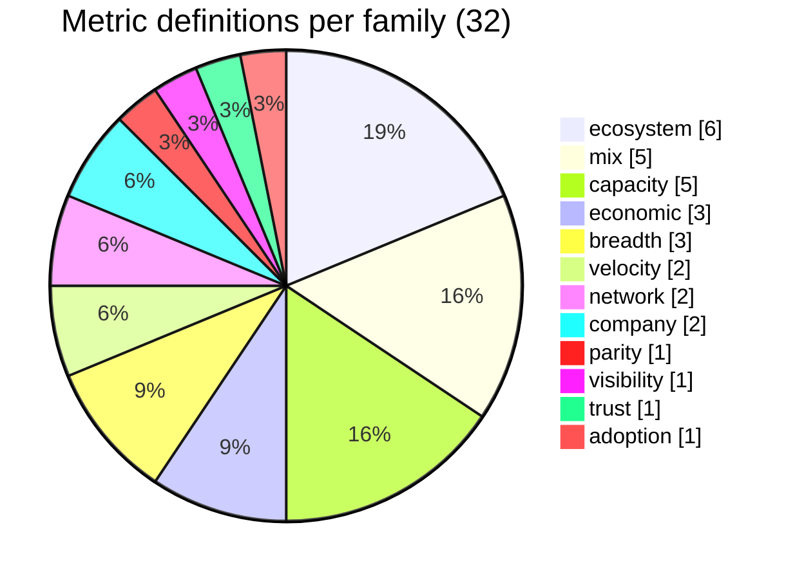
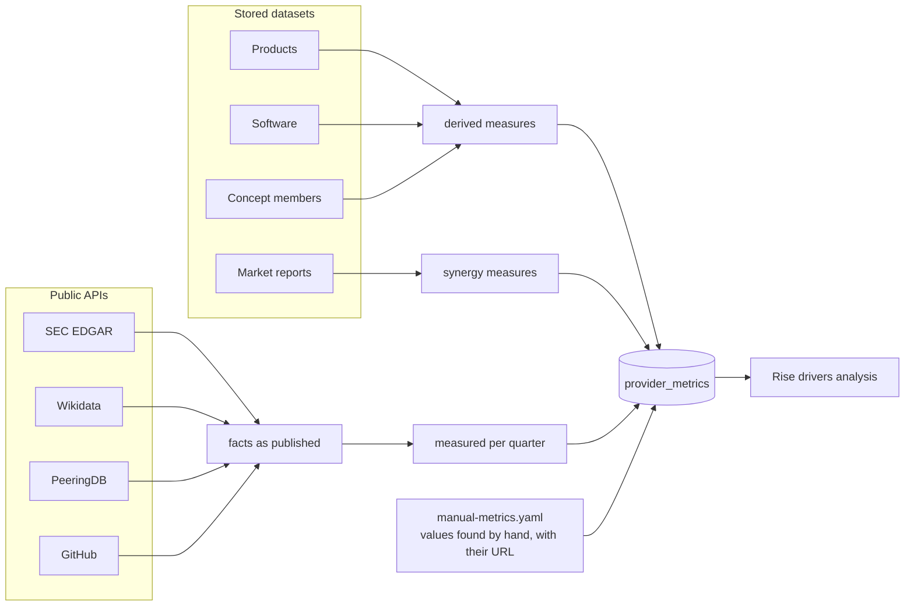
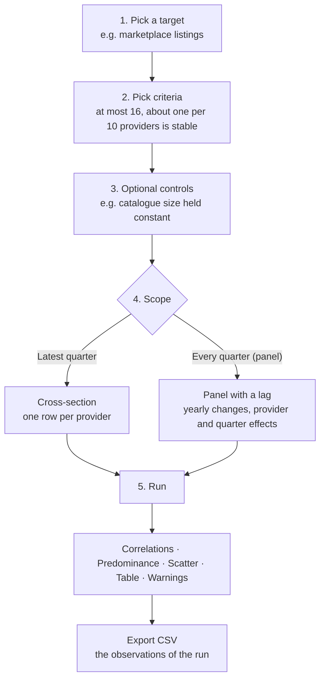
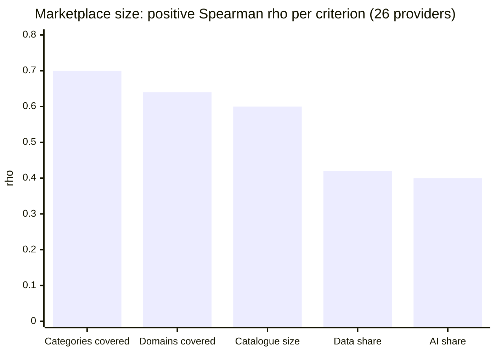

[↑ Docs index](../README.md) · Functional

# 08 — Rise drivers

Which criteria go with the rise of a cloud provider: the breadth of its catalogue, its marketplace, its developer
adoption, its network, its capex? The **"Rise drivers"** section of the Analysis tab answers this with robust
statistics on the measures gathered for every provider. This chapter is the functional summary; the method, the
criteria still missing and where to find them, and the first findings are in the analysis guide
[**What drives the rise of a cloud provider**](../analysis/rise-drivers.md). The statistics are implemented as
described in [16 — Analytics](../technical/16-analytics.md).

## Contents

- [The question and its two families of targets](#the-question-and-its-two-families-of-targets)
- [The measures](#the-measures)
- [Where the measures come from](#where-the-measures-come-from)
- [Running an analysis](#running-an-analysis)
- [Reading the result cards](#reading-the-result-cards)
- [First findings](#first-findings)
- [Cautions](#cautions)
- [See also](#see-also)

## The question and its two families of targets

| Family | Targets | Meaning |
|---|---|---|
| **Economic rise** (the market's verdict) | market share, revenue (share × market size), cloud revenue as reported | what customers pay |
| **Ecosystem rise** (investment and attractiveness) | catalogue products, launches per quarter, marketplace listings, publishers, new listings per quarter | what the provider builds and attracts |

Comparing the two tells whether a criterion moves the market, the ecosystem, or both.

## The measures

`provider_metrics` holds **one value per provider, quarter, metric and source**. The 32 definitions of
[`src/conf/metrics/metrics.yaml`](../../src/conf/metrics/metrics.yaml) fall into 12 families; 8 of them can be
chosen as a target.

| Family | Metrics | Source |
|---|---|---|
| economic | market share ✓, revenue ✓, cloud revenue ✓ | Synergy, annual reports (manual) |
| breadth | catalogue products ✓, taxonomy domains, taxonomy categories | computed from the catalogues |
| mix | AI, data, security, compute and developer-tool shares of the catalogue | computed |
| velocity | launches per quarter ✓, deletions per quarter | computed from the dates |
| ecosystem | marketplace listings ✓, publishers ✓, new listings per quarter ✓, SaaS, VM and AI-model shares | computed from the marketplaces |
| parity | share of the products with an equivalent at AWS, Azure or Google Cloud | computed from the [correspondences](06-service-correspondences.md) |
| visibility | analyst mentions | Synergy articles |
| capacity | capex, regions, availability zones, countries with a region, large GPU clusters | SEC EDGAR, manual |
| network | internet exchanges, interconnection facilities | PeeringDB |
| trust | sovereignty certifications | manual |
| adoption | SDK GitHub stars | GitHub |
| company | employees, age | Wikidata |

✓ = can be a target.

## Where the measures come from

- `CRAWLER_SOURCE=metrics uv run python src/main.py` computes the derived and Synergy measures from the stored
  datasets, reads the manual ones, then crawls the four APIs. The GUI computes the derived measures again before a
  run when a dataset was written.
- Values found by hand (revenue from an annual report, a share from an analyst press release) go in
  [`src/conf/metrics/manual-metrics.yaml`](../../src/conf/metrics/manual-metrics.yaml), with their source URL. **A
  manual value wins over every other source.**
- Where each provider is found in the APIs (SEC CIK, Wikidata item, network ASNs, GitHub repositories) is in
  [`src/conf/metrics/collectors.yaml`](../../src/conf/metrics/collectors.yaml).

## Running an analysis

The help chips next to each control explain the roles (target, criterion, control) and every column of the table.

## Reading the result cards

| Card | What to read |
|---|---|
| **Correlations** | bar = Spearman ρ, whisker = 95 % bootstrap interval, diamond = partial ρ (controls held constant), `*` q < 5 %, `**` q < 1 %; grey bars are not significant |
| **Predominance** | the share of the explained variance (R²) each criterion carries (Shapley split), with its interval: the direct answer to "which criteria are predominant" |
| **Scatter** | the target against the predominant criterion, a dot per provider (or per provider and quarter), on a log scale if wished |
| **Table** | every figure: share of R², standardized β and its interval, p-values, ρ, q, partial ρ, N, leave-one-out R², Granger p (panel) |
| **Warnings** ("Caveats") | few providers measuring the target, too many criteria for the observations, collinear or constant criteria, criteria left out |

The analysis drops what it cannot use instead of shrinking the sample: a criterion measured for too few providers,
or constant, is left out and named in the warnings. Up to 7 observations, the p-value of a correlation is exact. No
bootstrap interval is drawn from fewer than 3 providers.

## First findings

From the analysis guide (development data of 2026-10-20, one catalogue snapshot of 31 providers and one marketplace
snapshot of 26). **Associations, not causes.** Spearman correlation of each criterion with the marketplace size (log
of the listings):

The share of compute services is the one negative correlation (ρ −0.45), and it vanishes once the catalogue size is
held constant (partial ρ −0.08): compute-heavy providers have smaller marketplaces only because they are small.

- **Breadth of the offer** is the predominant criterion of the marketplace size, with the catalogue size held
  constant.
- With the collected criteria, **developer adoption** (GitHub stars of the provider's Terraform provider) carries
  about 60 % of the explained variance of both the marketplace size and the publishers.
- **Network reach** correlates but adds nothing beyond adoption and breadth; **age** does not matter.
- **Economic rise: no conclusion yet**, with market shares for 3 providers only. Revenue for the other providers
  (typed in `manual-metrics.yaml`) and weekly crawls (to build a panel) are what unlock it.

## Cautions

| Trap | What the tool does or what to do |
|---|---|
| Size inflates everything | partial correlations with size as a control, Shapley split |
| Leaders list more (reverse causality) | panel with lags and Granger tests, once history exists |
| 3 providers with shares | never regress share alone: use revenue |
| Synergy rounding, 2024Q3 break | yearly changes, the break marked |
| Year-only dates (AWS products) | yearly buckets |
| Spurious trends | differences against differences, never levels against levels |

## See also

- [What drives the rise of a cloud provider](../analysis/rise-drivers.md): the full method and findings.
- [07 — Market statistics](07-market-statistics.md): the economic targets.
- [16 — Analytics](../technical/16-analytics.md): the implementation of the statistics.
- References: [Spearman's rank correlation](https://en.wikipedia.org/wiki/Spearman%27s_rank_correlation_coefficient),
  [Benjamini–Hochberg procedure](https://en.wikipedia.org/wiki/False_discovery_rate#Benjamini%E2%80%93Hochberg_procedure),
  [Shapley value](https://en.wikipedia.org/wiki/Shapley_value),
  [Granger causality](https://en.wikipedia.org/wiki/Granger_causality).

[← Previous](07-market-statistics.md) · [Next →](09-gui-user-guide.md)
