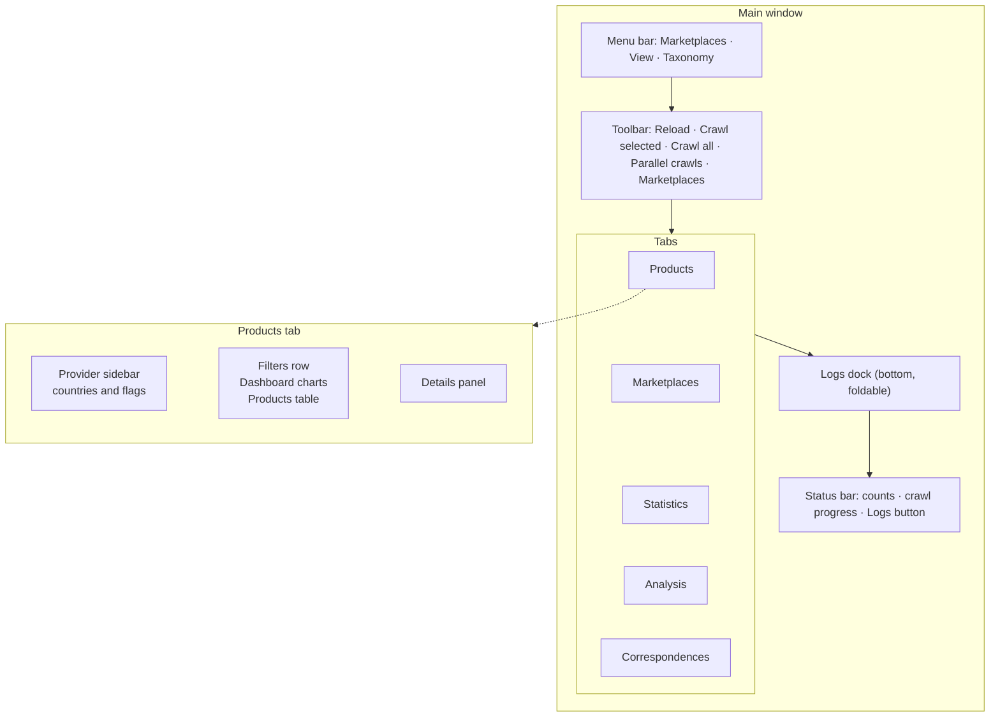
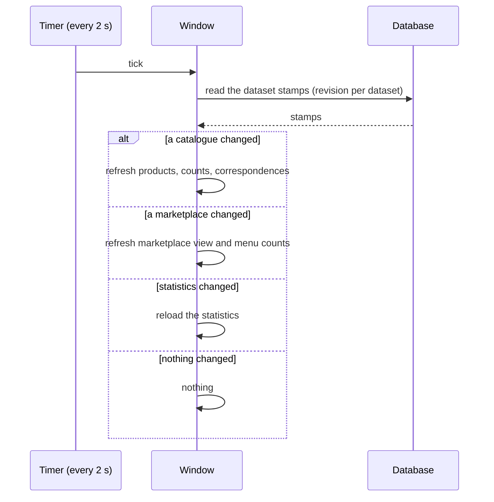
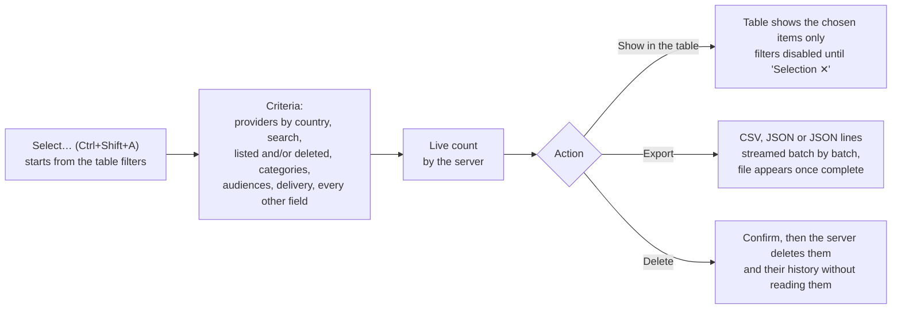
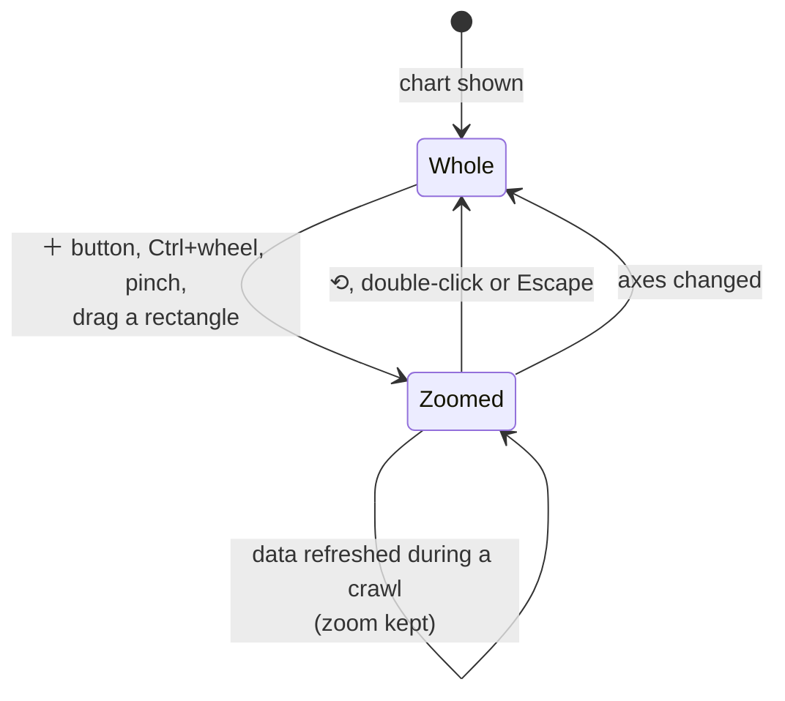

[↑ Docs index](../README.md) · Functional

# 09 — GUI user guide

The desktop explorer (PyQt6) is where the collected data is read, filtered, charted, corrected and exported, and
where crawls are launched. It never loads a whole catalogue or marketplace: tables are read page by page and every
count is made by the database, so it stays fast with 100,000+ items. This chapter walks through the window, each
tab, the filters, the bulk selection, the editing, the charts and the keyboard shortcuts. How the window is built is
in [18 — GUI architecture](../technical/18-gui-architecture.md).

## Contents

- [Starting the explorer](#starting-the-explorer)
- [The window at a glance](#the-window-at-a-glance)
- [Toolbar and menus](#toolbar-and-menus)
- [Live refresh](#live-refresh)
- [Products tab](#products-tab)
- [Marketplaces tab](#marketplaces-tab)
- [Statistics tab](#statistics-tab)
- [Analysis tab](#analysis-tab)
- [Correspondences tab](#correspondences-tab)
- [Categories manager](#categories-manager)
- [Bulk selection, export and deletion](#bulk-selection-export-and-deletion)
- [Creating and editing items by hand](#creating-and-editing-items-by-hand)
- [Charts](#charts)
- [Zoom and navigation in charts](#zoom-and-navigation-in-charts)
- [Keyboard shortcuts](#keyboard-shortcuts)
- [See also](#see-also)

## Starting the explorer

```bash
uv run python -m gui.window.app      # or: uv run poc-crawler-gui
```

In VS Code, use the launch configuration **"GUI: catalogue explorer"**. The database must be running
(`uv run install-stack`, see [20 — Operations](../technical/20-operations.md)). If it is not, the status bar says
"Database unavailable" and the views stay empty until it is back.

## The window at a glance



- Every pane folds to its title bar, and the splitters between panes can be dragged; the folded state is remembered
  from one session to the next.
- The **details panel** of the current tab is shown or hidden with **Ctrl+D**.
- The **logs** fold into the bottom dock; **Ctrl+L** (or "▴ Logs" in the status bar) shows them again.

## Toolbar and menus

| Control | Effect |
|---|---|
| **⟳ Reload** (F5) | reads the stored catalogues, marketplaces and statistics again |
| **▶ Crawl selected** (Ctrl+R) | crawls the selected provider, the providers of the selected country, or every provider. On the Marketplaces tab it crawls marketplaces, on the Statistics tab the statistics |
| **⏩ Crawl all** (Ctrl+Shift+R) | crawls the 32 providers, several at a time |
| **Parallel crawls** | how many providers are crawled at the same time (each one opens its own browser window when it needs one) |
| **🛒 Marketplaces** (toolbar button and menu) | lists the marketplaces under their country flag, with the number of software of their last extraction. Tick some, then "Extract the N selected marketplaces" |
| **View** menu | "Show the logs" (Ctrl+L), "Fold the logs", "Show or hide the details panel" (Ctrl+D) |
| **Taxonomy** menu | "Categories manager…" (Ctrl+Shift+T), "Source labels…", "Unclassified items…", "Recompute the categories", "Service correspondences", "Match services with AI" |

Only **one crawl run** at a time is launched from the GUI (it may crawl several providers in parallel). The window
refuses to close while a crawl runs. Changes to the items of a provider are refused while it is being crawled.

## Live refresh



During a crawl, products and software therefore appear every few seconds, and the sidebar marks the catalogue being
crawled. A refreshed table keeps showing its rows until they are read again, so it never blanks.

## Products tab

- **Sidebar:** the providers grouped under their country flag. Selecting a country or a provider filters the view.
- **Dashboard** (above the table, in collapsible cards):
  - the headline figures: **Products**, **Providers crawled**, **Latest crawl**;
  - the **products per provider** bar chart;
  - the **catalogue trends**, a configurable chart (see [Charts](#charts)).
- **Filters row:**
  - **search** (Ctrl+F), on the names, and on the descriptions with "In descriptions" (slower);
  - **country** and **cloud provider** (the provider list shows the providers of the chosen country with their
    product count, and follows the sidebar);
  - **categories:** the unified taxonomy, a fully ticked domain filtering on the whole domain;
  - **Show deleted:** the products gone from their website, struck through;
  - **More filters:** texts in the name, description or page, the **source label** (the category the catalogue gives,
    translated, aliases included), the **audience** (developer tool only, end-user software only, or both) and the
    **date ranges**.
- **Table:** read 200 rows at a time; sortable; columns for the dates added and updated, with the origin of each date
  in its tooltip.
- **Details panel:** the full record of the selected product: description, page link, categories, source labels,
  audiences, dates and their caveats. A value can be copied, or used as a filter.

## Marketplaces tab

The software of every marketplace, filtered on every field:

- **Main row:** search (name and publisher, optionally the descriptions), **bloc**, **country**, **marketplace**,
  **providers**, **categories**, **audience**, **delivery**, "Show deleted".
- **Provider filters combine:** the table shows the software of the providers matching all of them:
  - **Bloc:** United States, European Union, China, Russia, other.
  - **Country** and **marketplace:** one country, one provider.
  - **Providers:** a drop-down of the providers under their country with their software count, several can be ticked.
    It only offers the providers of the chosen bloc and country; a provider hidden this way keeps its tick for later.
- **More filters:** texts in the name, description or page address; the **publisher**, picked among the most frequent;
  the **source label** with its aliases and count; the audience; ranges of the **added, updated and deleted** dates;
  where the dates come from (website, crawl, unknown) and whether they are approximate, and why.
- **Charts:** the **software per domain** (largest first, in the colour of its main audience), the **marketplace
  analysis** configurable chart, and the **"Both audiences"** card (software meant for both, and its share).
- **Details panel:** the software record, with warnings about approximate dates.

Every filter runs on the server, so the counts, the charts and the table always describe the matching software.

## Statistics tab

See [07 — Market statistics](07-market-statistics.md): perimeter checkboxes (region, segment, providers, period with
"Latest" and "All"), the shares of the latest period, the configurable chart (market share race first), the market
size per period, and "⟳ Refresh from Synergy".

## Analysis tab

The Analysis tab compares the datasets with each other, per provider or per bloc. It opens with six ready-made
configurable charts, each one switchable to any other analysis:

| Card | Ready-made chart |
|---|---|
| Positioning | market share against marketplace size (bubbles, one per provider and quarter) |
| Rank | rank race (bump chart) |
| Blocs | catalogue per geopolitical bloc |
| Publishers | catalogue size against publishers |
| Domain trends | domain mix over time, one stacked area per provider |
| Audience | audience mix by provider (100 % bars) |

Below them, the **Rise drivers** section (target, criteria, controls, scope, Run, Export CSV) and its result cards:
see [08 — Rise drivers](08-rise-drivers.md).

## Correspondences tab

See [06 — Service correspondences](06-service-correspondences.md): provider columns ("+ Provider", "Presets ▾",
"All providers"), concepts or categories as rows, the diagram or the coverage matrix, filters, the concept details
panel with its editing actions, "Match with AI" and "Export ▾".

## Categories manager

Opened from the Taxonomy menu (Ctrl+Shift+T). Three tabs:

| Tab | What it does |
|---|---|
| **Categories** | the taxonomy tree: rename (en, ru, zh), describe, set audiences, **Add domain**, **Add category**, **Move**, **Merge**, **Hide/Show**, **Save** |
| **Source labels** | every provider label (columns: Original, Language, English, Status, Named by, Merged into, Categories, Providers, Items), with a find box. Actions: **Rename** (English name: the label joins the labels of that name), **Link**, **Unlink** (never file its items there, whatever the rules), **Merge** / **Unmerge** (alias of another label), **Noise**, **Reviewed**, **Pending** |
| **Unclassified** | the items still under `other`: **Assign categories…** by hand |

Buttons at the bottom: **Recompute every item** (a few minutes for 100,000 items), and, when an API key is set,
**Translate pending labels** and **Classify unclassified items**, with what was spent of the AI budget. Everything set
here is kept by every recomputation and by the language model (see [04 — Categories](04-categories.md)).

## Bulk selection, export and deletion

**"Select…"** (Ctrl+Shift+A, in the Products and Marketplaces tabs) chooses items by **criteria** rather than by rows.



- **Criteria:** the cloud providers ticked under their country (a country ticks all its providers); the search text,
  and whether the listed items, the deleted ones, or both are chosen; the unified categories (a fully ticked domain
  picks the whole domain); for software, the audiences and delivery methods; every other field (texts, publisher,
  source label, dates and their precision).
- Neither the export nor the deletion loads the chosen items into memory, however many there are.
- A deletion is refused while one of the providers concerned is being crawled.

## Creating and editing items by hand

The **New**, **Edit** and **Delete** buttons are in the filter row of the products and above the software table, and
in the right-click menu of the tables. Several rows can be selected (Shift or Ctrl+click, Ctrl+A for the whole table).

| Action | Shortcut | Effect |
|---|---|---|
| **New…** | Ctrl+N | a form for one item and its provider |
| **Edit…**, one row | F2 | its form; the provider and the dates are kept |
| **Edit…**, several rows | F2 | a bulk form where only the **ticked fields** change on every selected item (the name stays unique to each) |
| **Delete** | Del | removes the selected items and their history, once confirmed ("This cannot be undone") |

A selection may cover rows never read, such as a whole table of 70,000 software: their identifiers are read from the
server with the table's filters and order. Changes are refused while the provider is being crawled: a warning says
so, and nothing is written. Categories set in the edit form are marked as set by a person.

## Charts

The charts serve competitive analysis, forecasts and geopolitics. Every tab holds its charts in **collapsible cards**:

- **Collapsing:** click a card title (or press Space or Enter on it). "Expand all" and "Collapse all" fold every card
  of the tab.
- **Scrolling:** the charts keep their size and the tab scrolls. On the Products and Marketplaces tabs, a splitter
  sets how much room the charts take above the table.
- **Memory:** the folded cards and the chosen axes are remembered from one session to the next.
- **⤢ Widen** in a card header opens the chart in its own large window (closed by × or Escape).

The **configurable charts** (catalogue trends, marketplace analysis, statistics trends and the Analysis cards) have:

| Control | Choices |
|---|---|
| **Kind** | Line, Area (stacked), Bubble (competitive positioning), Heatmap, Mix (100 % bars) |
| **Y, X, Size** | the metric of each axis. X is time (report period, publication date, year, quarter, month, crawl date) or another metric |
| **By** | what each series stands for: players, providers, geopolitical blocs, delivery methods, audiences, taxonomy domains or categories |
| **Charts** | one chart, or one small chart per provider, bloc, delivery method, audience, domain or category (small multiples sharing series, colours, time axis and legend) |
| **⚙ Options** | values, share of the total, indexed to 100, year-on-year change, or rank (bump chart); number of series shown; forecast; logarithmic axes for bubbles. A dot (•) marks options changed from the defaults |
| **Views** | ready-made charts grouped by question: competitive analysis, forecast, geopolitics |
| **Export** | the picture (PNG, clipboard) or the data (CSV, clipboard), also in the right-click menu |

The ready-made **views** (23 in all) include: market share race, market size and revenue outlooks, bloc market
share, catalogue growth, catalogue per bloc, catalogue launches, new listings per bloc, listings momentum, delivery
trends and mix, publisher overlap, share against listings, catalogue against publishers, rank race, domain trends by
provider, audience trends, audience mix by provider, category mix by provider, catalogue domains by provider, and
domain mix by bloc.

**Rules that keep charts meaningful.** Options that do not go with the others are **disabled, with the reason as
tooltip** (for example: the market share is not known per delivery method; an area needs a time axis). A chart can
therefore not be configured into nonsense. Hovering a chart shows every series at the nearest x value; clicking a
legend entry hides or shows its series.

**Metrics and their sources:**

| Metric | Source |
|---|---|
| market share, revenue (share × market size), market size, 12-month market size, growth | Synergy reports |
| added, deleted, listed (running total) per bucket | stored items; items without a published date are dated by the crawl that first found them (footnote) |
| updated (and added, deleted, listed per crawl date) | crawl records, from the first crawl stored in the database (imports not counted) |
| publishers | marketplaces, counted from their first listing |

**Forecast.** A trend, not a prediction: a least-squares fit of the **last 8 points** of each series, projected
**4 steps** ahead. Sizes, which compound, are fitted as a constant growth rate. The legend shows the yearly trend, and
the forecast is dashed after a "forecast" line.

**Audience analyses** (in the Views of the Marketplaces charts): developer tools vs end-user software (and both) over
time; audience mix by provider; audience mix over time, by provider. **Domain mix over time, by provider:** one
stacked area per provider of the share of each domain, the same 8 largest domains for every provider.

## Zoom and navigation in charts



| Gesture | Effect |
|---|---|
| ＋ / － in the chart header | zoom around the middle; ⟲ shows the whole chart again (every small chart of a split chart at once) |
| Ctrl + wheel, or a pinch | zoom around the mouse |
| Ctrl + Shift + wheel | zoom the y axis only |
| drag a rectangle | zoom into it |
| double-click or Escape | show everything again |
| wheel (zoomed chart) | scroll within the data; Shift + wheel or a sideways swipe for the other axis; or a middle-button drag |
| wheel (chart not zoomed) | scrolls the page |
| ⤢ Widen (chart panel) | makes the chart at least 1.5 times as wide as the view, every name in full, scrolling sideways; small charts get twice as wide, fewer per row |

What zooms: time charts zoom their time axis; bubbles and heatmaps both axes; mixes their shares; bar charts their
values from zero; the market size chart its periods. The small charts of a split chart zoom their time axis together.

## Keyboard shortcuts

| Shortcut | Action |
|---|---|
| F5 | Reload |
| Ctrl+R | Crawl selected |
| Ctrl+Shift+R | Crawl all |
| Ctrl+F | Focus the products search |
| Ctrl+L | Show the logs |
| Ctrl+D | Show or hide the details panel |
| Ctrl+Shift+T | Categories manager |
| Ctrl+Shift+A | Select… (bulk selection) |
| Ctrl+N | New item |
| F2 | Edit the selected items |
| Del | Delete the selected items |
| Ctrl+A | Select the whole table |
| Space / Enter on a card title | Fold or unfold the chart card |
| Ctrl + wheel, Ctrl + Shift + wheel | Zoom a chart, zoom its y axis |
| Escape, double-click | Reset the zoom; close a widened chart window |

## See also

- [04 — Categories](04-categories.md), [05 — AI features](05-ai-features.md),
  [06 — Service correspondences](06-service-correspondences.md), [07 — Market statistics](07-market-statistics.md),
  [08 — Rise drivers](08-rise-drivers.md): the features behind the tabs.
- [16 — Analytics](../technical/16-analytics.md): how the chart series are computed.
- [18 — GUI architecture](../technical/18-gui-architecture.md): threads, paging and chart widgets.
- [Qt for Python / PyQt6](https://www.riverbankcomputing.com/software/pyqt/).

[← Previous](08-rise-drivers.md) · [Next →](../technical/10-architecture.md)
