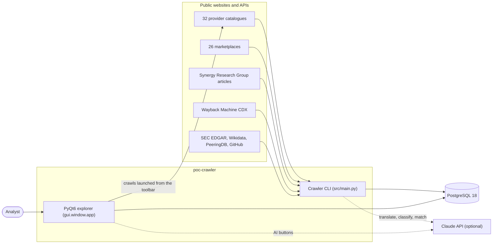
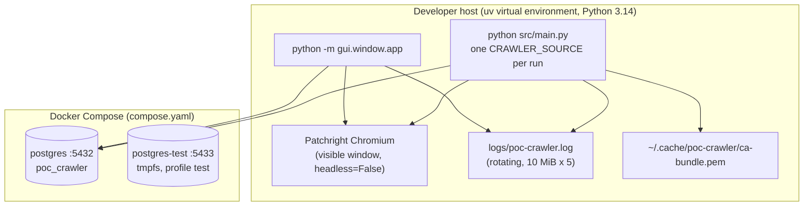
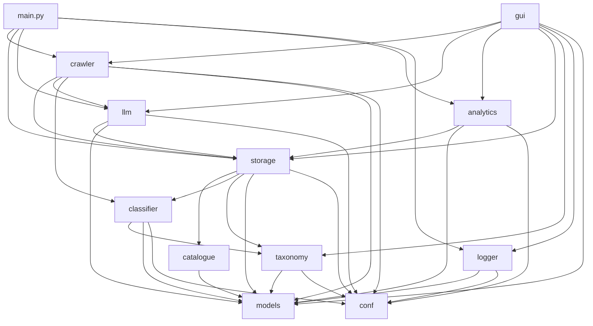
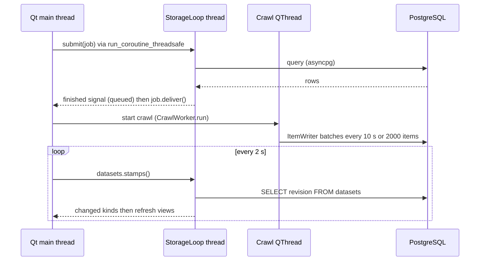
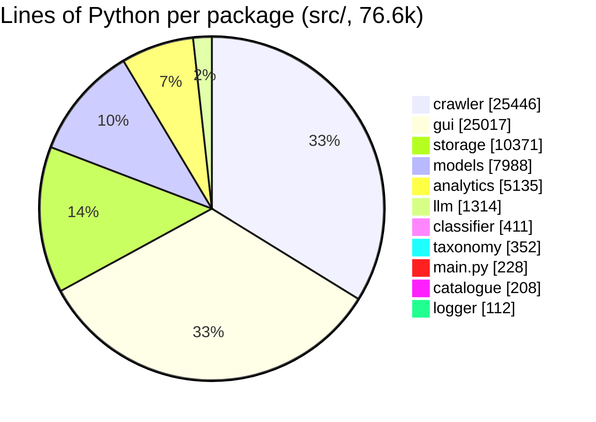
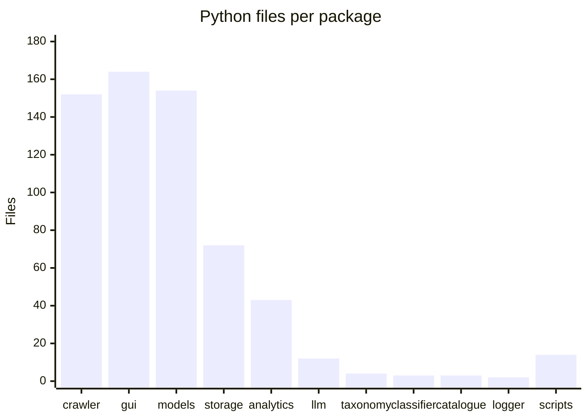

[↑ Docs index](../README.md) · Technical

# 10 — Architecture

poc-crawler is a single Python 3.14 code base with two programs:
- a **command-line crawler**, [`src/main.py`](../../src/main.py), which is one run per `CRAWLER_SOURCE`;
- a **PyQt6 desktop explorer**, [`gui.window.app`](../../src/gui/window/app.py).

Both use the same layers:
- [Scrapling](https://github.com/D4Vinci/Scrapling) spiders crawl the websites and APIs;
- Pydantic models validate every item;
- a rule-based classifier, with an optional language model, files the items in a unified taxonomy;
- an asynchronous [SQLAlchemy](https://docs.sqlalchemy.org/en/20/orm/extensions/asyncio.html) storage writes them to PostgreSQL;
- an analytics layer computes the chart series and the statistics.

This chapter maps those layers, how the packages depend on each other, the threads they run on, and the size of each part.

## Contents

- [System context](#system-context)
- [Containers and runtime](#containers-and-runtime)
- [Packages and layers](#packages-and-layers)
- [Package dependencies](#package-dependencies)
- [Threads and event loops](#threads-and-event-loops)
- [Main data flow](#main-data-flow)
- [Codebase composition](#codebase-composition)
- [Technology stack](#technology-stack)
- [Design principles](#design-principles)
- [See also](#see-also)

## System context

The crawler and the explorer never talk to each other directly. The database is their only interface:
- The explorer polls the `datasets` table every 2 s, so it sees what a crawl writes, whether the crawl was started from the command line or from the GUI.
- PostgreSQL advisory locks keep two crawls from writing the same dataset at once.

## Containers and runtime

- Only PostgreSQL runs in Docker ([`compose.yaml`](../../compose.yaml)). The application runs on the host, because the stealth browser opens a visible window.
- The `Dockerfile` is empty (see [20 — Operations](20-operations.md)).

## Packages and layers

| Layer | Package | Role | Key entry points |
|---|---|---|---|
| Entry | [`src/main.py`](../../src/main.py) | CLI: reads `CRAWLER_SOURCE`/`CRAWLER_TARGET` and dispatches | [`main()`](../../src/main.py#L192), [`run_source()`](../../src/main.py#L152) |
| Entry | [`gui/`](../../src/gui) | PyQt6 explorer: tabs, charts, editing, crawls on a `QThread` | [`gui.window.app.main`](../../src/gui/window/app.py#L33), [`MainWindow`](../../src/gui/window/main_window.py#L76) |
| Orchestration | [`crawler/runner.py`](../../src/crawler/runner.py) | Runs the crawls (in parallel), streams the items to the writer, then runs the LLM tasks | [`CatalogueRunner`](../../src/crawler/runner.py#L49) |
| Collection | [`crawler/`](../../src/crawler) | Scrapling spiders: 32 catalogues, 26 marketplaces, 1 statistics source, 4 metrics APIs | [`CrawlerFactory`](../../src/crawler/factory.py#L83), [`BaseCloudCrawler`](../../src/crawler/cloud/base.py#L27) |
| Domain | [`models/`](../../src/models) | Pydantic models and enums (items, queries, taxonomy, LLM, configuration) | [`CloudProvider`](../../src/models/cloud/enums.py#L69) |
| History | [`catalogue/history/`](../../src/catalogue/history) | Dating rules (added, updated, deleted) and the partial-crawl rule | [`ItemHistory`](../../src/catalogue/history/item_history.py#L14) |
| Classification | [`classifier/`](../../src/classifier), [`taxonomy/`](../../src/taxonomy) | Regex rules, label normalization, seed loading | [`SoftwareClassifier`](../../src/classifier/software_classifier.py#L27), [`LabelNormalizer`](../../src/taxonomy/label_normalizer.py#L13) |
| AI | [`llm/`](../../src/llm) | LangChain chat models, routing, budget, the three tasks | [`ChatModelFactory`](../../src/llm/chat_model_factory.py#L23) |
| Persistence | [`storage/`](../../src/storage) | Engine, tables, repositories, the crawl writer, importer and exporter | [`Storage`](../../src/storage/storage.py#L31), [`ItemWriter`](../../src/storage/writer/item_writer.py#L36) |
| Analytics | [`analytics/`](../../src/analytics) | Chart series, forecasts, provider metrics, driver statistics | see [16 — Analytics](16-analytics.md) |
| Support | [`logger/`](../../src/logger), [`conf/`](../../src/conf) | Logging setup, and the YAML configuration with its paths | [`setup_logging`](../../src/logger/__init__.py#L50), [`conf/__init__.py`](../../src/conf/__init__.py) |
| Tooling | [`scripts/`](../../scripts) | `install-stack`, `migrate-db`, Alembic migrations | [`StackInstaller`](../../scripts/install_stack.py#L26), [`DatabaseMigrator`](../../scripts/migrate_database.py#L33) |

## Package dependencies

These are the imports between the first-party packages, computed from the `import` statements of `src/`.

Rules the graph shows:
- `models` and `conf` depend on nothing. Every Pydantic model, enum and model-level exception lives in `models`.
- `storage` never imports `crawler`, `llm`, `analytics` or `gui`. The classification it applies while writing comes from `classifier` and `taxonomy`.
- `crawler` only depends on `llm` and `storage` through [`runner.py`](../../src/crawler/runner.py): the spiders themselves only yield dictionaries.
- `gui` is the only package that sees everything. It stays thin: queries go to `storage`, computations to `analytics`.

## Threads and event loops

| Program | Thread | Runs | Event loop |
|---|---|---|---|
| CLI | main | `asyncio.run(main())`: the runner, the Scrapling engine and the storage | one asyncio loop |
| GUI | Qt main thread | widgets, the 2 s polling `QTimer`, slots | Qt event loop |
| GUI | `storage` (daemon `threading.Thread`) | every GUI read and write, the LLM jobs, the driver analysis | its own asyncio loop ([`StorageLoop`](../../src/gui/storage_bridge/storage_loop.py#L20)) |
| GUI | crawl `QThread` (at most one) | [`CrawlWorker`](../../src/gui/crawl_worker.py#L21) → `asyncio.run(...)` → `CatalogueRunner` | a new asyncio loop per crawl |
| Both | per provider, inside a loop | `asyncio.Semaphore(concurrency)` + `asyncio.gather` in [`_run_parallel`](../../src/crawler/runner.py#L182) | — |

The GUI creates **two `Storage` instances**, one for its reads and one for its crawls, so two event loops never share an asyncpg connection. See [18 — GUI architecture](18-gui-architecture.md).

## Main data flow

```mermaid
flowchart LR
    page["Web page or JSON API"] --> spider["Spider.parse<br/>extract_products / extract_software"]
    spider --> dedup["In-crawl dedup<br/>name key + URL key"]
    dedup --> model["Pydantic model<br/>CloudProduct / MarketplaceSoftware"]
    model --> aud["Audience<br/>SoftwareClassifier.classify_product"]
    aud --> writer["ItemWriter.add<br/>buffer"]
    writer --> flush{"2000 items<br/>or 10 s?"}
    flush -- yes --> prep["Labels resolved<br/>ItemCategorizer.prepare"]
    prep --> write["Match, date, categorize<br/>INSERT / UPDATE / versions"]
    write --> pg[("PostgreSQL")]
    flush -- no --> writer
    pg --> after["After the crawl:<br/>LLM tasks"]
    pg --> poll["GUI polling<br/>datasets.revision"]
    poll --> views["Tables and charts"]
```

## Codebase composition

The counts come from `wc -l` on the working tree (`.py` files only; the YAML of `conf/` is not counted).

| Area | Files | Lines |
|---|---|---|
| `src/` total | 611 | 76,601 |
| `scripts/` (with Alembic) | 14 | 1,533 |
| `tests/` | 206 test files | 38,338 |

The crawlers and the GUI take two thirds of the code:
- each of the 32 provider packages holds its own extraction code (one `crawler.py`, often a `marketplace.py` and an `enums.py`);
- the GUI hand-paints its charts and the correspondence diagram.

## Technology stack

| Concern | Technology | Where |
|---|---|---|
| Language and packaging | [Python 3.14](https://docs.python.org/3.14/), [uv](https://docs.astral.sh/uv/), [hatchling](https://hatch.pypa.io/latest/) | [`pyproject.toml`](../../pyproject.toml) |
| Crawling | [Scrapling](https://scrapling.readthedocs.io/) spiders: `AsyncStealthySession` ([Patchright](https://github.com/Kaliiiiiiiiii-Vinyzu/patchright) Chromium) and `FetcherSession` (browser-impersonating HTTP, [curl_cffi](https://github.com/lexiforest/curl_cffi)) | [`crawler/`](../../src/crawler) |
| HTML parsing | [Scrapling selectors](https://scrapling.readthedocs.io/en/latest/parsing/selection/) (lxml) | provider crawlers |
| Validation | [Pydantic v2](https://docs.pydantic.dev/latest/) | [`models/`](../../src/models) |
| Database | [PostgreSQL 18](https://www.postgresql.org/docs/18/), [asyncpg](https://magicstack.github.io/asyncpg/), [SQLAlchemy 2 asyncio](https://docs.sqlalchemy.org/en/20/orm/extensions/asyncio.html), [Alembic](https://alembic.sqlalchemy.org/), [pg_trgm](https://www.postgresql.org/docs/current/pgtrgm.html) | [`storage/`](../../src/storage), [`scripts/migrations/`](../../scripts/migrations) |
| Language model | [LangChain](https://python.langchain.com/) (`langchain-anthropic`, `langchain-openai`), [Claude API](https://docs.anthropic.com/) | [`llm/`](../../src/llm) |
| Statistics | [NumPy](https://numpy.org/doc/), [SciPy](https://docs.scipy.org/doc/scipy/) | [`analytics/`](../../src/analytics) |
| Desktop UI | [PyQt6](https://www.riverbankcomputing.com/static/Docs/PyQt6/) | [`gui/`](../../src/gui) |
| Logging | `logging.config.dictConfig`, [colorlog](https://github.com/borntyping/python-colorlog) | [`logger/`](../../src/logger), [`conf/logger.yaml`](../../src/conf/logger.yaml) |
| Quality | [ruff](https://docs.astral.sh/ruff/), [mypy](https://mypy.readthedocs.io/), [pytest](https://docs.pytest.org/), [pytest-asyncio](https://pytest-asyncio.readthedocs.io/), [pytest-qt](https://pytest-qt.readthedocs.io/) | [`tests/`](../../tests) |

`fastapi`, `langgraph`, `beautifulsoup4` and `anthropic` are declared in `pyproject.toml`:
- `fastapi`, `langgraph` and `beautifulsoup4` are not imported by `src/`;
- `anthropic` is only imported for its `APIError` class, which the LLM tasks catch.

## Design principles

- **Database as the integration point.** Crawls write progressively, and every reader (the GUI, the analytics, the LLM tasks) reads from PostgreSQL. Nothing is passed in memory between programs.
- **Idempotent, resumable writes.** Items are matched by stable hashed keys. Unchanged items are never written again. A crawl that dies leaves `RUNNING` rows, which the next crawl marks `ABANDONED`.
- **People win over machines.** Anything a person edits (categories, label names, links, concepts, taxonomy nodes) is marked `user` or `edited` and is never overwritten by the rules, the seed or the language model.
- **Server-side everything.** Filters, counts, facets, pages and exports run in SQL. The GUI never loads a whole catalogue.
- **Strict project conventions**, enforced by tests in [`tests/conventions/`](../../tests/conventions) (see [19 — Testing and quality](19-testing-and-quality.md)):
  - typing with `Dict`/`List`/`Optional`, and no `Any`;
  - one exception module per package;
  - an ERROR log before every raise;
  - a fixed method layout in every class;
  - one class per GUI module.

## See also

- [11 — Configuration](11-configuration.md): every environment variable and YAML file.
- [12 — Crawler framework](12-crawler-framework.md): how the spiders are built.
- [13 — Storage](13-storage.md): tables, writer, locks.
- [18 — GUI architecture](18-gui-architecture.md): Qt threads and widgets.
- [Functional overview](../functional/01-overview.md).

[← Previous](../functional/09-gui-user-guide.md) · [Next →](11-configuration.md)
