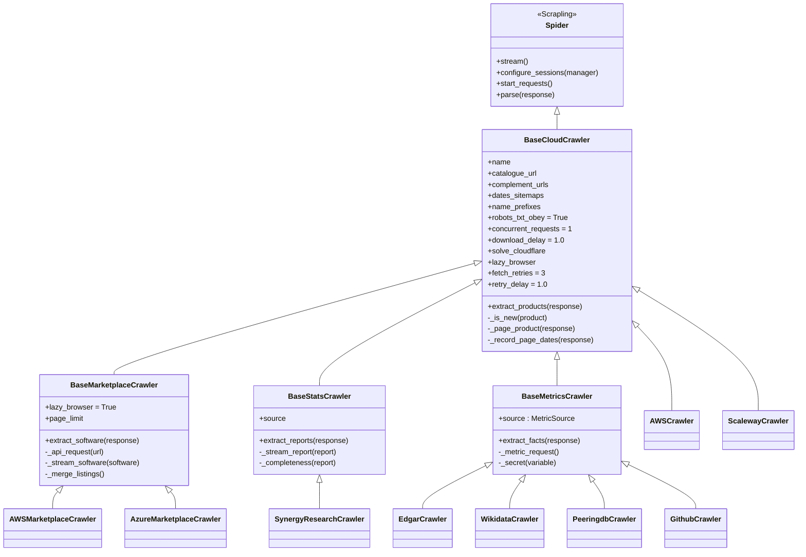
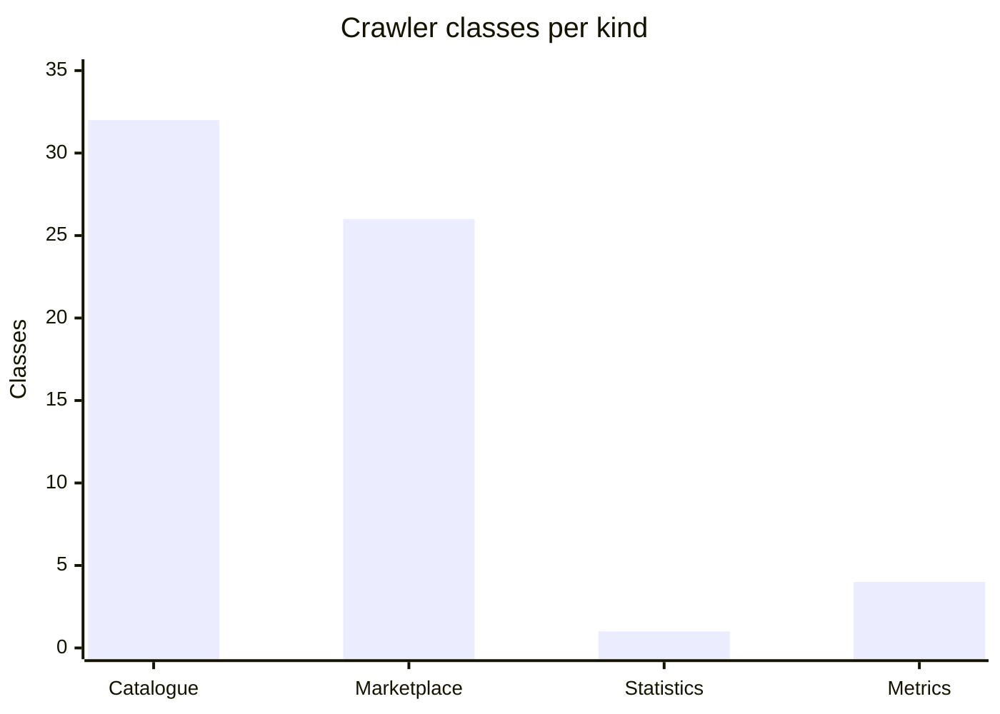
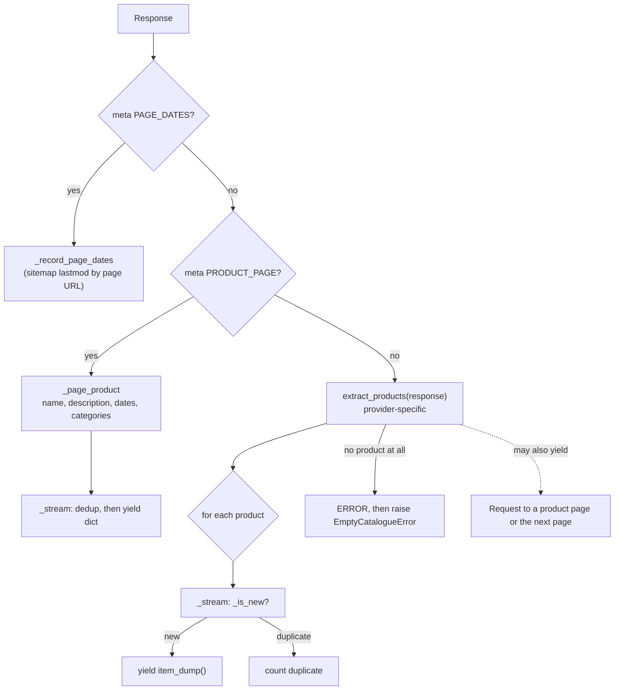
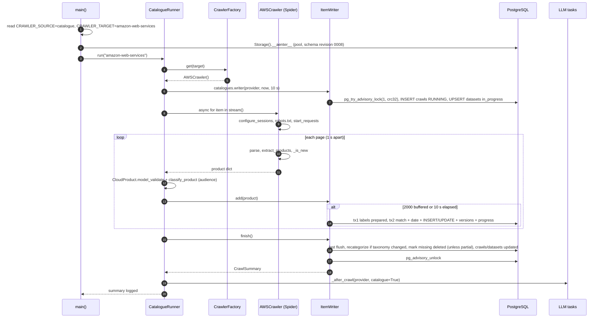

[↑ Docs index](../README.md) · Technical

# 12 — Crawler framework

Every crawler is a [Scrapling](https://scrapling.readthedocs.io/) `Spider`. Four base classes provide the shared behaviour:
- the HTTP sessions;
- robots.txt and the crawl delay;
- de-duplication;
- logging and error reporting.

A provider package only implements the extraction of its pages. [`CrawlerFactory`](../../src/crawler/factory.py#L83) maps every provider and source to its class, and [`CatalogueRunner`](../../src/crawler/runner.py#L49) runs the spiders, validates their items and streams them to the storage writer. This chapter documents that framework and the checklist for adding a provider.

## Contents

- [Class hierarchy](#class-hierarchy)
- [Crawler inventory](#crawler-inventory)
- [Base class contract](#base-class-contract)
- [Request flow and parse routing](#request-flow-and-parse-routing)
- [Sessions: stealth browser or impersonating HTTP](#sessions-stealth-browser-or-impersonating-http)
- [Politeness: robots.txt, delay, concurrency](#politeness-robotstxt-delay-concurrency)
- [De-duplication inside a crawl](#de-duplication-inside-a-crawl)
- [The runner](#the-runner)
- [One catalogue crawl end to end](#one-catalogue-crawl-end-to-end)
- [TLS: the merged CA bundle](#tls-the-merged-ca-bundle)
- [Exceptions](#exceptions)
- [How to add a provider](#how-to-add-a-provider)
- [See also](#see-also)

## Class hierarchy

| Base | File | Hook to implement | Item streamed |
|---|---|---|---|
| [`BaseCloudCrawler`](../../src/crawler/cloud/base.py#L27) | `crawler/cloud/base.py` | [`extract_products`](../../src/crawler/cloud/base.py#L792) | `CloudProduct.item_dump()` |
| [`BaseMarketplaceCrawler`](../../src/crawler/marketplace/base.py#L25) | `crawler/marketplace/base.py` | [`extract_software`](../../src/crawler/marketplace/base.py#L326) | `MarketplaceSoftware.item_dump()` |
| [`BaseStatsCrawler`](../../src/crawler/stats/base.py#L24) | `crawler/stats/base.py` | [`extract_reports`](../../src/crawler/stats/base.py#L148) | `MarketReport` (only when more complete) |
| [`BaseMetricsCrawler`](../../src/crawler/metrics/base.py#L32) | `crawler/metrics/base.py` | [`extract_facts`](../../src/crawler/metrics/base.py#L190) | `MetricFact` |

There is no `abc.ABC`. A hook that is not overridden logs an ERROR and raises `ParseNotImplementedError`.

## Crawler inventory

| Map in [`CrawlerFactory`](../../src/crawler/factory.py#L83) | Key | Entries | Built by |
|---|---|---|---|
| `CRAWLER_MAP` | `CloudProvider` | 32 | [`get(target)`](../../src/crawler/factory.py#L202) |
| `MARKETPLACE_MAP` | `CloudProvider` | 26. Arsys, Proximus NXT, Seeweb, DEEP, Gigas and China Mobile Cloud have none. | [`get_marketplace(target, classifier)`](../../src/crawler/factory.py#L229) |
| `STATISTICS_MAP` | name | 1 (`synergy`) | [`get_statistics(name)`](../../src/crawler/factory.py#L255) |
| `METRICS_MAP` | `MetricSource` | 4 (EDGAR, Wikidata, PeeringDB, GitHub) | [`get_metrics(source, catalog)`](../../src/crawler/factory.py#L274) |

Provider packages, one folder each under [`src/crawler/cloud/`](../../src/crawler/cloud):

| Bloc | Packages |
|---|---|
| United States | [`aws`](../../src/crawler/cloud/aws), [`azure`](../../src/crawler/cloud/azure), [`gcp`](../../src/crawler/cloud/gcp), [`ibm`](../../src/crawler/cloud/ibm), [`oracle`](../../src/crawler/cloud/oracle) |
| European Union | [`ovh`](../../src/crawler/cloud/ovh), [`scaleway`](../../src/crawler/cloud/scaleway), [`combell`](../../src/crawler/cloud/combell), [`proximus`](../../src/crawler/cloud/proximus), [`stackit`](../../src/crawler/cloud/stackit), [`tcloud`](../../src/crawler/cloud/tcloud), [`aruba`](../../src/crawler/cloud/aruba), [`seeweb`](../../src/crawler/cloud/seeweb), [`gcore`](../../src/crawler/cloud/gcore), [`deep`](../../src/crawler/cloud/deep), [`arsys`](../../src/crawler/cloud/arsys), [`gigas`](../../src/crawler/cloud/gigas) |
| Other (Switzerland, United Kingdom) | [`exoscale`](../../src/crawler/cloud/exoscale), [`infomaniak`](../../src/crawler/cloud/infomaniak), [`civo`](../../src/crawler/cloud/civo), [`krystal`](../../src/crawler/cloud/krystal) |
| China | [`alibaba`](../../src/crawler/cloud/alibaba), [`huawei`](../../src/crawler/cloud/huawei), [`tencent`](../../src/crawler/cloud/tencent), [`baidu`](../../src/crawler/cloud/baidu), [`volcengine`](../../src/crawler/cloud/volcengine), [`ctyun`](../../src/crawler/cloud/ctyun), [`ecloud`](../../src/crawler/cloud/ecloud) |
| Russia | [`yandex`](../../src/crawler/cloud/yandex), [`vkcloud`](../../src/crawler/cloud/vkcloud), [`cloudru`](../../src/crawler/cloud/cloudru), [`selectel`](../../src/crawler/cloud/selectel) |

The bloc of each provider comes from [`PROVIDER_COUNTRIES`](../../src/models/cloud/enums.py#L350) and `Country.bloc`. The shared helper [`NextFlightData`](../../src/crawler/cloud/next_flight_data.py#L17) reads the Next.js "flight" data embedded in some pages (VK Cloud, Cloud.ru). Each crawler's class docstring describes its sources.

## Base class contract

Class variables a provider crawler sets ([`base.py` L97–L109](../../src/crawler/cloud/base.py#L97)):

| Variable | Default | Meaning |
|---|---|---|
| `name` | `default-crawler` | Spider name, e.g. `aws` or `aws-marketplace`. Also used in the session IDs. |
| `catalogue_url` | `""` | Main listing, requested at priority 10. |
| `complement_urls` | `()` | Menus, sitemaps, documentation directories and APIs that complete the listing. |
| `dates_sitemaps` | `()` | Sitemaps read first (priority 20) for the `lastmod` dates of the product pages. |
| `name_prefixes` | `()` | Brand prefixes stripped from the name keys, e.g. `("Amazon ", "AWS ")`. |
| `robots_txt_obey` | `True` | Scrapling's own default is `False`. |
| `concurrent_requests` | 1 | One request at a time per crawler. |
| `download_delay` | 1.0 s | 3.0 s for China Mobile Cloud ([`ecloud`](../../src/crawler/cloud/ecloud/crawler.py#L97)), 1.5 s for the Yandex marketplace and Synergy. |
| `solve_cloudflare` | `False` | Passed to the stealth session. |
| `lazy_browser` | `False` | `True` starts the browser only when a request needs it. This is the default for marketplaces, statistics, metrics and Yandex. |
| `fetch_retries`, `retry_delay` | 3, 1.0 s | 4 retries and 60 s for China Mobile Cloud, whose website bans fast clients. |
| `DESCRIPTION_LIMIT` | 1000 | Descriptions are shortened to this many characters. |

Helpers inherited by every crawler:

| Helper | Purpose |
|---|---|
| [`_build_product`](../../src/crawler/cloud/base.py#L352) | Builds and validates a `CloudProduct`, logging and skipping an invalid entry. |
| [`_merge_categories`](../../src/crawler/cloud/base.py#L405) | Merges the listings of one product under several categories. |
| [`_next_data`](../../src/crawler/cloud/base.py#L443), [`_json_body`](../../src/crawler/cloud/base.py#L471) | Read the `__NEXT_DATA__` and JSON bodies. |
| [`_sitemap_entries`](../../src/crawler/cloud/base.py#L490), [`_sitemap_urls`](../../src/crawler/cloud/base.py#L515) | Read sitemaps, with `lastmod`. |
| [`_product_page_request`](../../src/crawler/cloud/base.py#L583), [`_page_product`](../../src/crawler/cloud/base.py#L631) | Follow a product page for its description, dates and categories. |
| [`_parse_date`](../../src/crawler/cloud/base.py#L331) | Tolerant date parsing. Dates before `EARLIEST_DATE` (1990) are dropped. |
| [`_use_application_logging`](../../src/crawler/cloud/base.py#L132) | Removes Scrapling's console handler, so that the spider logs go to [`logger.yaml`](../../src/conf/logger.yaml). |

## Request flow and parse routing

[`start_requests`](../../src/crawler/cloud/base.py#L772) yields the requests in this order:
1. every `dates_sitemaps` URL, at priority 20 with `PAGE_DATES` meta;
2. the `catalogue_url`, at priority 10;
3. every `complement_urls` URL. A sitemap that was already read for its dates is requested again with `dont_filter`.

[`BaseMarketplaceCrawler.parse`](../../src/crawler/marketplace/base.py#L341) is simpler:
- it streams `extract_software(response)` through `_stream_software`;
- it raises `EmptyCatalogueError` when a page holds no software, unless the request carries `MAY_BE_EMPTY`.

## Sessions: stealth browser or impersonating HTTP

Sessions are registered in `configure_sessions(manager)`, the first hook Scrapling calls:

| Crawler kind | Default session | Browser session |
|---|---|---|
| Catalogue ([`base.py` L704](../../src/crawler/cloud/base.py#L704)) | the stealth browser `<name>-session`: an [`AsyncStealthySession`](https://scrapling.readthedocs.io/en/latest/fetching/stealthy/) with `headless=False`, `timeout=120000`, `wait=2000`, `load_dom=True` | started at once, unless `lazy_browser` |
| Marketplace ([`base.py` L288](../../src/crawler/marketplace/base.py#L288)) | `FetcherSession(impersonate="chrome", timeout=60)`, id `<name>-http`, used by [`_api_request`](../../src/crawler/marketplace/base.py#L85) for the JSON APIs | lazy, requested with `sid=_browser_session_id()` |
| Statistics ([`base.py` L113](../../src/crawler/stats/base.py#L113)), Metrics ([`base.py` L154](../../src/crawler/metrics/base.py#L154)) | impersonating HTTP | lazy |
| Yandex catalogue and marketplace | overridden to impersonating HTTP | lazy |

The browser is [Patchright](https://github.com/Kaliiiiiiiiii-Vinyzu/patchright) Chromium (`uv run patchright install chromium`). It runs visibly, so a window opens for every browser crawl.

## Politeness: robots.txt, delay, concurrency

- **robots.txt** is applied by Scrapling's engine (`RobotsTxtManager`), not by project code:
  - the engine pre-fetches it once per domain and drops the disallowed requests;
  - it reads `Crawl-delay` and `Request-rate` ([RFC 9309](https://www.rfc-editor.org/rfc/rfc9309.html) plus the common extensions).
- **Delay per domain** = `max(download_delay, Crawl-delay, period / requests of Request-rate)`.
- **One request at a time** per crawler (`concurrent_requests = 1`).
- **Parallelism only across providers.** [`_run_parallel`](../../src/crawler/runner.py#L182) bounds it with an `asyncio.Semaphore(CRAWLER_CONCURRENCY)`. It warns when `concurrency + 1` exceeds `pool_size + max_overflow`, because each crawl holds one database connection.

## De-duplication inside a crawl

| Level | Key | Code |
|---|---|---|
| Catalogue product, name | casefold, parenthesized notes removed (ASCII and full-width), brand prefix stripped, non-word characters removed. `AWS App Runner` gives `apprunner`, `云服务器 BCC` gives `云服务器bcc`. | [`_name_key`](../../src/crawler/cloud/base.py#L197) |
| Catalogue product, URL | `netloc` without `www.` plus the path without its trailing `/` (scheme, query and fragment dropped) | [`_url_key`](../../src/crawler/cloud/base.py#L213) |
| Catalogue product | new only if neither key was seen (`seen_products`, `seen_urls`) | [`_is_new`](../../src/crawler/cloud/base.py#L233) |
| Marketplace software | `identity()` (URL, else `name\|publisher`). A listing seen again with **new** categories is streamed again, merged. | [`_stream_software`](../../src/crawler/marketplace/base.py#L256) |
| Runner, marketplace | distinct `identity()` counted, and the latest listing replaces the earlier one in the writer buffer | [`_stream_software`](../../src/crawler/runner.py#L259) |
| Writer | items keyed by their first match key, then matched to stored rows by hashed keys | see [13 — Storage](13-storage.md) |

## The runner

[`CatalogueRunner`](../../src/crawler/runner.py#L49) is shared by the CLI and the GUI.

| Method | Purpose |
|---|---|
| [`run(target)`](../../src/crawler/runner.py#L370) | Crawls one catalogue into an `ItemWriter`. Ends with `abort(EMPTY)` and `EmptyCrawlError` when nothing was crawled, else `finish()`. Then runs `_after_crawl(provider, True)`. |
| [`run_all`](../../src/crawler/runner.py#L399) | `run` for every `CloudProvider`, in parallel. |
| [`crawl(target)`](../../src/crawler/runner.py#L347) | The same crawl into an in-memory `ItemCollector`, without writing (used by the tests). |
| [`run_marketplace`](../../src/crawler/runner.py#L442), [`run_all_marketplaces`](../../src/crawler/runner.py#L474) | The marketplace equivalents. Their `_after_crawl(provider, False)` does no service matching. |
| [`run_statistics`](../../src/crawler/runner.py#L550) | Collects the reports in memory and writes them with `statistics.replace` (see [17](17-statistics-crawler.md)). |
| [`crawl_metrics`](../../src/crawler/runner.py#L585) | Streams the facts of every metrics crawler (see [16](16-analytics.md)). |
| [`refresh_taxonomy`](../../src/crawler/runner.py#L496), [`reclassify_marketplaces`](../../src/crawler/runner.py#L512), [`reclassify_catalogues`](../../src/crawler/runner.py#L531) | `CRAWLER_SOURCE=reclassify` (see [14](14-classification-engine.md)). |
| [`translate`](../../src/crawler/runner.py#L616), [`correspond`](../../src/crawler/runner.py#L633) | LLM tasks with no crawl (see [15](15-llm-layer.md)). |
| [`_stream_products`](../../src/crawler/runner.py#L223) | `CloudProduct.model_validate` → [`classify_product`](../../src/classifier/software_classifier.py#L351) (the audience goes in `categories`) → `on_product` callback → sink. |
| [`_after_crawl`](../../src/crawler/runner.py#L305) | If `after_crawl` is set and a model is configured: `LabelTranslator.run()` → `ItemClassifier.run(provider)` → `ServiceMatcher.run(provider)` (catalogues only). |

Constants: `DEFAULT_CONCURRENCY = 4` and `SAVE_INTERVAL = 10.0` s ([L75–L77](../../src/crawler/runner.py#L75)).

## One catalogue crawl end to end

## TLS: the merged CA bundle

[`CaBundle.install()`](../../src/crawler/tls/ca_bundle.py#L123) runs before every HTTP session is registered, in the marketplace, statistics and metrics bases and in Yandex:
1. read certifi's bundle;
2. append every distinct bundle named by `REQUESTS_CA_BUNDLE`, `CURL_CA_BUNDLE`, `SSL_CERT_FILE` or `POC_CRAWLER_CA_BUNDLES`;
3. write `~/.cache/poc-crawler/ca-bundle.pem`, only when its content changed;
4. point `REQUESTS_CA_BUNDLE` and `CURL_CA_BUNDLE` at that file, and remember the original bundles in `POC_CRAWLER_CA_BUNDLES`.

The bundle exists because an outdated system bundle named by `REQUESTS_CA_BUNDLE` lacks recent roots, such as the Sectigo root of scaleway.com, and then every page of those websites fails. If the file cannot be written, certifi's bundle is used alone.

## Exceptions

All crawler exceptions are defined in [`crawler/exception.py`](../../src/crawler/exception.py), and every raise follows an ERROR log.

| Exception | Raised when |
|---|---|
| `CrawlerError` | root of the package |
| `UnknownCrawlerTargetError` | `CRAWLER_TARGET` is not a `CloudProvider` |
| `ParseNotImplementedError` | a crawler lacks its `extract_*` hook |
| `CatalogueFormatError` | a page or API has an unexpected shape |
| `EmptyCatalogueError` | a catalogue or marketplace page holds no item |
| `EmptyCrawlError` | a whole crawl produced nothing: the stored dataset is kept |
| `NoMarketplaceError` | a provider has no marketplace |
| `CollectorCatalogError` | `collectors.yaml` cannot be read |

## How to add a provider

1. Add a member to [`CloudProvider`](../../src/models/cloud/enums.py#L69), and its country to [`PROVIDER_COUNTRIES`](../../src/models/cloud/enums.py#L350). Its bloc follows from the country.
2. Create `src/crawler/cloud/<package>/crawler.py` with a `BaseCloudCrawler` subclass:
   - set `name`, `catalogue_url`, `complement_urls`, `name_prefixes` and, if the provider publishes dates, `dates_sitemaps`;
   - implement `extract_products`;
   - describe the sources in the class docstring;
   - put the provider-specific `StrEnum`s in `enums.py`.
3. Optionally, add `marketplace.py` with a `BaseMarketplaceCrawler` subclass that implements `extract_software`, using `_api_request` for the JSON APIs.
4. Import the classes in [`factory.py`](../../src/crawler/factory.py) and register them in `CRAWLER_MAP` and, if needed, `MARKETPLACE_MAP`.
5. Add offline tests under `tests/crawler/cloud/<package>/`, with trimmed page snapshots in `tests/fixtures/`.
6. Keep every folder at 5 Python files or fewer, and follow the [conventions](19-testing-and-quality.md).
7. Run `tests/test_vscode_launch.py`. It fails until `.vscode/launch.json` offers the new target.
8. Optionally, add the provider to [`collectors.yaml`](../../src/conf/metrics/collectors.yaml) for the metrics, and its known foreign labels to [`label-seed.yaml`](../../src/conf/taxonomy/label-seed.yaml).

## See also

- [02 — Data collection](../functional/02-data-collection.md): what is crawled, from a user's point of view.
- [13 — Storage](13-storage.md): what the writer does with the streamed items.
- [17 — Statistics crawler](17-statistics-crawler.md).
- [Scrapling spiders documentation](https://scrapling.readthedocs.io/).

[← Previous](11-configuration.md) · [Next →](13-storage.md)
