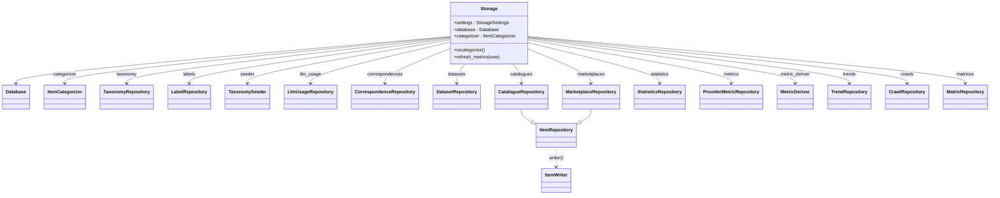
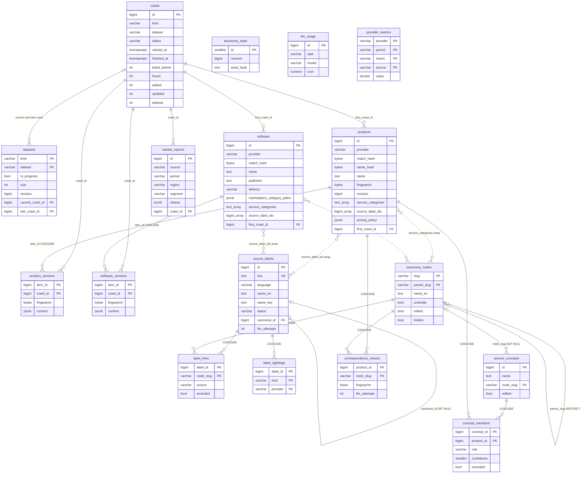
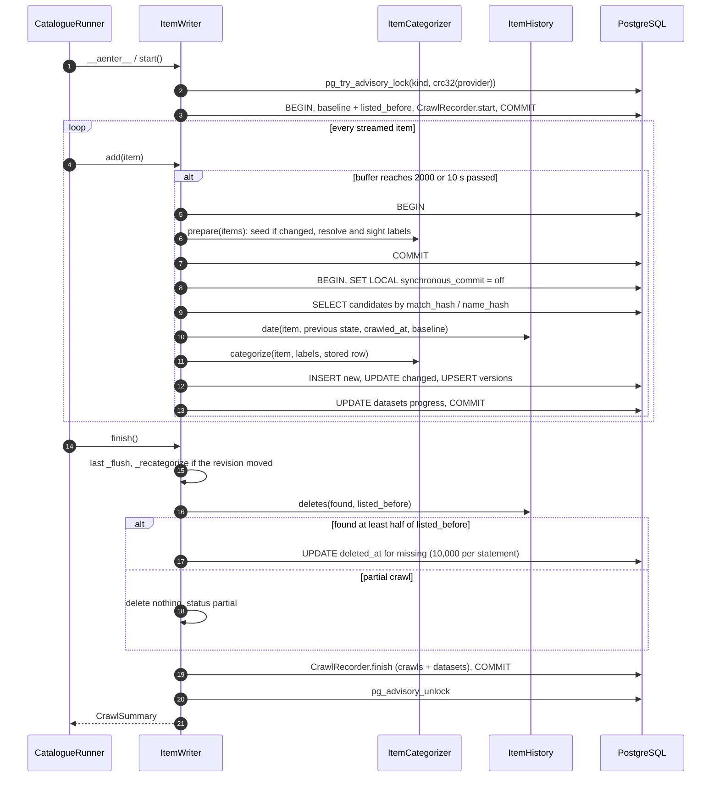
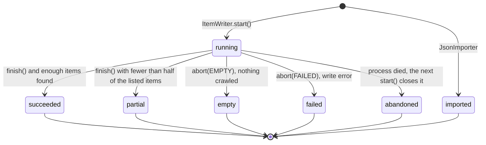
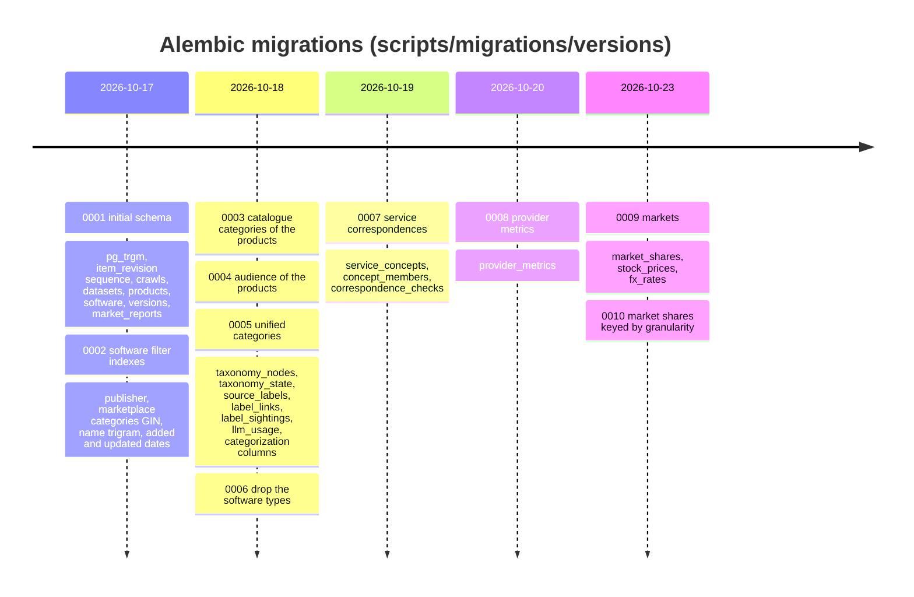

[↑ Docs index](../README.md) · Technical

# 13 — Storage

All the crawled data lives in PostgreSQL. The code reaches it through asynchronous [SQLAlchemy Core](https://docs.sqlalchemy.org/en/20/orm/extensions/asyncio.html) on the [asyncpg](https://magicstack.github.io/asyncpg/) driver. The schema is versioned by [Alembic](https://alembic.sqlalchemy.org/) migrations. This chapter documents:
- the [`Storage`](../../src/storage/storage.py#L31) facade;
- the 17 tables;
- the crawl writer, which dates, versions and progressively commits every item;
- the advisory locks, the repositories, and how the design scales to millions of items.

## Contents

- [Package layout](#package-layout)
- [The Storage facade](#the-storage-facade)
- [Database engine](#database-engine)
- [Schema](#schema)
- [Entity-relationship diagram](#entity-relationship-diagram)
- [The crawl writer](#the-crawl-writer)
- [Crawl status lifecycle](#crawl-status-lifecycle)
- [Advisory locks](#advisory-locks)
- [Repositories](#repositories)
- [Mappers and queries](#mappers-and-queries)
- [Import and export](#import-and-export)
- [Scaling choices](#scaling-choices)
- [Migrations](#migrations)
- [Exceptions](#exceptions)
- [See also](#see-also)

## Package layout

| Folder | Content |
|---|---|
| [`engine/`](../../src/storage/engine) | [`Database`](../../src/storage/engine/database.py#L19) (pool and schema check), [`DatasetLock`](../../src/storage/engine/dataset_lock.py#L16), [`StorageSettingsReader`](../../src/storage/engine/settings_reader.py) |
| [`tables/`](../../src/storage/tables) | declarative rows, shared column mixins ([`item_columns.py`](../../src/storage/tables/item_columns.py), [`version_columns.py`](../../src/storage/tables/version_columns.py)), [`StorageSchema`](../../src/storage/tables/schema.py#L30) |
| [`writer/`](../../src/storage/writer) | [`ItemWriter`](../../src/storage/writer/item_writer.py#L36), [`CrawlRecorder`](../../src/storage/writer/crawl_recorder.py#L21), `ClaimState` |
| [`repositories/`](../../src/storage/repositories) | items, datasets, statistics, taxonomy, LLM usage, correspondences, metrics, trends |
| [`mappers/`](../../src/storage/mappers) | [`ItemMapper`](../../src/storage/mappers/item_mapper.py#L23), [`ItemQueryBuilder`](../../src/storage/mappers/item_query_builder.py#L33), [`ReportMapper`](../../src/storage/mappers/report_mapper.py#L16) |
| [`importer/`](../../src/storage/importer), [`exporter/`](../../src/storage/exporter) | [`JsonImporter`](../../src/storage/importer/json_importer.py#L24), [`ItemExporter`](../../src/storage/exporter/item_exporter.py#L24) |

## The Storage facade

[`Storage`](../../src/storage/storage.py#L31) is an async context manager. It builds one `Database`, one shared `ItemCategorizer`, and every repository:

## Database engine

[`Database.open()`](../../src/storage/engine/database.py#L104) creates the `AsyncEngine` with these settings:

| Setting | Value |
|---|---|
| pool | `pool_size` (5) + `max_overflow` (30), `pool_pre_ping`, `pool_recycle=1800` s |
| batched inserts | `insertmanyvalues_page_size=1000` |
| per connection | `application_name=poc-crawler`, `jit=off`, `command_timeout=300` s |
| schema check | `alembic_version` must equal [`StorageSchema.REVISION`](../../src/storage/tables/schema.py#L39) = `0008`, else `StorageSchemaError` |

`install-stack` and `migrate-db` open the database with `check_schema=False`, because they run before the migrations.

## Schema

| Table | Primary key | Content | Migration |
|---|---|---|---|
| `crawls` | `id` | every crawl: kind, dataset, status, started/finished, listed_before, found, added, updated, deleted, error | 0001 |
| `datasets` | `(kind, dataset)` | the state of each catalogue, marketplace and statistics source, polled by the GUI: `in_progress`, `size`, `revision`, current and last crawl | 0001 |
| `products` | `id` | one row per catalogue product: [`ItemColumns`](../../src/storage/tables/item_columns.py) + `pricing_policy` JSONB, `catalogue_categories[]`, `categories[]` (audience) | 0001, 0003, 0004, 0005 |
| `software` | `id` | one row per marketplace software: `ItemColumns` + `publisher`, `delivery`, `marketplace_categories[]`, `marketplace_category_paths` JSONB, `categories[]` | 0001, 0002, 0005, 0006 |
| `product_versions`, `software_versions` | `(item_id, crawl_id)` | the content (JSONB, lz4) each time a crawl found the item new or changed | 0001 |
| `market_reports` | `id`, unique `(source, period, region, segment)` | Synergy figures: size, growth, `shares` and `mentions` JSONB | 0001 |
| `taxonomy_nodes` | `slug` (kebab-case CHECK) | domains (no parent) and categories: names en/ru/zh, audiences, `umbrella`, `origin`, `edited`, `hidden` | 0005 |
| `taxonomy_state` | `id` = 1 (single row) | `revision`, `seed_hash`, `seeded_at` | 0005 |
| `source_labels` | `id`, unique `key` | provider categories as written: language, English name, alias `name_key`, `status`, `canonical_id`, LLM claim columns | 0005 |
| `label_links` | `(label_id, node_slug)` | label → taxonomy node, with `source` (rule, seed, llm, user) and `excluded` | 0005 |
| `label_sightings` | `(label_id, kind, provider)` | where and when each label was seen | 0005 |
| `llm_usage` | `id` | every model call: task, model, 4 token counts, `cost` `Numeric(14,6)`, currency | 0005 |
| `service_concepts` | `id` | concepts of equivalent services, found in a taxonomy category | 0007 |
| `concept_members` | `(concept_id, product_id)` | `role` (equivalent or partial), `confidence` 0–100, `source`, `excluded` | 0007 |
| `correspondence_checks` | `(product_id, node_slug)` | the fingerprint a product was matched for, plus LLM attempts and error | 0007 |
| `provider_metrics` | `(provider, period, metric, source)` | one value per provider, quarter, metric and source, with `source_url` | 0008 |
| `market_shares` | `(segment, area, period, granularity, device, metric, source, label)` | a label's share of a segment, in an area, on a device, for a month, quarter or year, with its company, whether it is estimated, and `source_url` ([guide](../analysis/market-shares-and-stocks.md)) | 0009, 0010 |
| `stock_prices` | `(listing, day, source)` | a weekly close of a listing in its currency, with its volume | 0009 |
| `fx_rates` | `(currency, day)` | the US dollars one unit of a currency was worth that day (FRED) | 0009 |

Columns shared by `products` and `software` ([`ItemColumns`](../../src/storage/tables/item_columns.py)):

| Column | Type | Meaning |
|---|---|---|
| `id` | bigint identity | kept for the item's whole history, even when its page moves |
| `provider` | varchar(40) | `CloudProvider` value |
| `match_hash`, `name_hash` | bytea (16) | BLAKE2b of the most and least reliable match keys |
| `name`, `description`, `url` | text | content |
| `added_at/from/caveat`, `updated_at/from/caveat`, `deleted_at` | timestamptz + varchar | history dates and where they come from |
| `fingerprint` | bytea (16) | BLAKE2b of the content fields |
| `first_crawl_id` | FK → `crawls` | `NULL` for an item created by hand |
| `revision` | bigint, default `nextval('item_revision')` | bumped by every write, so readers can ask "what changed since revision N" |
| `service_categories[]`, `service_domains[]` | varchar(60)[] | unified taxonomy slugs (GIN indexed) |
| `source_label_ids[]` | bigint[] | the item's source labels (GIN indexed) |
| `categories_source`, `categories_fingerprint` | varchar, bytea | `rules`, `llm` or `user`, and the content the model categorized |

## Entity-relationship diagram

Solid lines are foreign keys. Dotted lines are logical links, held in array columns without a foreign key.

`llm_usage`, `provider_metrics`, `taxonomy_state` and the markets tables (`market_shares`, `stock_prices`, `fx_rates`) stand alone. Their `provider` and `task` columns hold enum values.

## The crawl writer

[`ItemWriter[T]`](../../src/storage/writer/item_writer.py#L36) is created by [`ItemRepository.writer()`](../../src/storage/repositories/item_repository.py#L807) and used as an async context manager by the runner.

| Step | Method | What happens |
|---|---|---|
| start | [`start()`](../../src/storage/writer/item_writer.py#L627) | The crawl takes **its own connection** and a **session** advisory lock. In one transaction it reads `baseline` (whether any row exists) and `listed_before` (rows not deleted). [`CrawlRecorder.start`](../../src/storage/writer/crawl_recorder.py#L49) then marks old `running` crawls `abandoned`, inserts the crawl, and sets the dataset `in_progress`. |
| add | [`add(item)`](../../src/storage/writer/item_writer.py#L652) | Buffers the item, keyed by its first match key, so an item streamed again replaces itself. It flushes when the buffer reaches `batch_size` (2000) **or** `flush_interval` (10 s) has passed. A failed flush is logged and retried with the next batch. |
| flush | [`_flush()`](../../src/storage/writer/item_writer.py#L511) | **Transaction 1:** [`ItemCategorizer.prepare`](../../src/storage/repositories/taxonomy/item_categorizer.py#L169) seeds if needed, refreshes the caches, then resolves and sights the source labels. **Transaction 2:** `SET LOCAL synchronous_commit = off`, `_write`, `recorder.progress`. |
| write | [`_write()`](../../src/storage/writer/item_writer.py#L446) | [`_candidates`](../../src/storage/writer/item_writer.py#L302) loads the stored rows by `match_hash`, `name_hash` or claimed id. `_match` gives each crawled item the lowest-id stored row not already claimed. [`ItemHistory.date`](../../src/catalogue/history/item_history.py#L90) dates it, then `categorize` files it. New rows are `INSERT … RETURNING`, changed rows are a batched `UPDATE` (new `revision`), and unchanged rows are not touched. [`_write_versions`](../../src/storage/writer/item_writer.py#L417) upserts on `(item_id, crawl_id)`. |
| finish | [`finish()`](../../src/storage/writer/item_writer.py#L695) | Last flush. [`_recategorize`](../../src/storage/writer/item_writer.py#L601) runs if the taxonomy revision moved during the crawl. Then [`ItemHistory.deletes(found, listed_before)`](../../src/catalogue/history/item_history.py#L132): `succeeded` deletes the missing items in chunks of 10,000 ([`_delete_missing`](../../src/storage/writer/item_writer.py#L540)); `partial` (under half found) deletes nothing. Then `recorder.finish`, unlock, `CrawlSummary`. |
| abort | [`abort(status, reason)`](../../src/storage/writer/item_writer.py#L674) | `empty` or `failed`: keeps what was written and deletes nothing. `__aexit__` calls it if the crawl did not finish. |

The claims made by a write stay pending until its transaction commits. A failed write is rolled back (`_rollback_claims`) and the categorizer caches are invalidated.

## Crawl status lifecycle

[`CrawlStatus`](../../src/models/storage/enums.py):

Only `succeeded` marks the missing items as deleted.

## Advisory locks

[PostgreSQL advisory locks](https://www.postgresql.org/docs/current/explicit-locking.html#ADVISORY-LOCKS) use two `int4` keys. The first key is a namespace:

| First key | Holder | Second key | Kind | Code |
|---|---|---|---|---|
| 1 | catalogue crawl | signed `crc32(provider)` | session (`pg_try_advisory_lock`) | [`DatasetLock.acquire`](../../src/storage/engine/dataset_lock.py#L67) |
| 2 | marketplace crawl | signed `crc32(provider)` | session | same |
| 3 | statistics replace | signed `crc32(source)` | transaction (`pg_try_advisory_xact_lock`) | [`acquire_for_transaction`](../../src/storage/engine/dataset_lock.py#L100) |
| 4 | taxonomy seed | 0 | transaction (`pg_advisory_xact_lock`, blocking) | [`TaxonomySeeder.LOCK_KEYS`](../../src/storage/repositories/taxonomy/taxonomy_seeder.py#L62) |
| 6 | service matching of one category | signed `crc32(slug)` | session, try | [`CorrespondenceRepository.lock`](../../src/storage/repositories/correspondence/correspondence_repository.py#L543) |

Kinds 1–3 are mapped by [`DatasetLock.KIND_KEYS`](../../src/storage/engine/dataset_lock.py#L30).

How the locks are used:
- Session locks are released by the server if the process dies, so a crashed crawl never blocks the next one.
- [`held()`](../../src/storage/engine/dataset_lock.py#L125) reads `pg_locks`. [`DatasetRepository`](../../src/storage/repositories/dataset_repository.py#L23) uses it to report a dataset as in progress only while its lock is really held. A stale `in_progress` flag left by a crash is therefore ignored.
- Manual edits, deletions and re-categorizations of a provider take the **transaction** lock of kind 1 or 2 ([`ItemRepository._lock`](../../src/storage/repositories/item_repository.py#L163)). They are refused (`StorageLockError`) while a crawl holds the session lock of that provider.

## Repositories

| Repository | Main methods | Notes |
|---|---|---|
| [`ItemRepository[T]`](../../src/storage/repositories/item_repository.py#L42) | `list`, `read`, `create`, `update`, `delete`, `item_ids`, `read_many`, `update_many`, `delete_many`, `items`, `changes`, `count`, `stream`, `delete_matching`, `writer`, `import_items`, `recategorize`, `reclassify`, `category_counts`, `label_counts`, `unclassified`, `unclassified_batch`, `apply_llm_categories` | `STREAM_SIZE = 2000` ([`stream`](../../src/storage/repositories/item_repository.py#L735) uses `yield_per`). Manual changes take the dataset lock and are refused during a crawl. |
| [`CatalogueRepository`](../../src/storage/repositories/catalogue_repository.py#L22) | `load(provider)` → `CloudCatalogue` | products |
| [`MarketplaceRepository`](../../src/storage/repositories/marketplace_repository.py#L32) | `load`, [`facets`](../../src/storage/repositories/marketplace_repository.py#L117) | counts by provider, audience, domain and delivery |
| [`DatasetRepository`](../../src/storage/repositories/dataset_repository.py#L23) | `read`, [`stamps`](../../src/storage/repositories/dataset_repository.py#L100) | the GUI polls `stamps` every 2 s |
| [`StatisticsRepository`](../../src/storage/repositories/statistics_repository.py#L27) | [`replace`](../../src/storage/repositories/statistics_repository.py#L65), `load` | statistics are replaced as a whole, under lock 3 |
| [`TaxonomyRepository`](../../src/storage/repositories/taxonomy/taxonomy_repository.py#L29) | `load`, `read`, `revision`, `bump`, `add_node`, `update_node`, `set_hidden`, `move_node`, `merge_node` | see [14](14-classification-engine.md) |
| [`LabelRepository`](../../src/storage/repositories/taxonomy/label_repository.py#L49) | `sight`, `relink`, `recompute_rule_links`, `set_name`, `set_status`, `link`, `unlink`, `merge`, `unmerge`, `claim_pending`, `apply_translations`, `release`, `seen_at` | see [14](14-classification-engine.md), [15](15-llm-layer.md) |
| [`LlmUsageRepository`](../../src/storage/repositories/llm/llm_usage_repository.py#L19) | `record`, `spent` | the budget |
| [`CorrespondenceRepository`](../../src/storage/repositories/correspondence/correspondence_repository.py#L63) | `lock`, `unlock`, `pending_buckets`, `bucket`, `apply_answer`, `release`, `rows`, `concept`, `services`, `stats`, `coverage`, `rename`, `link`, `unlink`, `merge`, `create`, `delete`, `invalidate`, `classes`, `sizes` | see [15](15-llm-layer.md) |
| [`ProviderMetricRepository`](../../src/storage/repositories/metrics/provider_metric_repository.py#L22), [`MetricDeriver`](../../src/storage/repositories/metrics/metric_deriver.py#L26), [`ManualMetricLoader`](../../src/storage/repositories/metrics/manual_metric_loader.py#L20) | `upsert`, `replace_source`, `read`, `derive` | see [16](16-analytics.md) |
| [`TrendRepository`](../../src/storage/repositories/trends/trend_repository.py#L30), [`TrendStatements`](../../src/storage/repositories/trends/trend_statements.py#L28), [`CrawlRepository`](../../src/storage/repositories/trends/crawl_repository.py#L22), [`MatrixRepository`](../../src/storage/repositories/trends/matrix_repository.py#L28) | `series`, `undated_share`, `history`, `cells`, `publisher_overlap` | the chart queries |

## Mappers and queries

- [`ItemMapper[T]`](../../src/storage/mappers/item_mapper.py#L23):
  - `hash_key` is a BLAKE2b digest of 16 bytes (`HASH_SIZE`);
  - `key_hashes` hashes the first and last of `item.match_keys()`;
  - `content` is the model without its dates and its categorization, stored in the versions;
  - `to_row`, `state_of`, `differs` and `to_model` convert between models and rows.
- Match keys:
  - a product has `url:<casefolded url>`, then `name:<casefolded name>`;
  - a software has `id:<identity>`, then `name:<name>|<publisher>`.
- [`ItemQueryBuilder`](../../src/storage/mappers/item_query_builder.py#L33) turns an [`ItemQuery`](../../src/models/storage/pages/item_query.py) into `WHERE` and `ORDER BY` clauses. The query's fields are:
  - `providers`, `search` (optionally in the descriptions), `include_deleted`;
  - `categories` (audiences of a software), `deliveries`;
  - text filters on `name`, `description` and `url`;
  - `publishers`, `audiences`, `service_categories`, `source_labels`;
  - `added`, `updated` and `deleted` `DateFilter`s, `approximate`, `caveats`;
  - `sort` and `descending`, `offset`, `limit` (1–5000), `with_total`.
- A read returns a `Page[T]` (items, offset, limit, total) of `StoredItem[T]` (id, provider, revision, item).

## Import and export

- [`JsonImporter.import_folder(folder, replace)`](../../src/storage/importer/json_importer.py#L161) imports the files of the former file storage (`output/*.json`, `output/marketplaces/*.json`):
  - one transaction per file, with the dates kept as they are;
  - crawls are recorded as `imported`;
  - a stored dataset is kept unless `replace`;
  - the tables are analysed afterwards.
- [`ItemExporter[T].export(query, path, format)`](../../src/storage/exporter/item_exporter.py#L184) writes CSV, JSON or JSON lines:
  - it streams batches of 2000 into a `.part` file and renames it once complete;
  - it never loads the selection into memory.

## Scaling choices

- **Incremental writes.** Only new and changed items are written, so a crawl of an unchanged marketplace writes nothing but its counters.
- **Fixed-size hashed keys.** Matching uses `(provider, match_hash)` and `(provider, name_hash)` B-tree indexes on 16-byte hashes, not on long URLs.
- **Revision-ordered reads.** The `item_revision` sequence and the `(provider, revision)` indexes serve `changes(after)` and the GUI refresh.
- **[GIN](https://www.postgresql.org/docs/current/gin.html) indexes** on every array column, and **[pg_trgm](https://www.postgresql.org/docs/current/pgtrgm.html)** trigram indexes on the names for the text search.
- **[`fillfactor = 85`](https://www.postgresql.org/docs/current/sql-createtable.html#RELOPTION-FILLFACTOR)** on `products` and `software`, so updates stay in place (HOT updates).
- **lz4 TOAST compression** of the versions' JSONB (`default_toast_compression=lz4` in [`compose.yaml`](../../compose.yaml)).
- **`synchronous_commit = off`** for the crawl batches only (`SET LOCAL`): losing the last batch in a crash is harmless, because the next crawl writes it again.
- **Server-side paging, counting, facets and streaming**, so the GUI never loads a whole dataset.

## Migrations

The chain is linear. [`DatabaseMigrator`](../../scripts/migrate_database.py#L33) builds the Alembic configuration in code, with no `alembic.ini`. [`env.py`](../../scripts/migrations/env.py) runs either:
- online, through an asyncpg `NullPool` engine and `run_sync`;
- offline, as SQL.

Its target metadata is `StorageSchema().metadata`.

| Command | Method |
|---|---|
| `migrate-db upgrade [rev]` | [`upgrade`](../../scripts/migrate_database.py#L175): to `head` by default, then the taxonomy seed |
| `migrate-db seed [--force]` | [`seed`](../../scripts/migrate_database.py#L155) |
| `migrate-db downgrade <rev>` | [`downgrade`](../../scripts/migrate_database.py#L194) |
| `migrate-db current`, `history` | [`current`](../../scripts/migrate_database.py#L211), [`history`](../../scripts/migrate_database.py#L228) |
| `migrate-db revision -m "…" [--autogenerate]` | [`revision`](../../scripts/migrate_database.py#L239): numbered after the head |
| `migrate-db check` | [`check`](../../scripts/migrate_database.py#L263): fails when the tables and the schema differ |

When a migration is added, bump [`StorageSchema.REVISION`](../../src/storage/tables/schema.py#L39), or every program refuses to open the database.

## Exceptions

[`storage/exception.py`](../../src/storage/exception.py):

| Exception | Raised when |
|---|---|
| `StorageError` | root of the package |
| `StorageConnectionError` | the server cannot be reached |
| `StorageSchemaError` | the schema is missing or at another revision |
| `StorageLockError` | the dataset is being crawled, or the lock was lost |
| `StorageWriteError` | a write fails |
| `StorageReadError` | a read fails |
| `StorageImportError` | a JSON import fails |
| `StorageExportError` | an export fails |

## See also

- [03 — History and versions](../functional/03-history-and-versions.md): the dating rules from a user's point of view.
- [12 — Crawler framework](12-crawler-framework.md): what feeds the writer.
- [14 — Classification engine](14-classification-engine.md): what `prepare` and `categorize` do.
- [20 — Operations](20-operations.md): `install-stack`, Compose tuning, troubleshooting.

[← Previous](12-crawler-framework.md) · [Next →](14-classification-engine.md)
