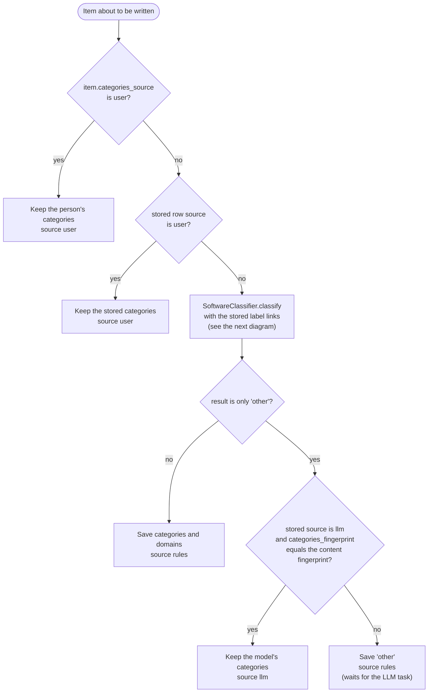
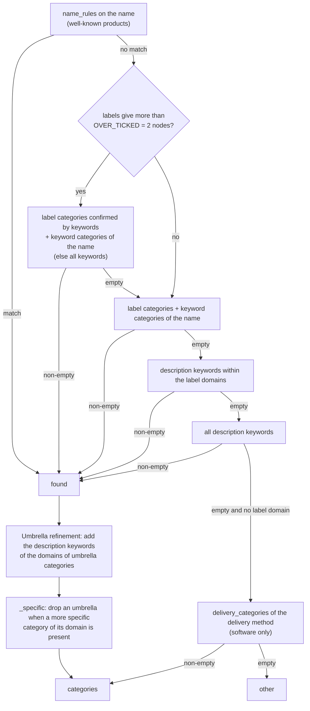
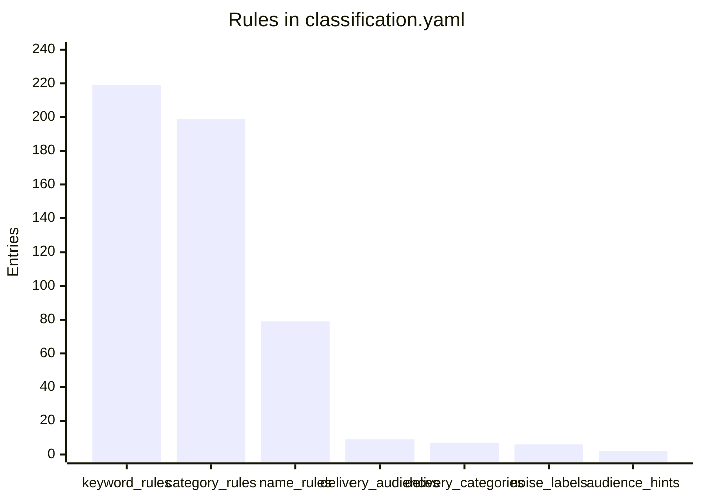
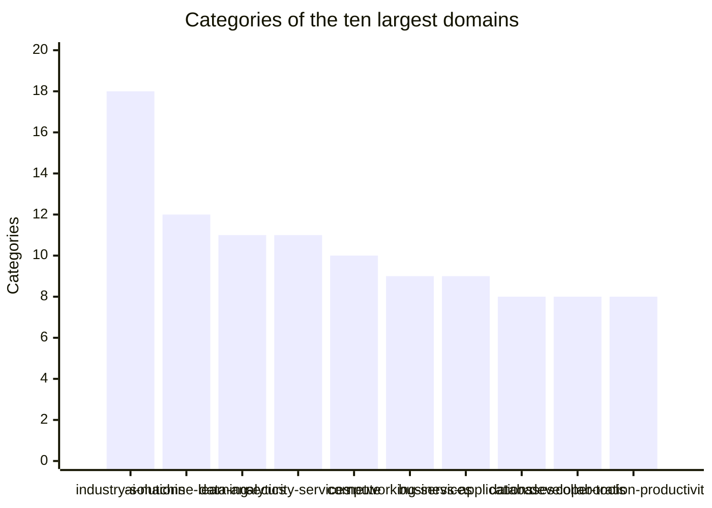
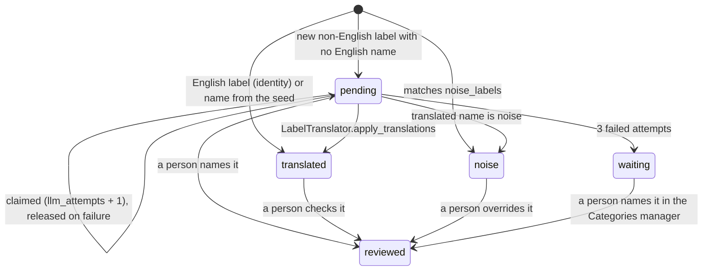
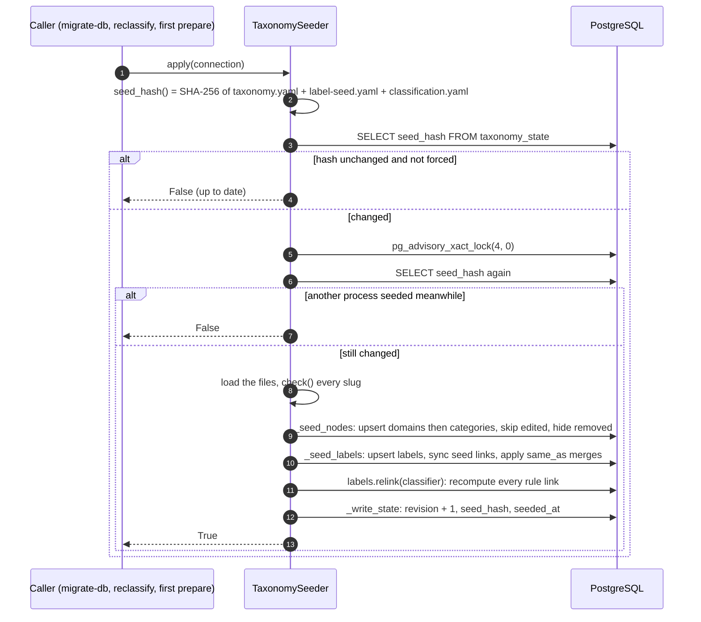

[↑ Docs index](../README.md) · Technical

# 14 — Classification engine

Every catalogue product and marketplace software is filed into one English taxonomy, **Domain › Category**: 29 domains and 195 categories, 224 nodes in all. Each item also gets its audiences (developer tool, end-user software, or both). The engine is made of:
- a pure, regex-based [`SoftwareClassifier`](../../src/classifier/software_classifier.py#L27);
- a store of the providers' own categories (**source labels**), normalized by [`LabelNormalizer`](../../src/taxonomy/label_normalizer.py#L13);
- a database-aware cascade, [`ItemCategorizer`](../../src/storage/repositories/taxonomy/item_categorizer.py#L34), which decides who has the last word: a person, the label links, the rules, or the language model;
- a seeder, [`TaxonomySeeder`](../../src/storage/repositories/taxonomy/taxonomy_seeder.py#L38), which loads the YAML seed idempotently.

## Contents

- [Components](#components)
- [The categorization cascade](#the-categorization-cascade)
- [Inside the rules: SoftwareClassifier](#inside-the-rules-softwareclassifier)
- [Audiences](#audiences)
- [Rule inventory](#rule-inventory)
- [Taxonomy shape](#taxonomy-shape)
- [Source labels](#source-labels)
- [Label normalization key](#label-normalization-key)
- [Label status lifecycle](#label-status-lifecycle)
- [Seeding](#seeding)
- [Recomputing](#recomputing)
- [Who may override what](#who-may-override-what)
- [See also](#see-also)

## Components

| Component | File | Role |
|---|---|---|
| [`SoftwareClassifier`](../../src/classifier/software_classifier.py#L27) | `classifier/software_classifier.py` | Applies [`classification.yaml`](../../src/conf/classification.yaml) to a name, description, labels and delivery. No I/O after loading. |
| [`TaxonomySeedLoader`](../../src/taxonomy/seed_loader.py#L23) | `taxonomy/seed_loader.py` | Loads [`taxonomy.yaml`](../../src/conf/taxonomy/taxonomy.yaml) and [`label-seed.yaml`](../../src/conf/taxonomy/label-seed.yaml). [`check()`](../../src/taxonomy/seed_loader.py#L125) rejects any slug the taxonomy lacks (`UnknownTaxonomySlugError`). |
| [`LabelNormalizer`](../../src/taxonomy/label_normalizer.py#L13) | `taxonomy/label_normalizer.py` | De-duplication key and language of a label. |
| [`ItemCategorizer`](../../src/storage/repositories/taxonomy/item_categorizer.py#L34) | `storage/repositories/taxonomy/` | The cascade: [`prepare`](../../src/storage/repositories/taxonomy/item_categorizer.py#L169), [`categorize`](../../src/storage/repositories/taxonomy/item_categorizer.py#L252), [`recompute`](../../src/storage/repositories/taxonomy/item_categorizer.py#L325). |
| [`LabelRegistry`](../../src/storage/repositories/taxonomy/label_registry.py#L27) | same | In-process cache of the labels by key, with their alias groups. It inserts new labels with `INSERT … ON CONFLICT (key) DO NOTHING`, sorted by key, so parallel crawls never deadlock. |
| [`LabelRepository`](../../src/storage/repositories/taxonomy/label_repository.py#L49) | same | Label CRUD, rule links, sightings, the LLM claims. |
| [`TaxonomyRepository`](../../src/storage/repositories/taxonomy/taxonomy_repository.py#L29) | same | Node CRUD (add, update, hide, move, merge) and the taxonomy revision. |
| [`TaxonomySeeder`](../../src/storage/repositories/taxonomy/taxonomy_seeder.py#L38) | same | Applies the seed files under a lock. |

## The categorization cascade

[`ItemCategorizer.categorize`](../../src/storage/repositories/taxonomy/item_categorizer.py#L252) runs for every item the writer inserts or updates, and for every item a recomputation reads. **The first answer wins:**

Notes on the cascade:
- **Label links** are the stored `label_links`, not the rules. A person or the model may have changed them. A label's group includes its aliases (same English-name key, or merged via `canonical_id`), and a node excluded by any member of the group is dropped.
- **The LLM answer** is written later by [`ItemClassifier`](../../src/llm/tasks/item_classifier.py#L31), through [`apply_llm_categories`](../../src/storage/repositories/item_repository.py#L1111). That method only touches rows still filed under `other` and not set by a person. The answer survives until the item's content (its fingerprint) changes.

## Inside the rules: SoftwareClassifier

[`SoftwareClassifier.classify`](../../src/classifier/software_classifier.py#L305) prepares its inputs, then [`_categories`](../../src/classifier/software_classifier.py#L207) applies its own order of precedence:
1. **Noise labels are dropped.** These are the whole labels matching `noise_labels`.
2. **The label nodes are computed.** They are either the stored links (when `label_nodes` is given) or `category_rules`. They are split into categories (`listed`) and domain-only links (`label_domains`).
3. **The name is stripped of its packaging suffix** ([`_product_name`](../../src/classifier/software_classifier.py#L162)), so "Grafana on Ubuntu 24.04" becomes "Grafana".
4. **`_categories` picks the categories:**

5. **The domains** are those of the categories, plus the domain-only label links.
6. **The audiences** are computed, as described below.

[`classify_product`](../../src/classifier/software_classifier.py#L351) is the entry point the runner uses for catalogue products. It passes `delivery=None` and the catalogue categories as labels, and the runner only keeps the audiences it returns.

Matching details:
- Patterns are case-insensitive Python regexes.
- Short Latin words are wrapped in `(?<![a-z])…(?![a-z])`, because `\b` does not separate Latin from Chinese characters.
- Russian words are matched by their stem (`[а-я]*`).
- [`_normalize`](../../src/classifier/software_classifier.py#L151) turns `-_/>|` into spaces before matching. This is lighter than the label key described below.

## Audiences

[`_audiences`](../../src/classifier/software_classifier.py#L256) and [`classify`](../../src/classifier/software_classifier.py#L305) work in this order:
1. The audiences of every category and label domain, from the taxonomy. A category without its own audiences inherits those of its domain.
2. Plus the `audience_hints` regexes matched on the normalized labels.
3. If nothing is found, a software uses `delivery_audiences[delivery]`, and a product uses `product_audiences` (`[developer-tool]`).

The audience is stored in the `categories` column, as `developer-tool` and/or `end-user-software`. On a normal write the writer keeps the crawler's audience. Only [`recompute`](../../src/storage/repositories/taxonomy/item_categorizer.py#L325) overwrites it.

## Rule inventory

| Key | Matched on | Gives |
|---|---|---|
| `name_rules` (79) | the name, without its packaging suffix | categories of well-known products (e.g. Odoo is an ERP) |
| `category_rules` (199) | a source label | categories or domains: the **rule links** of the labels |
| `keyword_rules` (219) | the name, then the description (en, ru, zh) | categories |
| `delivery_categories` (7) | delivery method | fallback categories (e.g. `virtual-machine` → machine images) |
| `delivery_audiences` (9) | delivery method | fallback audiences (SaaS → end-user, API → developer) |
| `product_audiences` (1) | — | `[developer-tool]` |
| `noise_labels` (6) | a whole label | "not a category" |
| `audience_hints` (2) | the labels | extra audiences |
| `packaging_suffix` (1) | the end of a name | stripped before matching |

## Taxonomy shape

[`taxonomy.yaml`](../../src/conf/taxonomy/taxonomy.yaml) has 29 domains and 195 categories. The `unclassified` domain and its `other` category are hidden, so 28 domains and 194 categories are visible. Each node has `slug`, `en`, `ru`, `zh`, `description`, `audiences`, and `umbrella` (13 umbrella categories, the generic ones of their domains).

## Source labels

A **source label** is a category as a provider writes it, in any language. Each distinct normalized key is stored once in `source_labels`:

| Column | Meaning |
|---|---|
| `key` (unique) | [`LabelNormalizer.key`](../../src/taxonomy/label_normalizer.py#L112) of the text. `Databases`, `DataBases` and `DATABASE` share it. |
| `language` | `zh` for Han characters, `ru` for Cyrillic letters, else `en` ([`language`](../../src/taxonomy/label_normalizer.py#L125)) |
| `name_en`, `name_key` | the English name, and its key. Labels sharing a `name_key` are **aliases** ("Базы данных" counts with "Databases"). |
| `status` | `pending`, `translated`, `reviewed` or `noise` |
| `canonical_id` | an explicit merge into another label (one level only) |
| `name_source`, `status_source`, `canonical_source` | `identity`, `seed`, `llm`, `rule` or `user`: who set each value |
| `llm_claimed_at`, `llm_attempts`, `llm_error` | the LLM claim of the label |

Lifecycle of a label:
1. A crawl batch calls `prepare`, which calls [`LabelRegistry.resolve`](../../src/storage/repositories/taxonomy/label_registry.py#L226).
2. A label never seen before is inserted with its [`rule_status`](../../src/storage/repositories/taxonomy/label_repository.py#L170) and its rule links ([`rule_nodes`](../../src/storage/repositories/taxonomy/label_repository.py#L154)).
3. [`sight`](../../src/storage/repositories/taxonomy/label_repository.py#L211) records in `label_sightings` that the label was seen at this provider.

## Label normalization key

[`LabelNormalizer.key`](../../src/taxonomy/label_normalizer.py#L112) works in four steps:
1. NFKC, then casefold.
2. [`_separate`](../../src/taxonomy/label_normalizer.py#L69) turns punctuation and symbols into spaces, except `+` and `#` attached to a word (C++, C#).
3. The conjunction tokens `and`, `&`, `+` and `и` are dropped.
4. [`_token`](../../src/taxonomy/label_normalizer.py#L88) normalizes each token, and the tokens are joined **without spaces**. For each token:
   - Latin look-alikes become Cyrillic inside Cyrillic words;
   - the Chinese conjunctions `与和及、` are removed;
   - English plurals are stripped from ASCII words longer than 3 letters: `ies` becomes `y`, and a trailing `s` is dropped unless the word ends in `ss`, `us`, `is` or `as`.

| Label | Key |
|---|---|
| `Backup & Recovery` | `backuprecovery` |
| `Databases` / `DataBases` / `DATABASE` | `database` |
| `C++ Tools` | `c++tool` |

## Label status lifecycle

`waiting` is not a stored status. It stands for `pending` with `llm_attempts` = 3: [`claim_pending`](../../src/storage/repositories/taxonomy/label_repository.py#L590) skips those labels, as well as any label claimed less than an hour ago.

## Seeding

[`TaxonomySeeder.apply`](../../src/storage/repositories/taxonomy/taxonomy_seeder.py#L367) is idempotent and safe for concurrent processes:

When the seed is applied:
- after `migrate-db upgrade`, and on `migrate-db seed [--force]`;
- on `CRAWLER_SOURCE=reclassify` ([`refresh_taxonomy`](../../src/crawler/runner.py#L496));
- lazily, on the first `ItemCategorizer.prepare` of each process. A missing `revision` forces it.

A new `taxonomy_state.revision` invalidates the classifier and registry caches of every process at its next `prepare`.

## Recomputing

| Trigger | Scope | Code |
|---|---|---|
| `CRAWLER_SOURCE=reclassify` | seed, recompute the rule links of every label, then every provider's software and products | [`run_source`](../../src/main.py#L152) → [`reclassify_marketplaces`](../../src/crawler/runner.py#L512), [`reclassify_catalogues`](../../src/crawler/runner.py#L531) |
| Taxonomy changed during a crawl | the crawled provider | [`ItemWriter._recategorize`](../../src/storage/writer/item_writer.py#L601) |
| A label translated, linked or merged | the items carrying those labels | [`Storage.recategorize(label_ids=…)`](../../src/storage/storage.py#L140) |
| A node edited, moved or merged | the items under those nodes | `Storage.recategorize(node_slugs=…)` |
| GUI: "Recompute the categories" | everything | the Taxonomy menu |

[`recompute`](../../src/storage/repositories/taxonomy/item_categorizer.py#L325):
- reads pages of `RECOMPUTE_PAGE = 2000` items in id order, under the dataset's transaction lock;
- resolves their labels again, runs `categorize`, and writes only the rows that differ.

The datasets being crawled are skipped, and are categorized again once their crawl is over. A full reclassification of about 110,000 software takes about 5 minutes and should be followed by `VACUUM (ANALYZE) software, products`.

## Who may override what

| Object | Set by person | Never overwritten by |
|---|---|---|
| Item categories | `categories_source = user` | rules, seed, LLM |
| Label English name and status | `name_source` / `status_source = user` | seed, LLM |
| Label → node link | `label_links.source = user`, or `excluded = true` | rule recomputation, seed, LLM (`ON CONFLICT DO NOTHING`) |
| Label merge | `canonical_source = user` | seed |
| Taxonomy node | `edited = true` | seed (a removed seed node is hidden, never deleted) |

## See also

- [04 — Categories](../functional/04-categories.md): the user's view of the taxonomy.
- [15 — LLM layer](15-llm-layer.md): the translation and classification tasks.
- [13 — Storage](13-storage.md): the taxonomy tables in the ER diagram.

[← Previous](13-storage.md) · [Next →](15-llm-layer.md)
