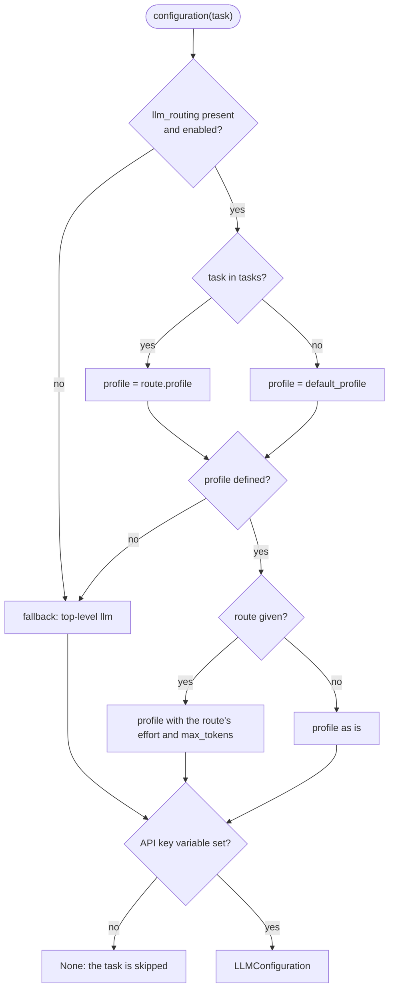
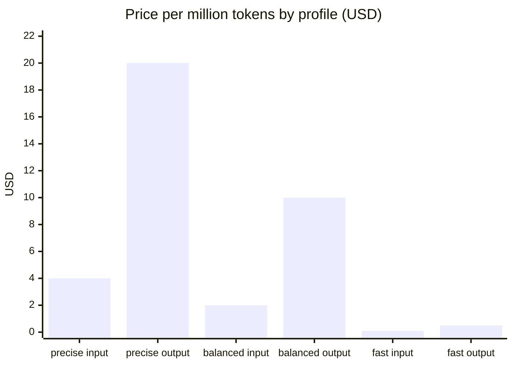
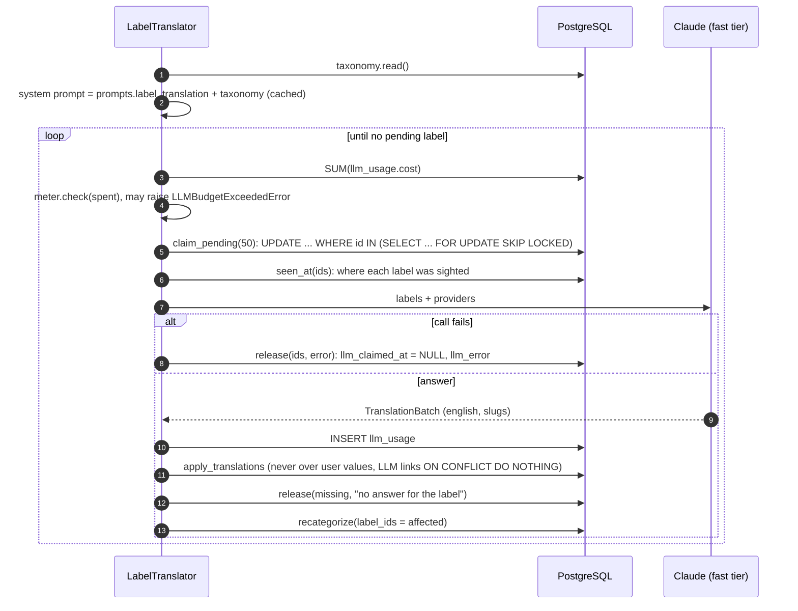
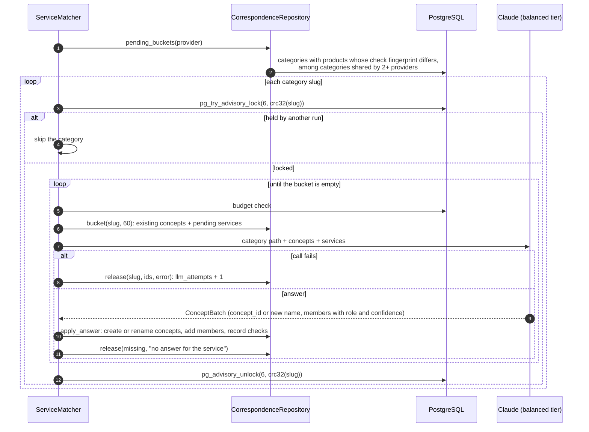

[↑ Docs index](../README.md) · Technical

# 15 — LLM layer

The language model is **optional**: when the variable named by `api_key` is unset, nothing is sent and every feature still works without it. When it is set, three tasks fill the gaps the rules leave:
- **label translation**: pending foreign source labels get an English name and taxonomy links;
- **item classification**: items left under `other` are filed;
- **service correspondence**: equivalent catalogue services of different providers are grouped into concepts.

The layer is plain [LangChain](https://python.langchain.com/) (`ChatAnthropic`, `ChatOpenAI`) with structured outputs. Each task has a routed model tier, and a spending ceiling is enforced from the `llm_usage` table. There is no tracing back-end.

## Contents

- [Components](#components)
- [Settings and routing](#settings-and-routing)
- [Model tiers and prices](#model-tiers-and-prices)
- [Building the chat model](#building-the-chat-model)
- [Cost metering and budget](#cost-metering-and-budget)
- [The three tasks](#the-three-tasks)
- [Label translation](#label-translation)
- [Item classification](#item-classification)
- [Service correspondence](#service-correspondence)
- [When the tasks run](#when-the-tasks-run)
- [Failure handling](#failure-handling)
- [See also](#see-also)

## Components

| Component | File | Role |
|---|---|---|
| [`LLMSettingsLoader`](../../src/llm/settings_loader.py#L19) | `llm/settings_loader.py` | Reads [`conf/llm.yaml`](../../src/conf/llm.yaml), or `$CRAWLER_LLM_CONFIG`. A missing file gives empty settings. |
| [`LLMSettings`](../../src/models/configuration/llm/llm_settings.py#L16) | `models/configuration/llm/` | `llm`, `llm_routing`, `llm_budget`, `batch_size` (1–200, default 50), `after_crawl` |
| [`LLMRoutingConfig`](../../src/models/configuration/llm/routing/llm_routing_config.py#L16) | `models/configuration/llm/routing/` | profiles, default profile, task routes, [`resolve()`](../../src/models/configuration/llm/routing/llm_routing_config.py#L67) |
| [`LLMConfiguration`](../../src/models/configuration/llm/model/llm_configuration.py#L15) | `models/configuration/llm/model/` | provider, model, key (a `SecretStr` read from the named variable), limits, prices |
| [`ChatModelFactory`](../../src/llm/chat_model_factory.py#L23) | `llm/chat_model_factory.py` | builds the LangChain chat model, structured output, cached system prompt |
| [`UsageMeter`](../../src/llm/usage_meter.py#L16) | `llm/usage_meter.py` | token counts, cost, budget check |
| [`LabelTranslator`](../../src/llm/tasks/label_translator.py#L27) | `llm/tasks/` | task `label_translation` |
| [`ItemClassifier`](../../src/llm/tasks/item_classifier.py#L31) | `llm/tasks/` | task `item_classification` |
| [`ServiceMatcher`](../../src/llm/tasks/correspondence/service_matcher.py#L28) | `llm/tasks/correspondence/` | task `service_correspondence` |
| [`TaxonomyPrompt`](../../src/llm/tasks/taxonomy_prompt.py#L25), [`CorrespondencePrompt`](../../src/llm/tasks/correspondence/correspondence_prompt.py#L19) | prompts | system prompts from [`prompts.yaml`](../../src/conf/taxonomy/prompts.yaml), plus the user messages of each batch |
| [`LlmUsageRepository`](../../src/storage/repositories/llm/llm_usage_repository.py#L19) | storage | `record` and `spent` |

## Settings and routing

[`LLMSettings.configuration(task)`](../../src/models/configuration/llm/llm_settings.py#L44) returns the model of a task, or `None` when no model is configured or its key is unset:



Validation at load time:
- a route naming an unknown profile raises `UnknownLLMProfileError`;
- `api_key` must be the *name* of a variable, never the key itself.

## Model tiers and prices

The tiers of [`llm.yaml`](../../src/conf/llm.yaml), with their list prices in USD per million tokens:

| Profile | Model | Input | Output | Used by |
|---|---|---|---|---|
| `precise` | `claude-opus-5-5` | 4.00 | 20.00 | — (available) |
| `balanced` (default) | `claude-sonnet-5-5` | 2.00 | 10.00 | `item_classification` (effort low), `service_correspondence` (effort medium) |
| `fast` | `claude-haiku-5-5` | 0.10 | 0.50 | `label_translation` (effort low) |



Cache reads cost `cache_read_rate_per_million`, which defaults to a tenth of the input rate. See the [Claude models overview](https://docs.anthropic.com/en/docs/about-claude/models) and [pricing](https://www.anthropic.com/pricing).

## Building the chat model

[`ChatModelFactory.make(cfg)`](../../src/llm/chat_model_factory.py#L116):

| Provider | Model rule | Parameters sent |
|---|---|---|
| `anthropic` ([`_anthropic`](../../src/llm/chat_model_factory.py#L64)) | name starts with one of `ADAPTIVE_PREFIXES` (`claude-fable-`, `claude-mythos-`, `claude-opus-5`, `claude-sonnet-5`, `claude-haiku-5`, `claude-opus-4-7`, `claude-opus-4-8`) | `effort`, never `temperature` (the current models reject it with a 400) |
| `anthropic` | older models | `temperature`. `effort` is ignored with a warning. |
| `openai` ([`_openai`](../../src/llm/chat_model_factory.py#L87)) | `o*` and `gpt-5*` | `reasoning_effort`, with `xhigh` and `max` clamped to `high`. Parallel tool calls are disabled. |

Structured answers come from [`structured(cfg, schema)`](../../src/llm/chat_model_factory.py#L138), which calls `.with_structured_output(schema, method=…, include_raw=True)`:
- `method="json_schema"` for Anthropic. Claude [structured outputs](https://docs.anthropic.com/en/docs/build-with-claude/structured-outputs) are used, because the current models refuse forced tool use.
- `method="function_calling"` for OpenAI.
- The result is `{raw, parsed, parsing_error}`. The task reads `usage_metadata` from `raw`, and raises `LLMResponseError` when `parsed` is not the expected schema.

The system prompt is made by [`system_message`](../../src/llm/chat_model_factory.py#L155):
- For Anthropic it carries `cache_control: {"type": "ephemeral"}` ([prompt caching](https://docs.anthropic.com/en/docs/build-with-claude/prompt-caching)).
- The taxonomy (every slug with its English name and description) is appended to the translation and classification prompts. Those prompts are therefore identical from one call to the next, and only the batch changes.

## Cost metering and budget

[`UsageMeter.cost`](../../src/llm/usage_meter.py#L70):

```text
cost = ( uncached_input × input_rate
       + cache_write    × input_rate × 1.25
       + cache_read     × cache_read_rate
       + output         × output_rate ) / 1,000,000
```

- [`tokens`](../../src/llm/usage_meter.py#L50) reads `input_tokens`, `output_tokens` and `input_token_details.cache_read` / `cache_creation`. The uncached input is the total minus the cache reads and writes.
- Every call is recorded in `llm_usage`: task, provider, model, the 4 token counts, cost, currency and timestamp.
- **Before every batch**, [`check(spent)`](../../src/llm/usage_meter.py#L90) compares the sum of `llm_usage.cost` in the budget currency with `llm_budget.ceiling` (10 USD by default):
  - with `enforce: true`, it raises `LLMBudgetExceededError`, which stops the task (what was done so far is kept);
  - with `enforce: false`, it only warns.

## The three tasks

| Task | Class | Batch source | Concurrency control | Answer schema |
|---|---|---|---|---|
| `label_translation` | [`LabelTranslator`](../../src/llm/tasks/label_translator.py#L27) | [`claim_pending(batch_size)`](../../src/storage/repositories/taxonomy/label_repository.py#L590) | `FOR UPDATE SKIP LOCKED` row claims | [`TranslationBatch`](../../src/models/taxonomy/llm/translation_batch.py) / [`LabelTranslation`](../../src/models/taxonomy/llm/label_translation.py) |
| `item_classification` | [`ItemClassifier`](../../src/llm/tasks/item_classifier.py#L31) | [`unclassified_batch(batch_size, after_id, provider)`](../../src/storage/repositories/item_repository.py#L1080): items under `other`, keyset-paged by id, products then software | a guarded update (`'other' = ANY(service_categories)` and not set by a person) | [`CategorizationBatch`](../../src/models/taxonomy/llm/categorization_batch.py) / [`ItemCategorization`](../../src/models/taxonomy/llm/item_categorization.py) |
| `service_correspondence` | [`ServiceMatcher`](../../src/llm/tasks/correspondence/service_matcher.py#L28) | [`pending_buckets(provider)`](../../src/storage/repositories/correspondence/correspondence_repository.py#L573), then [`bucket(slug, 60)`](../../src/storage/repositories/correspondence/correspondence_repository.py#L600) | session advisory lock `(6, crc32(slug))` per category | [`ConceptBatch`](../../src/models/correspondence/llm/concept_batch.py) / [`ConceptAnswer`](../../src/models/correspondence/llm/concept_answer.py) / [`MemberAnswer`](../../src/models/correspondence/llm/member_answer.py) |

Each task follows the same `_call` pattern:
1. `structured(cfg, Schema).ainvoke([system, human])`;
2. price the call and record it;
3. check the parsed answer.

The errors caught per batch (`CALL_ERRORS`) are `anthropic.APIError`, `openai.APIError`, `LangChainException`, Pydantic `ValidationError` and `LLMResponseError`.

## Label translation



Claimable labels are those with:
- `status = 'pending'`;
- `llm_attempts < 3`;
- `llm_claimed_at` unset or more than **1 hour** old.

A claim sets `llm_claimed_at = now()` and increments `llm_attempts`. After 3 failed attempts the label waits for a person in the Categories manager. Only slugs of visible taxonomy nodes are kept from an answer.

## Item classification

[`ItemClassifier.run(provider)`](../../src/llm/tasks/item_classifier.py#L184) pages the items filed under `other`, first the catalogue products and then the marketplace software:
- Each item is sent with its id, provider, name, description (cut to 600 characters, `TaxonomyPrompt.DESCRIPTION_LIMIT`) and labels.
- [`_categories`](../../src/llm/tasks/item_classifier.py#L116) keeps the answered slugs that are existing categories other than `other`, and derives their domains.
- [`apply_llm_categories`](../../src/storage/repositories/item_repository.py#L1111) writes `categories_source = 'llm'` and `categories_fingerprint = fingerprint`. The [cascade](14-classification-engine.md) keeps that answer until the content changes.
- A failed batch is skipped (`continue`), and there is **no attempt counter**: the next run sends the same items again.

## Service correspondence



Rules of the matcher:
- **Pending services** are listed products whose `correspondence_checks.fingerprint` differs from their current `products.fingerprint`. This covers new products, changed products, and products moved to another category.
  - Products are bucketed by category, or by domain when they have no category.
  - Only categories holding services of 2 or more providers are matched.
  - A product with 3 failed attempts waits until its content changes, which resets the counter.
- **People win:**
  - the model only **adds** members;
  - members a person added or excluded (`excluded = true`) are kept, and an excluded service is never filed there again;
  - a concept a person `edited` is never renamed.
- **Answer shape:** each concept either reuses an existing `concept_id` or gives a new name and description. Each member has a `role` (`equivalent` or `partial`) and a `confidence` from 0 to 100.

## When the tasks run

| Trigger | Tasks | Scope |
|---|---|---|
| After a catalogue crawl ([`_after_crawl`](../../src/crawler/runner.py#L305), if `after_crawl: true`) | translation → classification → correspondence | every pending label, then the crawled provider's items and services |
| After a marketplace crawl | translation → classification | every pending label, then the provider's items |
| `CRAWLER_SOURCE=translate` | translation → classification → correspondence | everything |
| `CRAWLER_SOURCE=correspond` | correspondence | every category |
| GUI, Categories manager: "Translate pending labels", "Classify unclassified items" | one task | everything, on the storage thread |
| GUI, Correspondences tab or Taxonomy menu: "Match with AI" | correspondence | every category, or one |

The GUI buttons are shown only when a key is set, along with what has been spent of the budget.

## Failure handling

| Situation | Effect |
|---|---|
| No API key | `configuration()` returns `None`. The task logs at INFO and returns 0. Labels stay `pending` and items stay `other`. |
| Budget reached | `LLMBudgetExceededError`. `_after_crawl` logs a warning and the crawl stays successful. `main` logs "The language model tasks stopped". |
| Call or parsing error | The batch is released with its error. Labels and services are retried by a later run, up to 3 attempts. Items are retried on every run. |
| Partial answer | Unanswered ids are released with "no answer for …". |
| Concurrent runs | Labels: `SKIP LOCKED`. Services: one run per category (advisory lock). Items: guarded updates. |

## See also

- [05 — AI features](../functional/05-ai-features.md) and [06 — Service correspondences](../functional/06-service-correspondences.md): the user's view.
- [14 — Classification engine](14-classification-engine.md): the cascade that keeps the model's answers.
- [11 — Configuration](11-configuration.md): every field of `llm.yaml`.
- [LangChain structured output](https://python.langchain.com/docs/concepts/structured_outputs/) and the [Claude API documentation](https://docs.anthropic.com/).

[← Previous](14-classification-engine.md) · [Next →](16-analytics.md)
