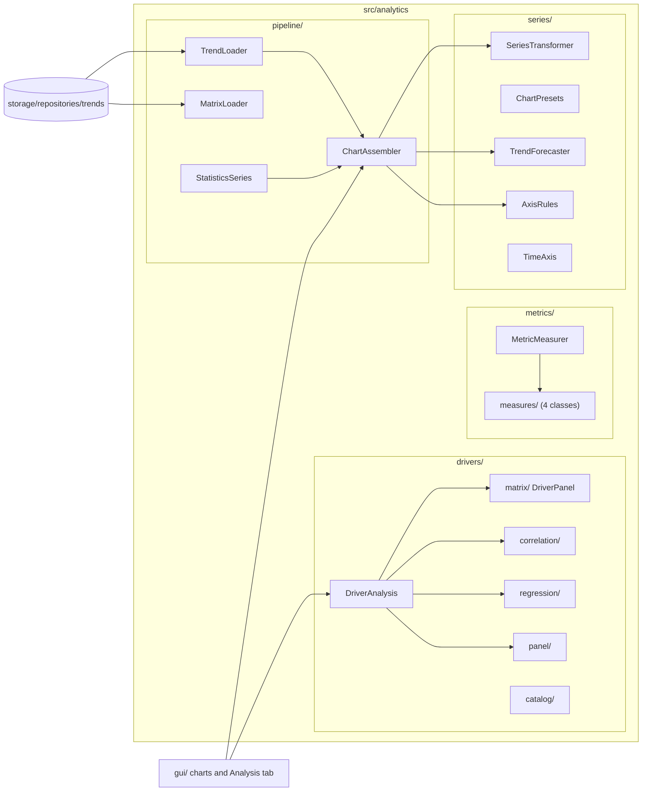
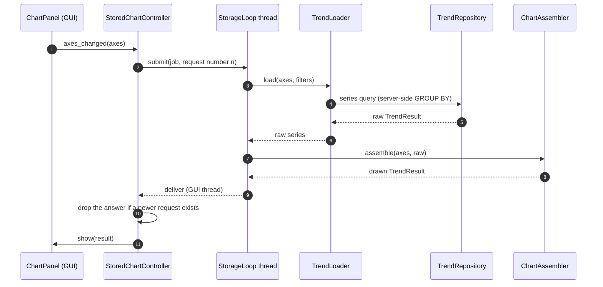
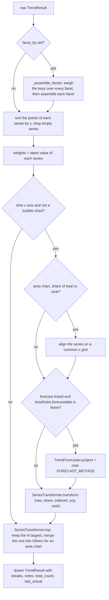
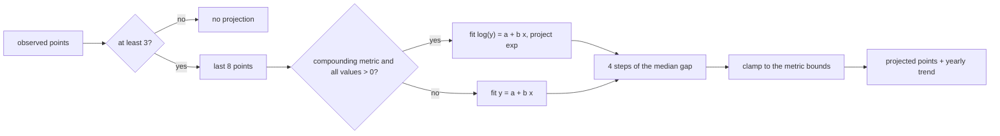
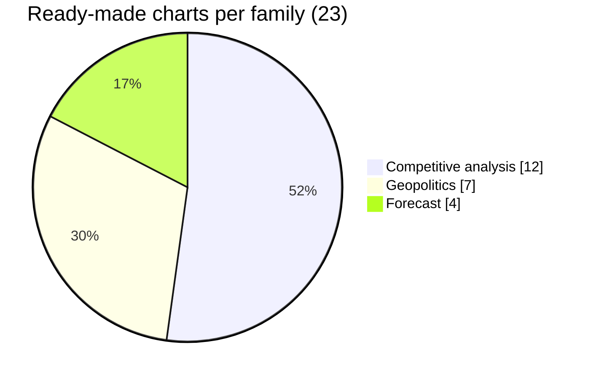
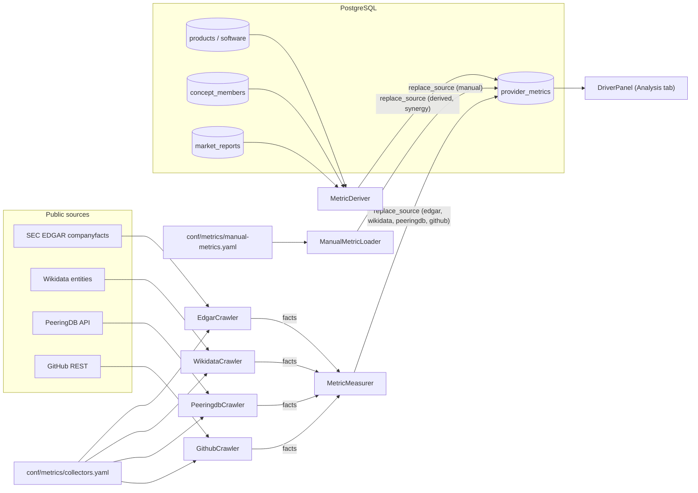
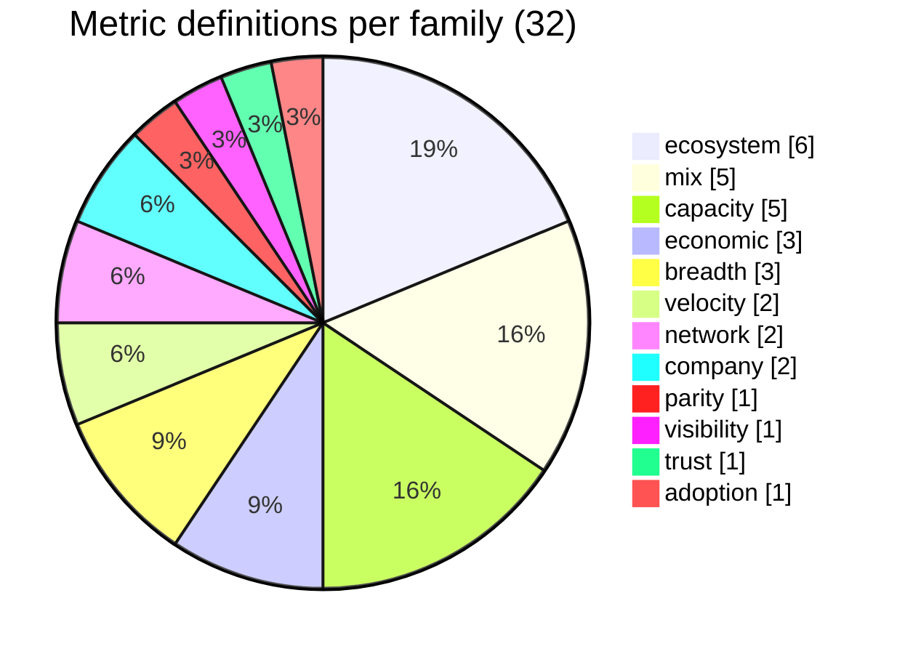
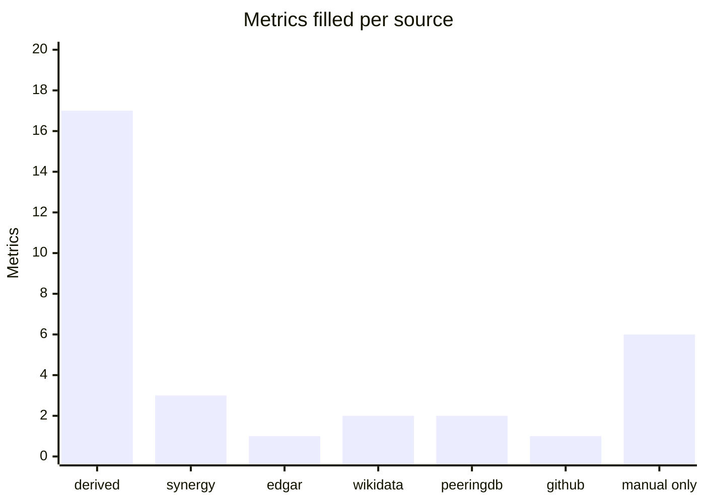
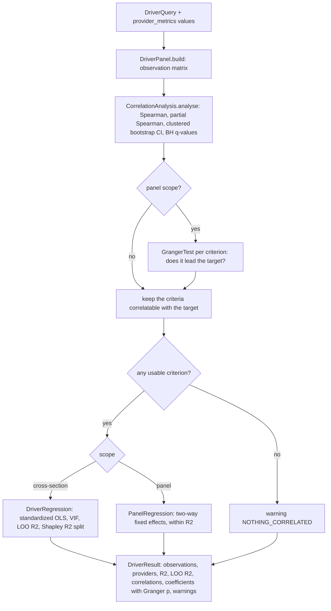

[↑ Docs index](../README.md) · Technical

# 16 — Analytics: chart series, forecasts, metrics and rise drivers

`src/analytics/` holds every computation the GUI shows, kept apart from the widgets so that it can be tested
without Qt. It has four parts:
- **The chart pipeline** turns the raw series read by the repositories into the series a chart draws: alignment,
  forecast, transforms and top-N selection.
- **The axis rules and presets** keep a configurable chart from being configured into nonsense.
- **The metrics pipeline** turns crawled facts (SEC EDGAR, Wikidata, PeeringDB, GitHub), the stored datasets and the
  hand-typed values into one table of provider measures per quarter.
- **The driver analysis** ranks the criteria that weigh most in the rise of a provider: rank correlations, bootstrap
  intervals, multiple-testing control, regression, Shapley importance and Granger tests.

The method behind the driver analysis, its targets, its criteria and its first findings are in
[analysis/rise-drivers.md](../analysis/rise-drivers.md). This chapter documents the code.

## Contents

- [Package map](#package-map)
- [Chart pipeline](#chart-pipeline)
  - [Loaders](#loaders)
  - [ChartAssembler](#chartassembler)
  - [SeriesTransformer](#seriestransformer)
  - [TrendForecaster](#trendforecaster)
  - [TimeAxis](#timeaxis)
- [Axis rules and presets](#axis-rules-and-presets)
- [Metrics pipeline](#metrics-pipeline)
  - [Metric definitions](#metric-definitions)
  - [Sources of the measures](#sources-of-the-measures)
  - [Collectors](#collectors)
  - [Measures computed from the facts](#measures-computed-from-the-facts)
  - [Measures derived from the stored data](#measures-derived-from-the-stored-data)
- [Driver analysis](#driver-analysis)
  - [Pipeline of DriverAnalysis.run](#pipeline-of-driveranalysisrun)
  - [Building the observations](#building-the-observations)
  - [Statistical methods](#statistical-methods)
  - [Warnings](#warnings)
- [Errors and logging](#errors-and-logging)
- [See also](#see-also)

## Package map

| Subpackage | Classes | Role |
|---|---|---|
| [`pipeline/`](../../src/analytics/pipeline/) | [`TrendLoader`](../../src/analytics/pipeline/trend_loader.py#L26), [`MatrixLoader`](../../src/analytics/pipeline/matrix_loader.py#L17), [`StatisticsSeries`](../../src/analytics/pipeline/statistics_series.py#L22), [`ChartAssembler`](../../src/analytics/pipeline/chart_assembler.py#L17) | Read the raw series and matrices, assemble what a chart draws |
| [`series/`](../../src/analytics/series/) | [`AxisRules`](../../src/analytics/series/axis_rules.py#L26), [`ChartPresets`](../../src/analytics/series/chart_presets.py#L21), [`SeriesTransformer`](../../src/analytics/series/series_transformer.py#L18), [`TrendForecaster`](../../src/analytics/series/trend_forecaster.py#L16), [`TimeAxis`](../../src/analytics/series/time_axis.py#L15) | Rules of the axes, ready-made charts, transforms, forecast, time arithmetic |
| [`metrics/`](../../src/analytics/metrics/) | [`MetricMeasurer`](../../src/analytics/metrics/metric_measurer.py#L24) and four measure classes | Turn crawled facts into provider measures |
| [`drivers/`](../../src/analytics/drivers/) | [`DriverAnalysis`](../../src/analytics/drivers/driver_analysis.py#L28) and 15 helper classes | The "Rise drivers" statistics |

The SQL queries feeding the charts live in
[`src/storage/repositories/trends/`](../../src/storage/repositories/trends/): [`TrendRepository`](../../src/storage/repositories/trends/trend_repository.py#L30),
[`MatrixRepository`](../../src/storage/repositories/trends/matrix_repository.py#L28) and
[`CrawlRepository`](../../src/storage/repositories/trends/crawl_repository.py#L22). The analytics package never
opens a connection itself.

## Chart pipeline

A configurable chart is described by its `ChartAxes` (kind, x, y, size, grouping, facet, transform, top, forecast).
The pipeline runs in the GUI's storage thread for stored data, or locally for the market statistics.

### Loaders

| Class | Reads | Notes |
|---|---|---|
| [`TrendLoader`](../../src/analytics/pipeline/trend_loader.py#L26) | Series of the stored items (added, deleted, listed per bucket), of the crawl records, of the marketplace publishers and of the provider metrics | Uses `TrendRepository` and `CrawlRepository`. Items with no published date are dated by the crawl that first found them, and a chart note says so. |
| [`MatrixLoader`](../../src/analytics/pipeline/matrix_loader.py#L17) | Heatmap and mix cells | Uses `MatrixRepository.cells` and `publisher_overlap`. |
| [`StatisticsSeries`](../../src/analytics/pipeline/statistics_series.py#L22) | Series of the Synergy market reports | Works on the `MarketReport`s already loaded by the Statistics tab, with no storage access. It computes revenue (share × market size), bloc shares, and the remainder as "Others". |

### ChartAssembler

[`ChartAssembler.assemble`](../../src/analytics/pipeline/chart_assembler.py#L155) dispatches to a faceted path
(small multiples, one sub-result per facet with shared series keys and colours) or to the single-chart path
[`_assemble_series`](../../src/analytics/pipeline/chart_assembler.py#L59):

The methodology breaks (Synergy's Q3 2024 reclassification) are only kept on time charts. `last_actual` is the x
of the latest observed point, which the GUI uses to draw the "forecast" separator.

### SeriesTransformer

[`SeriesTransformer`](../../src/analytics/series/series_transformer.py#L18) implements the value transforms of
`ValueTransform` (`src/models/trends/enums.py`):

| Transform | Meaning |
|---|---|
| `raw` | The values as computed. |
| `share-of-total` | Each series as a percentage of the sum of the series at each x (needs aligned series). |
| `indexed` | Each series divided by its first non-zero value, times 100. |
| `yoy` | Change over 12 months, in percent. |
| `rank` | The rank of each series at each x (a bump chart). |

It also provides `weights`, `align`, `top`, `pair` (one point per provider and period for bubble charts: x metric
against y metric) and `snapshot` (the latest value of each series).

### TrendForecaster

[`TrendForecaster`](../../src/analytics/series/trend_forecaster.py#L16) gives a trend, not a prediction:

| Constant | Value | Meaning |
|---|---|---|
| `WINDOW` | 8 | The latest observed points fitted. |
| `HORIZON` | 4 | Projected steps. |
| `MINIMUM` | 3 | Fewer observed points: no projection. |

- **Step.** The median gap between the fitted points, 3 months by default.
- **Model.** An [ordinary least-squares](https://en.wikipedia.org/wiki/Ordinary_least_squares) line. For the
  compounding metrics (`COMPOUNDING_METRICS`: revenue, market size, twelve-month size, listed, catalogue size,
  marketplace size, publishers) and all-positive values, the line is fitted on the logarithm, i.e. a constant growth
  rate. Otherwise it is linear.
- **Bounds.** Projected values are clamped to the metric's bounds (a share stays between 0 and 100).
- **Legend.** The yearly trend is reported in % per year. The projected points carry `projected = true` and are
  drawn dashed.

### TimeAxis

[`TimeAxis`](../../src/analytics/series/time_axis.py#L15) puts every period on a month ordinal
(`year × 12 + month − 1`). A quarter, half-year or year is placed on its last month, so that Synergy quarters,
crawl dates and item dates share one axis. Its buckets are year, quarter, month, report period, publication date and
crawl date.

## Axis rules and presets

[`AxisRules`](../../src/analytics/series/axis_rules.py#L26) (about 570 lines) says, for each chart scope
(statistics, catalogue, marketplace, analysis), which kinds, metrics, groupings, transforms and facets are valid
together. Every blocked option gets an `OptionBlock` reason, shown as the tooltip of the disabled option:

| `OptionBlock` | Why the option is disabled |
|---|---|
| `same-as-x` | The y metric equals the x metric. |
| `needs-time-axis` | An area chart, a forecast or a yoy transform needs time on x. |
| `needs-numeric-axis` | A bubble chart needs a metric on x. |
| `needs-calendar-axis` | Years, quarters or months are required (not report periods). |
| `not-additive` | Shares cannot be stacked or summed. |
| `not-per-grouping` | The metric is not known per this grouping (e.g. the market share per delivery method). |
| `not-from-crawls` | The metric does not come from crawl records. |
| `same-as-rows` | Heatmap columns equal its rows. |
| `needs-providers` | The option needs a per-provider grouping. |
| `no-catalogues`, `no-marketplaces`, `no-statistics` | The dataset is empty. |
| `same-as-series` | The facet equals the series grouping. |

`repair()` brings an invalid saved configuration back to the nearest valid one, and `is_valid()` checks one.

[`ChartPresets`](../../src/analytics/series/chart_presets.py#L21) holds the ready-made charts of the "Views" menu,
23 presets in 3 families:

Examples: `share-race`, `rank-race`, `share-vs-listings`, `publisher-overlap` (competitive), `market-size-outlook`,
`revenue-outlook`, `catalogue-growth` (forecast), `bloc-market-share`, `catalogue-blocs`, `domain-mix-by-bloc`
(geopolitics). The Analysis tab places six of them side by side; see
[18-gui-architecture.md](18-gui-architecture.md).

## Metrics pipeline

`CRAWLER_SOURCE=metrics` (see [11-configuration.md](11-configuration.md)) runs
[`collect_metrics`](../../src/main.py#L116), which fills `provider_metrics` (one value per provider, quarter, metric
and source; see [13-storage.md](13-storage.md)).

Order of a run:
1. [`Storage.refresh_metrics`](../../src/storage/storage.py#L166) runs
   [`MetricDeriver`](../../src/storage/repositories/metrics/metric_deriver.py#L26) and
   [`ManualMetricLoader`](../../src/storage/repositories/metrics/manual_metric_loader.py#L20). The GUI also runs it
   before an analysis when a dataset was written since.
2. [`CatalogueRunner.crawl_metrics`](../../src/crawler/runner.py#L585) streams the facts of the four metrics
   crawlers, one source after the other.
3. [`MetricMeasurer.measure`](../../src/analytics/metrics/metric_measurer.py#L77) turns the facts of a source into
   measures.
4. [`ProviderMetricRepository.replace_source`](../../src/storage/repositories/metrics/provider_metric_repository.py#L98)
   replaces the stored values of that source. A source yielding nothing is skipped and its stored values are kept.

### Metric definitions

[`src/conf/metrics/metrics.yaml`](../../src/conf/metrics/metrics.yaml) defines 32 metrics in 12 families (read by
[`MetricCatalogLoader`](../../src/analytics/drivers/catalog/metric_catalog_loader.py#L18)). Each one has a label, a
family, a scale (`count` analysed as log(1 + x), `amount` as log x, `share` as is), a unit, its sources, and whether
it can be a target (8 can).

| Family | Metrics (✓ = can be a target) |
|---|---|
| economic | market-share ✓, revenue ✓, cloud-revenue ✓ |
| breadth | products ✓, domains, categories |
| mix | ai-share, data-share, security-share, compute-share, developer-share |
| velocity | launches ✓, deletions |
| ecosystem | marketplace-size ✓, publishers ✓, new-listings ✓, saas-share, vm-share, ai-model-share |
| parity | parity |
| visibility | mentions |
| capacity | capex, regions, availability-zones, countries-served, gpu-clusters |
| network | network-exchanges, facilities |
| trust | certifications |
| adoption | sdk-stars |
| company | employees, age |

[`drivers-help.yaml`](../../src/conf/metrics/drivers-help.yaml) holds the help texts of the Analysis tab (roles,
warnings, table columns), read by
[`DriverHelpLoader`](../../src/analytics/drivers/catalog/driver_help_loader.py#L19).

### Sources of the measures

`MetricSource` (`src/models/drivers/enums.py`) has seven values. The number of metrics each source fills today:

- **derived** (17): computed from the crawled products, software and concept members.
- **synergy** (3): market-share, revenue and mentions, from the stored Synergy reports.
- **edgar** (1): capex. **wikidata** (2): age, employees. **peeringdb** (2): network-exchanges, facilities.
  **github** (1): sdk-stars.
- **manual only** (6): cloud-revenue, regions, availability-zones, countries-served, gpu-clusters and
  certifications have no collector. Their values go in
  [`manual-metrics.yaml`](../../src/conf/metrics/manual-metrics.yaml) with their source URL (the file holds no
  values yet).

When several sources measure the same metric, the driver panel prefers MANUAL, then EDGAR, SYNERGY, WIKIDATA,
PEERINGDB, GITHUB and DERIVED.

### Collectors

[`src/conf/metrics/collectors.yaml`](../../src/conf/metrics/collectors.yaml) (read by
[`CollectorCatalogLoader`](../../src/crawler/metrics/catalog_loader.py#L18)) says where each of its 29 providers is
found: SEC CIK, Wikidata item, autonomous systems, GitHub repositories (mostly the Terraform providers). It names the
environment variables holding secrets, never the secrets themselves.

| Crawler | Endpoint | Facts | Variable |
|---|---|---|---|
| [`EdgarCrawler`](../../src/crawler/metrics/edgar/crawler.py#L17) | [SEC EDGAR XBRL companyfacts](https://www.sec.gov/search-filings/edgar-application-programming-interfaces) `data.sec.gov/api/xbrl/companyfacts/CIK{cik}.json` | capex concepts (`PaymentsToAcquirePropertyPlantAndEquipment`, then `PaymentsToAcquireProductiveAssets`) | `CRAWLER_SEC_USER_AGENT` (SEC requires a contact) |
| [`WikidataCrawler`](../../src/crawler/metrics/wikidata/crawler.py#L19) | [Wikidata](https://www.wikidata.org/wiki/Wikidata:Data_access) `Special:EntityData/{Q}.json` | inception (P571), employees (P1128) at their point in time (P585) | — |
| [`PeeringdbCrawler`](../../src/crawler/metrics/peeringdb/crawler.py#L18) | [PeeringDB API](https://www.peeringdb.com/apidocs/) `api/net?asn__in=…&depth=2` | exchanges and facilities of the networks | `PEERINGDB_API_KEY` (anonymous queries are throttled) |
| [`GithubCrawler`](../../src/crawler/metrics/github/crawler.py#L18) | [GitHub REST](https://docs.github.com/en/rest/repos/repos#get-a-repository) `api.github.com/repos/{owner}/{name}` | stars | `GITHUB_TOKEN` (60 requests an hour without) |

They are built on [`BaseMetricsCrawler`](../../src/crawler/metrics/base.py#L32), itself a `BaseCloudCrawler`, so
they obey `robots.txt` like every crawler (see [12-crawler-framework.md](12-crawler-framework.md)). Wikidata's
SPARQL endpoint is disallowed by its `robots.txt`, which is why the entity JSON is read instead. The crawlers only
stream the facts as the sources state them; every computation is in `analytics/metrics/`.

### Measures computed from the facts

[`MetricMeasurer`](../../src/analytics/metrics/metric_measurer.py#L24) dispatches each source to one class of
[`measures/`](../../src/analytics/metrics/measures/):

| Class | Source | Computation |
|---|---|---|
| [`CapexQuarters`](../../src/analytics/metrics/measures/capex_quarters.py#L18) | edgar | Turns year-to-date filings into quarters by differencing, keeping only facts spanning 80 to 100 days for a single quarter. Follows the concept fallback order of `collectors.yaml`. |
| [`CompanyMeasures`](../../src/analytics/metrics/measures/company_measures.py#L15) | wikidata | Age from the inception date, employees at their date. |
| [`NetworkMeasures`](../../src/analytics/metrics/measures/network_measures.py#L15) | peeringdb | Distinct exchanges and facilities, deduplicated across the provider's ASNs. |
| [`AdoptionMeasures`](../../src/analytics/metrics/measures/adoption_measures.py#L15) | github | Sum of the stars of the provider's repositories. |

### Measures derived from the stored data

[`MetricDeriver`](../../src/storage/repositories/metrics/metric_deriver.py#L26) computes the derived measures in SQL:
- **Snapshot measures** (put on the quarter of the computation): products, domains, categories (the `other` and
  `unclassified` nodes ignored), the catalogue shares (AI = `ai-machine-learning`, data = `databases` +
  `data-analytics`, security = `security-services` + `identity-access`, compute = `compute` +
  `containers-kubernetes`), the developer share, marketplace size, publishers, the delivery shares (SaaS, VM, AI
  model) and parity (share of the products with an equivalent at AWS, Azure or Google Cloud, once the AI matched the
  services; see [15-llm-layer.md](15-llm-layer.md)).
- **Dated measures** (put on the quarter of their dates): launches, deletions and new listings.
- **Synergy measures:** market share and revenue from the worldwide cloud infrastructure reports, and mentions (the
  number of articles of the quarter naming the provider).

## Driver analysis

The Analysis tab's "Rise drivers" section calls [`DriverAnalysis.run`](../../src/analytics/drivers/driver_analysis.py#L195)
off the GUI thread (`asyncio.to_thread`, see [`DriversPanel`](../../src/gui/analysis/drivers/drivers_panel.py#L55)).
A `DriverQuery` (`src/models/drivers/query/`) names the target, the criteria (16 at most), the controls (4 at most),
the scope (`cross-section` or `panel`), the lag (0 to 8 quarters), the bootstrap draws (400) and the seed (7).

### Pipeline of DriverAnalysis.run

### Building the observations

[`DriverPanel.build`](../../src/analytics/drivers/matrix/driver_panel.py#L368) makes a
[`DriverMatrix`](../../src/analytics/drivers/matrix/driver_matrix.py#L17):
- **Source preference:** one value per provider, quarter and metric, chosen MANUAL > EDGAR > SYNERGY > WIKIDATA >
  PEERINGDB > GITHUB > DERIVED.
- **Scale transforms:** count → log(1 + x), amount → log x, share unchanged.
- **Cross-section:** one row per provider, at its latest complete quarter.
- **Panel:** one row per provider and quarter, the target taken as its yearly change (4 quarters) and the criteria
  lagged by the chosen lag.
- **Quarter arithmetic:** [`QuarterCalendar`](../../src/analytics/drivers/matrix/quarter_calendar.py#L12) maps
  `YYYYQn` to `4 × year + (n − 1)`.

### Statistical methods

| Method | Class | Details | Reference |
|---|---|---|---|
| Spearman rank correlation | [`SpearmanCorrelation`](../../src/analytics/drivers/correlation/spearman_correlation.py#L15) | Pearson on average ranks. p-value by the t approximation with n − 2 − controls degrees of freedom, or an exact permutation test when n ≤ 7. | [Spearman's ρ](https://en.wikipedia.org/wiki/Spearman%27s_rank_correlation_coefficient) |
| Partial Spearman | [`SpearmanCorrelation.partial`](../../src/analytics/drivers/correlation/spearman_correlation.py#L124) | Ranks regressed on the control ranks, residuals correlated. | [Partial correlation](https://en.wikipedia.org/wiki/Partial_correlation) |
| Clustered bootstrap | [`ClusterResampler`](../../src/analytics/drivers/matrix/cluster_resampler.py#L15) | Resamples whole providers (needs 3 at least), 95 % percentile intervals. | [Bootstrapping](https://en.wikipedia.org/wiki/Bootstrapping_%28statistics%29) |
| False discovery rate | [`BenjaminiHochberg`](../../src/analytics/drivers/correlation/benjamini_hochberg.py#L11) | q-values over the criteria tested. | [Benjamini & Hochberg (1995)](https://doi.org/10.1111/j.2517-6161.1995.tb02031.x) |
| Correlation step | [`CorrelationAnalysis.analyse`](../../src/analytics/drivers/correlation/correlation_analysis.py#L87) | Combines the four above per criterion. | — |
| Standardized OLS | [`OlsEstimator`](../../src/analytics/drivers/regression/ols_estimator.py#L17), [`OlsFit`](../../src/analytics/drivers/regression/ols_fit.py#L13) | Standardized β with 95 % intervals and p-values, VIF (collinear above 10), leave-one-out R² from the PRESS residuals e / (1 − h). | [Variance inflation factor](https://en.wikipedia.org/wiki/Variance_inflation_factor), [PRESS](https://en.wikipedia.org/wiki/PRESS_statistic) |
| Shapley / LMG importance | [`ShapleyDecomposition`](../../src/analytics/drivers/regression/shapley_decomposition.py#L13) | Splits the R² between the criteria, averaging over every order; subset R² = r′R⁻¹r; 10 criteria at most; at most 200 importance bootstrap draws beyond 6 criteria. | [Grömping (2007), relative importance](https://doi.org/10.1198/000313007X188252) |
| Cross-section regression | [`DriverRegression`](../../src/analytics/drivers/regression/driver_regression.py#L25) | Runs the OLS and the Shapley split, keeps the criteria most correlated with the target when too many. | — |
| Two-way fixed effects | [`FixedEffectsDemeaner`](../../src/analytics/drivers/panel/fixed_effects_demeaner.py#L12), [`PanelRegression`](../../src/analytics/drivers/panel/panel_regression.py#L18) | Alternating demeaning by provider and quarter (200 iterations, tolerance 1e-10), within R². | [Fixed effects model](https://en.wikipedia.org/wiki/Fixed_effects_model) |
| Granger causality | [`GrangerTest`](../../src/analytics/drivers/panel/granger_test.py#L18) | Pooled F-test: own lags against own lags plus the criterion's lags, with a provider effect. | [Granger causality](https://en.wikipedia.org/wiki/Granger_causality) |

### Warnings

`DriverWarningKind` (`src/models/drivers/enums.py`) lists what limits the conclusions; the GUI shows them on the
warning board with the help of `drivers-help.yaml`:

| Kind | Meaning |
|---|---|
| `few-providers` | Too few providers measure the target to tell a criterion from a provider. |
| `few-observations` | Too few complete observations: the results are fragile. |
| `missing-values` | Observations miss a criterion and are left out of the regression. |
| `uncorrelatable` | A criterion has fewer than 3 observations with the target, or is constant. |
| `nothing-correlated` | No criterion can be correlated with the target. |
| `left-out` | Criteria not correlated with the target are left out of the regression. |
| `constant` | Criteria constant over the observations are left out. |
| `too-many-criteria` | Only the criteria most correlated with the target are regressed. |
| `regression-skipped` | Too few observations for the criteria: no regression. |
| `unstable` | Fewer than about 10 observations per criterion. |
| `collinear` | Criteria moving together: their coefficients are unstable. |
| `short-panel` | The panel holds too few providers or quarters. |

## Errors and logging

- The only exception module of the package is
  [`analytics/drivers/exception.py`](../../src/analytics/drivers/exception.py), rooted at `DriverAnalysisError`.
  The rest of the package returns warnings or empty results rather than raising.
- Every class logs at DEBUG, and the driver analysis logs a WARNING with the number of warnings and an INFO with the
  observations and the R² (see [20-operations.md](20-operations.md) for the log files).

## See also

- [analysis/rise-drivers.md](../analysis/rise-drivers.md): the method, the criteria and the findings.
- [08-rise-drivers.md](../functional/08-rise-drivers.md): the Analysis tab card, for users.
- [09-gui-user-guide.md](../functional/09-gui-user-guide.md): the configurable charts, for users.
- [13-storage.md](13-storage.md): `provider_metrics` and the trend repositories.
- [17-statistics-crawler.md](17-statistics-crawler.md): where the Synergy reports come from.
- [18-gui-architecture.md](18-gui-architecture.md): how the charts call this package.

[← Previous](15-llm-layer.md) · [Next →](17-statistics-crawler.md)
