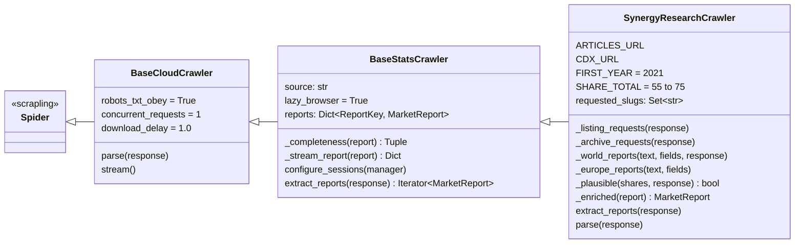
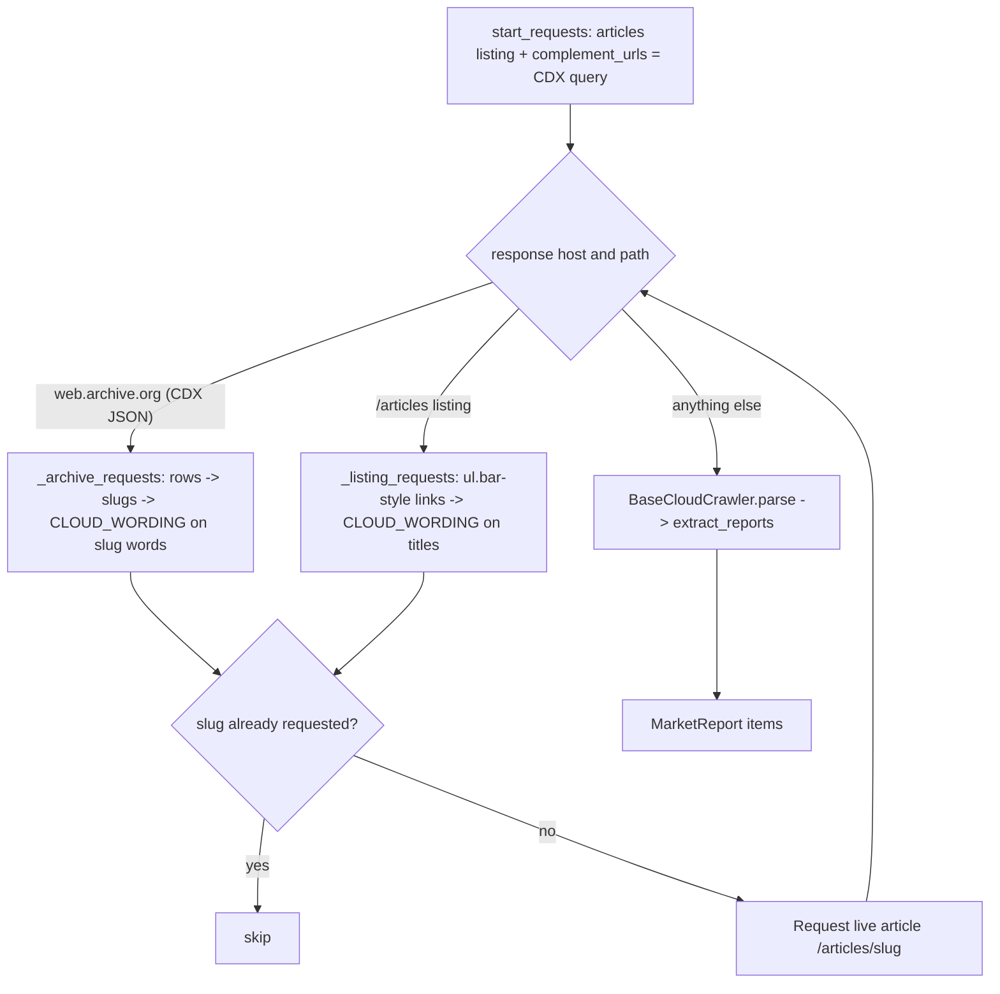
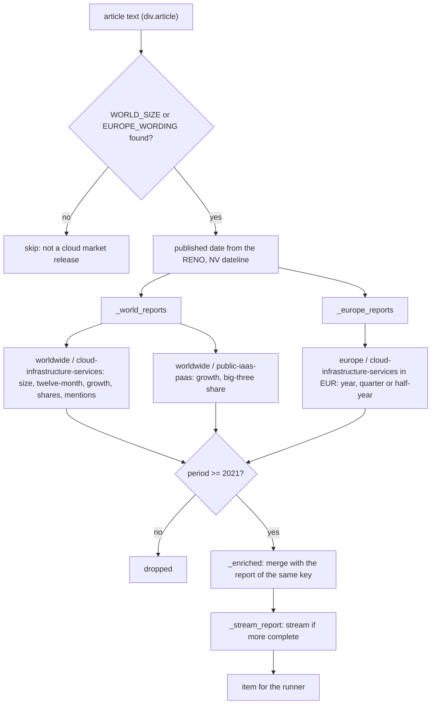
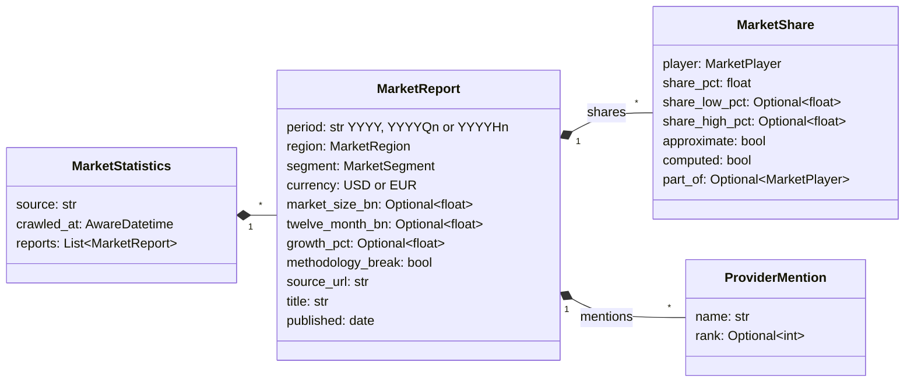
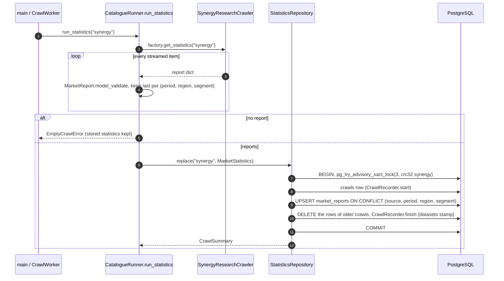

[↑ Docs index](../README.md) · Technical

# 17 — Market statistics crawler (Synergy Research Group)

The cloud market shares come from the press releases of
[Synergy Research Group](https://www.srgresearch.com/articles), the figures most of the press quotes. The
statistics crawler reads the live press-release listing and, for the older articles, the article addresses archived
by the [Wayback Machine](https://web.archive.org/). It extracts the figures from the article text with regular
expressions (the charts are images), checks that they are plausible, merges the reports several articles give for
the same quarter, and replaces the stored statistics in one transaction. This chapter documents
[`src/crawler/stats/`](../../src/crawler/stats/), the [`MarketReport`](../../src/models/stats/market_report.py#L20)
model and the write path.

## Contents

- [Classes](#classes)
- [Sources and request routing](#sources-and-request-routing)
- [From an article to reports](#from-an-article-to-reports)
  - [Period](#period)
  - [Worldwide figures](#worldwide-figures)
  - [European figures](#european-figures)
  - [Mentions](#mentions)
  - [Plausibility](#plausibility)
  - [Merging reports of the same quarter](#merging-reports-of-the-same-quarter)
- [Data model](#data-model)
- [Persistence](#persistence)
- [Running it](#running-it)
- [Limits](#limits)
- [See also](#see-also)

## Classes



| Class | File | Role |
|---|---|---|
| [`BaseStatsCrawler`](../../src/crawler/stats/base.py#L24) | `crawler/stats/base.py` | The base of the statistics crawlers. Its default session is a browser-impersonating HTTP client (`<name>-http`), the stealth browser being lazy. It keeps the reports streamed so far by `(period, region, segment)` and streams a report again only when it is more complete ([`_stream_report`](../../src/crawler/stats/base.py#L81)). |
| [`SynergyResearchCrawler`](../../src/crawler/stats/synergy.py#L26) | `crawler/stats/synergy.py` | The Synergy crawler: request routing, text extraction, plausibility and merging. |
| `SynergyPlayerName`, `SynergyOrdinal`, `SynergyPatternGroup`, `SynergyCurrency` | [`crawler/stats/enums.py`](../../src/crawler/stats/enums.py) | The names, ordinals, regex group names and currencies the patterns use. |

The crawler is registered under the name `synergy` in the `STATISTICS_MAP` of `CrawlerFactory` (see
[12-crawler-framework.md](12-crawler-framework.md)). Like every crawler it obeys `robots.txt`, sends one request at a
time and waits 1 s between requests.

## Sources and request routing

| Source | URL | What is read |
|---|---|---|
| Press releases | `https://www.srgresearch.com/articles` | The listing (2023 onwards), filtered by `CLOUD_WORDING` on the link titles. |
| Wayback Machine CDX | `web.archive.org/cdx/search/cdx?url=srgresearch.com/articles/&matchType=prefix&collapse=urlkey&filter=statuscode:200&output=json` | Every article address ever archived, back to 2013, filtered by `CLOUD_WORDING` on the slug words. Only the slugs are used. See the [CDX server API](https://github.com/internetarchive/wayback/tree/master/wayback-cdx-server). |
| Articles | `https://www.srgresearch.com/articles/<slug>` | Always the live article, never the archived copy. Each slug is requested once (`requested_slugs`). |

[`parse`](../../src/crawler/stats/synergy.py#L767) routes each response:



A listing with no link, a CDX answer that is not a JSON array, or an article without `div.article` raises
`CatalogueFormatError` (after an ERROR log).

## From an article to reports

[`extract_reports`](../../src/crawler/stats/synergy.py#L727) reads the article text and skips it when it gives
neither a world market size nor the European wording. Otherwise it builds the worldwide and European reports, drops
those before `FIRST_YEAR` (2021: older articles measure a narrower market), and merges each one with the report
already streamed for the same key.



### Period

- The publication date comes from the dateline (`DATELINE`: `RENO, NV, <Month day, year>`).
- A quarterly release covers the calendar quarter before its publication
  ([`_quarter`](../../src/crawler/stats/synergy.py#L395)): an article of February 2026 gives `2025Q4`.
- The quarter is cross-checked against the alt text of the article's chart (`ALT_QUARTER`, e.g. `CIS Q226`). A
  mismatch is logged as a WARNING, not dropped.
- European periods come from the text itself: a year, a quarter (`2025Q3`) or a half-year (`2025H1`).

### Worldwide figures

| Pattern | Gives |
|---|---|
| `WORLD_SIZE` | The quarter's cloud infrastructure services revenue (required for a worldwide report). |
| `TWELVE_MONTH` | The trailing twelve-month size. |
| `GROWTH` | The year-on-year growth. |
| `SHARES` | The shares listed by position: Amazon, Microsoft, Google. |
| `PLAYER_SHARES` | One pattern per player, for shares given separately or as bands ("32-34 %": the middle is the share, the band is kept). |
| `BIG_THREE` | The combined share of the three leaders. Amazon, Microsoft and Google become `part_of = big-three`. |
| `PUBLIC_GROWTH`, `PUBLIC_TOP_THREE` | The public IaaS + PaaS segment: growth and combined top-three share. |
| `METHODOLOGY_BREAK` | "Relative to previous quarterly analyses": Synergy reclassified revenues (Q3 2024). |

A share qualified by "around", "about"… is marked `approximate`.

### European figures

`EUROPE_MARKET`, `EUROPE_HALF` and `EUROPE_TWELVE_MONTH` give the market size in euros. `EUROPE_BIG_THREE`,
`EUROPE_PROVIDERS` and `EUROPE_LEADERS` give the share of the three global leaders, of the European providers, and of
SAP and Deutsche Telekom (as `part_of = european-providers` when the aggregate is given).

### Mentions

Synergy only quantifies a few players. The others it names (Oracle, Alibaba, Huawei, CoreWeave…) become
`ProviderMention`s, in order of appearance, with their rank when the text gives one (`RANK`: "fourth-placed
Alibaba" → rank 4). A player with a share is never also a mention. The mentions feed the `mentions` metric (see
[16-analytics.md](16-analytics.md)) and the list shown under the Statistics charts.

### Plausibility

[`_plausible`](../../src/crawler/stats/synergy.py#L452) drops the worldwide shares of Amazon, Microsoft and Google
(with a WARNING) unless they are in descending order and, when all three are given, sum to between 55 % and 75 %
(`SHARE_TOTAL`). This catches a regex picking up the wrong numbers when Synergy changes its wording.

### Merging reports of the same quarter

Several articles may publish the same quarter: the quarterly release (with the growth) and a share-trend article
(with the combined big-three share). Two mechanisms keep the best version:
1. [`_enriched`](../../src/crawler/stats/synergy.py#L688) takes the report with the most shares as primary and
   completes it with the size, twelve-month size, growth, extra mentions and methodology break of the other.
2. [`_stream_report`](../../src/crawler/stats/base.py#L81) streams the merged report only when its completeness
   (number of shares, size known, growth known, number of mentions) beats the one streamed before.

The runner keeps the last streamed report per key.

## Data model



| Model | File |
|---|---|
| [`MarketStatistics`](../../src/models/stats/market_statistics.py#L13) | `models/stats/market_statistics.py` |
| [`MarketReport`](../../src/models/stats/market_report.py#L20) | `models/stats/market_report.py` |
| [`MarketShare`](../../src/models/stats/market_share.py#L14) | `models/stats/market_share.py` |
| [`ProviderMention`](../../src/models/stats/provider_mention.py#L10) | `models/stats/provider_mention.py` |

Enumerations (`src/models/cloud/enums.py`):
- `MarketRegion`: `worldwide`, `europe`.
- `MarketSegment`: `cloud-infrastructure-services` (IaaS, PaaS and hosted private cloud), `public-iaas-paas`.
- `MarketPlayer`: `amazon`, `microsoft`, `google`, `big-three`, `european-providers`, `sap`, `deutsche-telekom`,
  `neoclouds`, `others`.

The model validators raise the errors of [`models/stats/exception.py`](../../src/models/stats/exception.py)
(`StatsModelError`, `InvalidShareBandError`, `SharesOverflowError`) on an inverted band or shares summing above
100 % (only the top-level shares, those with no `part_of`, are summed). "Others (computed)" is not stored:
[`MarketReport.others()`](../../src/models/stats/market_report.py#L78) computes it on demand as 100 % minus the
top-level shares, with `computed = true`, and only when the leaders are quantified (together as the big three, or
each of them). [`StatisticsSeries`](../../src/analytics/pipeline/statistics_series.py#L22) puts it in the `OTHER`
bloc of the bloc charts.

## Persistence



- [`CatalogueRunner.run_statistics`](../../src/crawler/runner.py#L550) collects every report in memory (a few
  dozen), so the statistics never use the progressive `ItemWriter`.
- [`StatisticsRepository.replace`](../../src/storage/repositories/statistics_repository.py#L65) takes the
  transaction-level advisory lock of the `statistics` dataset kind and records the crawl. It upserts the
  `market_reports` rows built by [`ReportMapper`](../../src/storage/mappers/report_mapper.py#L16) on their unique
  key `(source, period, region, segment)` (`xmax = 0` tells an insert from an update), then deletes the rows the
  crawl did not write. A database error raises `StorageWriteError`; see [13-storage.md](13-storage.md).
- [`StatisticsRepository.load`](../../src/storage/repositories/statistics_repository.py#L139) gives the Statistics
  tab its `MarketStatistics`.

## Running it

```bash
CRAWLER_SOURCE=statistics uv run python src/main.py
```

In the GUI: "Refresh from Synergy" on the Statistics tab, or the crawl actions of the toolbar while that tab is shown
(see [09-gui-user-guide.md](../functional/09-gui-user-guide.md)). The live smoke test is
[`tests/live/test_live_statistics.py`](../../tests/live/test_live_statistics.py), and the offline tests read the 14
snapshots of [`tests/fixtures/stats/`](../../tests/fixtures/stats/) (see
[19-testing-and-quality.md](19-testing-and-quality.md)).

## Limits

- Only AWS, Azure, Google Cloud and the aggregates are quantified worldwide; T Cloud appears through Deutsche
  Telekom in Europe. The other providers are mentions only.
- The figures are whole percents, and Synergy's Q3 2024 reclassification lowered Microsoft's share: the trend charts
  mark the break.
- A wording change at Synergy makes a pattern miss. The plausibility check and the "no figure" DEBUG log make it
  visible; the live test catches it.

## See also

- [07-market-statistics.md](../functional/07-market-statistics.md): the figures as users see them.
- [16-analytics.md](16-analytics.md): `StatisticsSeries` and the Synergy-derived metrics.
- [12-crawler-framework.md](12-crawler-framework.md): the crawler base classes.
- [13-storage.md](13-storage.md): `market_reports` and the advisory locks.

[← Previous](16-analytics.md) · [Next →](18-gui-architecture.md)
