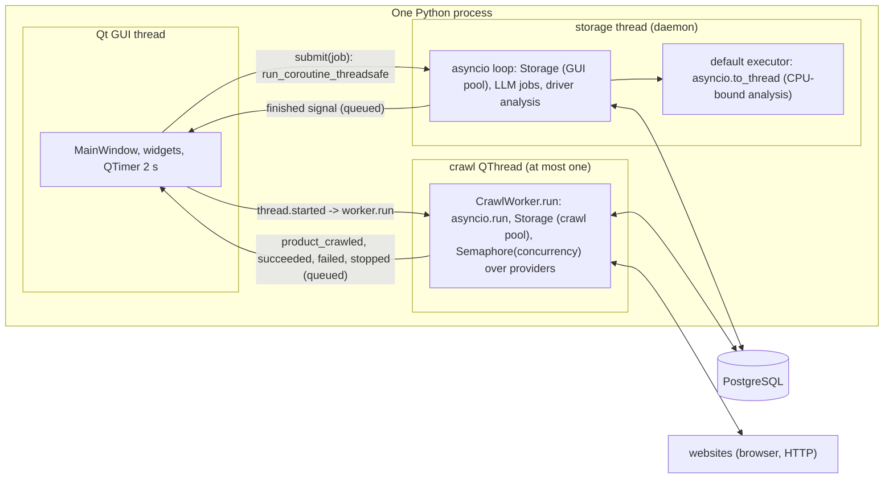
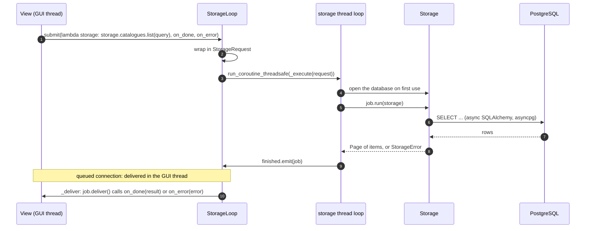
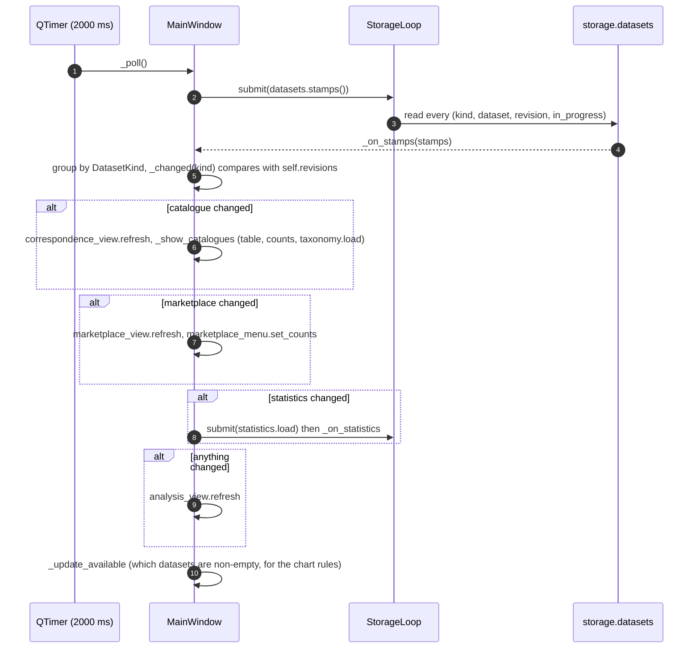
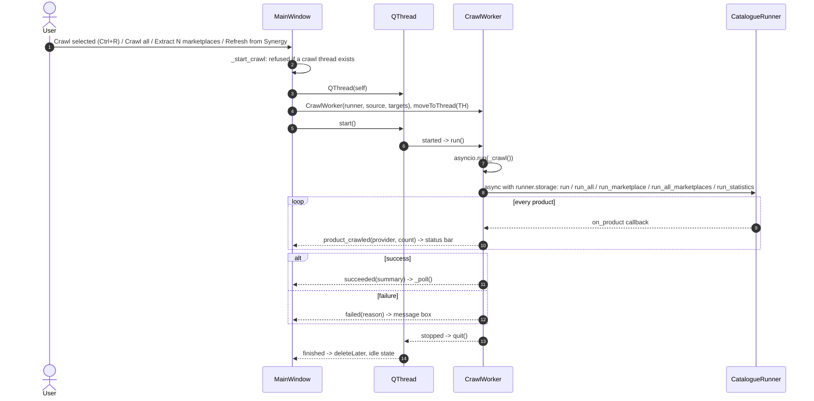
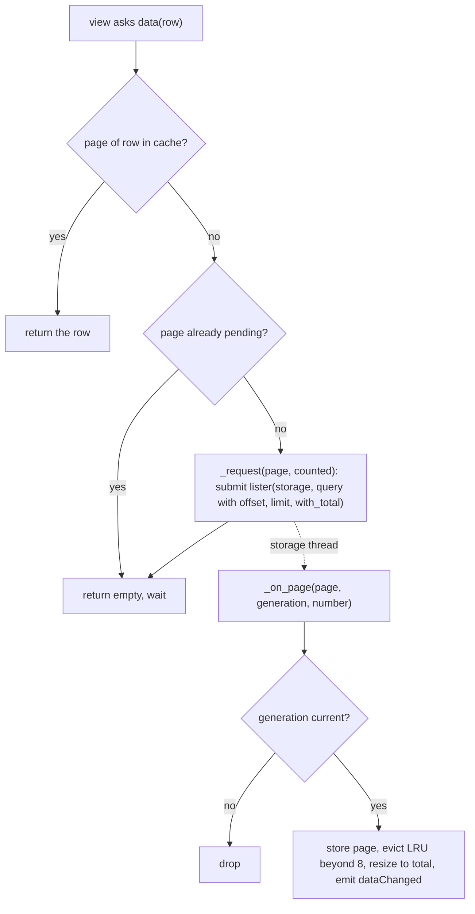
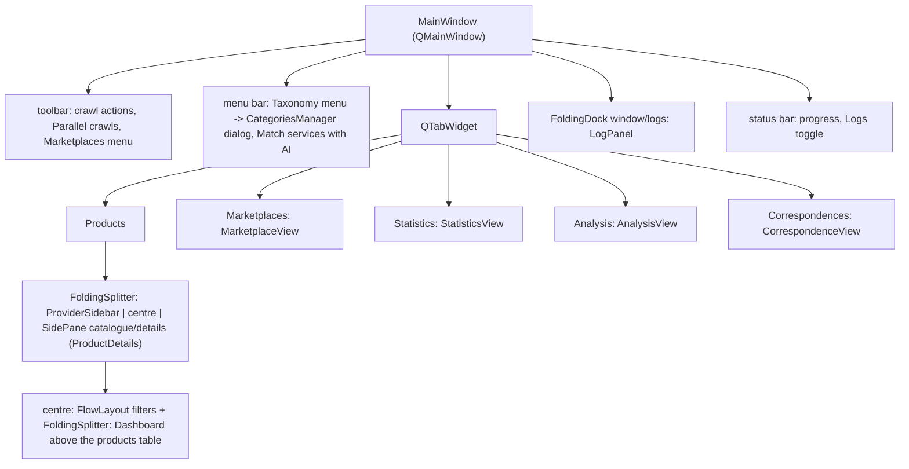
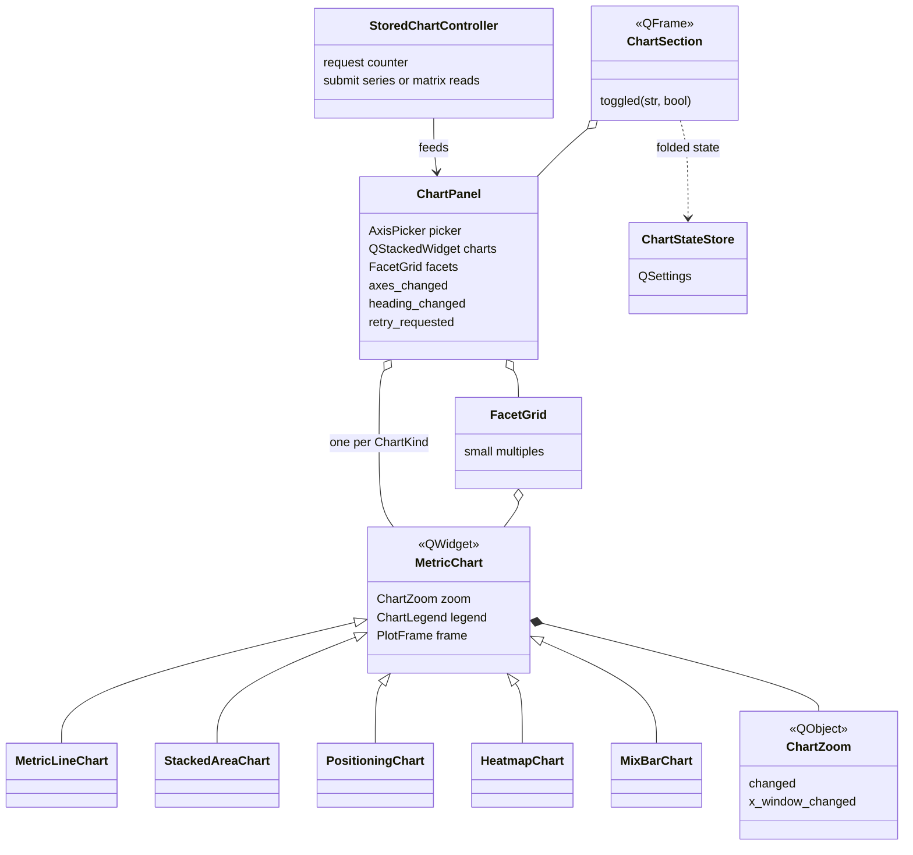
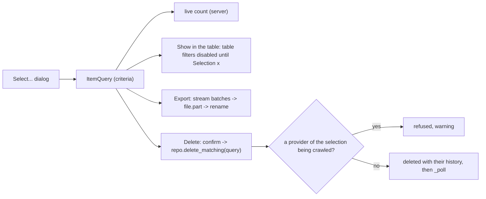
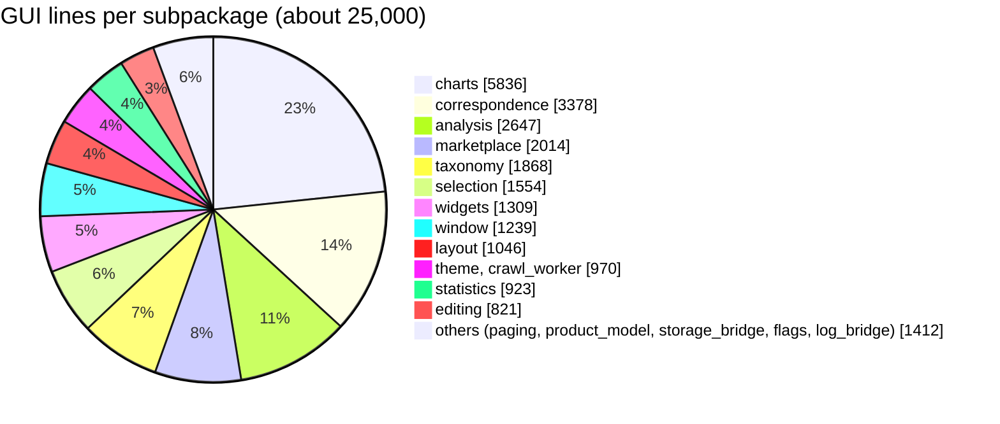

[↑ Docs index](../README.md) · Technical

# 18 — GUI architecture (PyQt6)

The explorer is a [PyQt6](https://www.riverbankcomputing.com/static/Docs/PyQt6/) desktop application: 164 modules
and about 25,000 lines in [`src/gui/`](../../src/gui/), one class per module (a convention test enforces it). It never
blocks on the database. Every read and write runs on a dedicated asyncio thread, and the answers come back to the
GUI thread through a queued Qt signal. Crawls run on a separate `QThread` with their own event loop and their own
`Storage`. The window polls the dataset revisions every 2 s and refreshes only the views whose data changed. Tables
read pages of 200 rows on demand and keep at most 8 of them in memory. This chapter describes the threads, the
storage bridge, the polling, the paged tables and the main widget families. The user-level guide is
[09-gui-user-guide.md](../functional/09-gui-user-guide.md).

## Contents

- [Start-up](#start-up)
- [Threads](#threads)
- [Storage bridge](#storage-bridge)
- [Dataset polling](#dataset-polling)
- [Crawls launched from the window](#crawls-launched-from-the-window)
- [Paged tables](#paged-tables)
- [Window composition](#window-composition)
- [Charts](#charts)
- [Correspondence diagram](#correspondence-diagram)
- [Analysis tab](#analysis-tab)
- [Selection, export and editing](#selection-export-and-editing)
- [Taxonomy manager](#taxonomy-manager)
- [Logs panel](#logs-panel)
- [Layout widgets and persistence](#layout-widgets-and-persistence)
- [Code size per subpackage](#code-size-per-subpackage)
- [See also](#see-also)

## Start-up

```bash
uv run python -m gui.window.app     # or: uv run poc-crawler-gui, or the "GUI: catalogue explorer" launch configuration
```

[`gui.window.app.main`](../../src/gui/window/app.py#L33):
1. Sets up logging from `src/conf/logger.yaml` (see [20-operations.md](20-operations.md)).
2. Creates the `QApplication` and the [`Theme`](../../src/gui/theme.py#L33) (palette, chart colours).
3. Creates the [`ChartStateStore`](../../src/gui/charts/sections/chart_state_store.py#L15), backed by an INI
   `QSettings("poc-crawler", "charts")`, which remembers folded cards and chosen axes.
4. Builds [`MainWindow`](../../src/gui/window/main_window.py#L76) with **two** `Storage` instances: one inside the
   [`StorageLoop`](../../src/gui/storage_bridge/storage_loop.py#L20) for the GUI's reads, and one inside the
   [`CatalogueRunner`](../../src/crawler/runner.py#L49) for crawls. They never share an asyncpg connection.

## Threads

There are no subprocesses: the GUI, the storage loop and the crawls are threads of one process.



| Thread | What runs there | Event loop |
|---|---|---|
| Qt GUI (main) | Every widget, the polling `QTimer`, every slot | Qt's |
| `storage` (`threading.Thread`, daemon) | Every GUI database read and write, the LLM jobs (AI matching, translation, classification), the driver analysis | Its own asyncio loop, `run_forever` |
| Crawl `QThread` (at most one) | [`CrawlWorker.run`](../../src/gui/crawl_worker.py#L148) → `asyncio.run(_crawl())`; providers run concurrently under the runner's `asyncio.Semaphore` | A fresh asyncio loop per crawl |
| Storage loop's default executor | CPU-bound driver analysis (`asyncio.to_thread`) | none |

Cross-thread calls only go through queued [signals](https://doc.qt.io/qt-6/signalsandslots.html) or
`asyncio.run_coroutine_threadsafe`, so a widget is only ever touched from the GUI thread.

## Storage bridge

[`src/gui/storage_bridge/`](../../src/gui/storage_bridge/) holds four modules:

| Class | Role |
|---|---|
| [`StorageLoop`](../../src/gui/storage_bridge/storage_loop.py#L20) | Owns the storage thread and its loop. [`start`](../../src/gui/storage_bridge/storage_loop.py#L134) creates them lazily, [`submit`](../../src/gui/storage_bridge/storage_loop.py#L149) schedules a job, [`stop`](../../src/gui/storage_bridge/storage_loop.py#L170) drains and closes. Signal `finished(object)`. |
| [`StorageRequest[R]`](../../src/gui/storage_bridge/storage_request.py#L12) | One job: the coroutine factory, its result or `StorageError`, and the two callbacks (`run`, `fail`, `deliver`). |
| [`StorageJob`](../../src/gui/storage_bridge/storage_job.py#L12) | The `Protocol` every job implements. |



[`_shutdown`](../../src/gui/storage_bridge/storage_loop.py#L100) gives the running jobs `DRAIN_TIMEOUT` (2 s) to
finish, cancels the rest, closes the database, then stops the loop. `stop` waits `STOP_TIMEOUT` (5 s) at most.

## Dataset polling

The window does not listen to the database: it polls the `datasets` table, whose `revision` changes with every write
(see [13-storage.md](13-storage.md)).



| Method | Line |
|---|---|
| `POLL_INTERVAL_MS = 2000` | [main_window.py:132](../../src/gui/window/main_window.py#L132) |
| `_poll` | [main_window.py:950](../../src/gui/window/main_window.py#L950) |
| `_on_stamps` | [main_window.py:753](../../src/gui/window/main_window.py#L753) |
| `_changed` | [main_window.py:687](../../src/gui/window/main_window.py#L687) |
| `_show_catalogues` | [main_window.py:703](../../src/gui/window/main_window.py#L703) |
| `_update_available` | [main_window.py:738](../../src/gui/window/main_window.py#L738) |
| `reload` (F5: forget every revision, refresh everything) | [main_window.py:1117](../../src/gui/window/main_window.py#L1117) |

Because a running crawl writes every 10 s (see [13-storage.md](13-storage.md)), new items appear in the tables
within seconds, and the sidebar marks the datasets `in_progress`. A crawl that ends, or an edit made in the window,
calls `_poll` at once.

## Crawls launched from the window



- [`_start_crawl`](../../src/gui/window/main_window.py#L1007), [`crawl_selected`](../../src/gui/window/main_window.py#L1128)
  and [`crawl_all`](../../src/gui/window/main_window.py#L1142) choose the source from the current tab: catalogue,
  marketplace, or statistics on the Statistics tab.
- The "Parallel crawls" spin box sets `runner.concurrency`
  ([`_on_concurrency_changed`](../../src/gui/window/main_window.py#L898)).
- [`closeEvent`](../../src/gui/window/main_window.py#L1158) refuses to close while a crawl runs. Otherwise it stops the
  timer, removes the log handler and stops the storage loop.
- The LLM tasks after a crawl run inside the crawl thread, as in the command line (see
  [15-llm-layer.md](15-llm-layer.md)).

## Paged tables

The products and software tables never load a whole dataset. Both models derive from
[`PagedTableModel[T, R]`](../../src/gui/paging/page/paged_table_model.py#L25), a `QAbstractTableModel`:

| Constant / member | Value | Role |
|---|---|---|
| `PAGE_SIZE` | 200 | Rows read per query (`ItemQuery.offset`, `limit`). |
| `MAX_PAGES` | 8 | Pages kept in the [`PageCache`](../../src/gui/paging/page/page_cache.py#L9), an LRU `OrderedDict` with `fresh` and `pending` sets. |
| `generation` | counter | Increased by [`set_query`](../../src/gui/paging/page/paged_table_model.py#L168) and [`refresh`](../../src/gui/paging/page/paged_table_model.py#L183): a page answering an older generation is dropped in [`_on_page`](../../src/gui/paging/page/paged_table_model.py#L108). |



- **Server-side everything.** Filtering, sorting and counting are done by the database
  (`ItemQuery` → [`ItemQueryBuilder`](../../src/storage/mappers/item_query_builder.py)); see
  [13-storage.md](13-storage.md).
- **Refresh without flicker.** `refresh` invalidates the cache but keeps the stale rows on screen until the new page
  arrives.
- **Subclasses.** [`ProductTableModel`](../../src/gui/product_model/product_table_model.py#L29) (rows `ProductRow`)
  and [`SoftwareTableModel`](../../src/gui/marketplace/model/software_table_model.py#L29) (rows `SoftwareRow`).

## Window composition



| View | Class | Content |
|---|---|---|
| Products | built in `MainWindow` | [`Dashboard`](../../src/gui/widgets/dashboard/dashboard.py#L30) (a `SectionStack`: provider bar chart, stat cards, catalogue trends `ChartPanel`), the products table, `ProductDetails` |
| Marketplaces | [`MarketplaceView`](../../src/gui/marketplace/widgets/marketplace_view.py#L63) | `DomainBarChart`, trends `ChartPanel`, `SoftwareTableModel` table, `SoftwareDetails`, `AdvancedSoftwareFilters`, its own `ItemActions` and `SelectionActions` |
| Statistics | [`StatisticsView`](../../src/gui/statistics/view/statistics_view.py#L35) | `PerimeterPanel`, share bars, trends `ChartPanel`, `MarketSizeChart`; assembles locally with `ChartAssembler` and `StatisticsSeries` |
| Analysis | [`AnalysisView`](../../src/gui/analysis/analysis_view.py#L24) | Six preset charts and the rise-drivers sections |
| Correspondences | [`CorrespondenceView`](../../src/gui/correspondence/correspondence_view.py#L67) | Diagram or coverage matrix, filters, concept details |

The Dashboard, the Logs and the Categories manager are not tabs: the Dashboard sits above the products table, the
Logs are a bottom dock, and the Categories manager is a dialog of the Taxonomy menu.
[`TaxonomyCache`](../../src/gui/taxonomy/taxonomy_cache.py#L18) shares the taxonomy between the views (signal
`changed`).

## Charts

The charts are hand-painted `QWidget`s (no charting library). Their data comes from
[16-analytics.md](16-analytics.md).



| Subpackage | Classes |
|---|---|
| [`charts/base/`](../../src/gui/charts/base/) | [`MetricChart`](../../src/gui/charts/base/metric_chart.py#L28), [`ChartZoom`](../../src/gui/charts/base/chart_zoom.py#L19), [`ChartLegend`](../../src/gui/charts/base/chart_legend.py#L16), `PlotFrame` |
| [`charts/plots/`](../../src/gui/charts/plots/) | [`MetricLineChart`](../../src/gui/charts/plots/series/metric_line_chart.py#L17), [`StackedAreaChart`](../../src/gui/charts/plots/series/stacked_area_chart.py#L18), [`PositioningChart`](../../src/gui/charts/plots/series/positioning_chart.py#L20) (bubbles), [`HeatmapChart`](../../src/gui/charts/plots/matrix/heatmap_chart.py#L20), [`MixBarChart`](../../src/gui/charts/plots/matrix/mix_bar_chart.py#L18), [`FacetGrid`](../../src/gui/charts/plots/facets/facet_grid.py#L24) |
| [`charts/picker/`](../../src/gui/charts/picker/) | [`AxisPicker`](../../src/gui/charts/picker/axis_picker.py#L32) (`axes_changed`), `ChartKindBar`, `OptionsMenu`, `OptionCombo` (disabled options carry the `OptionBlock` reason) |
| [`charts/panels/`](../../src/gui/charts/panels/) | [`ChartPanel`](../../src/gui/charts/panels/chart_panel.py#L47), [`StoredChartController`](../../src/gui/charts/panels/stored_chart_controller.py#L23), styling (`ChartTitles`, `SeriesStyler`) |
| [`charts/sections/`](../../src/gui/charts/sections/) | [`ChartSection`](../../src/gui/charts/sections/section/chart_section.py#L16) (collapsible, detachable card), `ChartWindow`, `SectionsToolbar` (Expand all, Collapse all), [`ChartStateStore`](../../src/gui/charts/sections/chart_state_store.py#L15) |
| [`charts/common/`](../../src/gui/charts/common/) | `NiceScale`, `AxisFormatter`, [`ChartExporter`](../../src/gui/charts/common/chart_exporter.py#L20) (PNG, clipboard, CSV), `ChartLabels` |

`StoredChartController` numbers its requests and ignores an answer when a newer request exists, so a quick series of
axis changes never shows an outdated chart. `ChartZoom` keeps the zoom while the data refreshes during a crawl, and
resets it when the axes change.

## Correspondence diagram

[`CorrespondenceDiagram`](../../src/gui/correspondence/diagram/correspondence_diagram.py#L34) draws one column per
chosen provider and one row per concept, grouped by taxonomy domain:
- shapes: [`DiagramPill`](../../src/gui/correspondence/diagram/shapes/diagram_pill.py#L15) (a service),
  [`DiagramEdge`](../../src/gui/correspondence/diagram/shapes/diagram_edge.py#L11) (a curve between adjacent columns,
  coloured by correspondence class, dashed when partial, thicker when the model is surer),
  [`DiagramGroup`](../../src/gui/correspondence/diagram/shapes/diagram_group.py#L13) (a domain band);
- `DiagramLayout`, `DiagramHeader`, `DiagramLegend`, `DiagramScrollArea`;
- signals `laid_out`, `concept_selected`, `service_selected`.

[`CoverageMatrix`](../../src/gui/correspondence/coverage/coverage_matrix.py#L18) shows, for each pair of providers,
the share of one's services with an equivalent at the other (`pair_selected` opens the comparison). "Match with AI"
([`CorrespondenceView.match`](../../src/gui/correspondence/correspondence_view.py#L793)) submits a `ServiceMatcher`
job to the storage thread (see [15-llm-layer.md](15-llm-layer.md)). `ConceptDetails` and `ConceptEditor` rename,
merge, delete and edit concepts and members.

## Analysis tab

[`AnalysisView`](../../src/gui/analysis/analysis_view.py#L24) holds six preset `ChartPanel` + `StoredChartController`
pairs (positioning, rank race, blocs, publishers, domain trends, audience) and the rise-drivers sections.
[`DriversPanel`](../../src/gui/analysis/drivers/drivers_panel.py#L55) refreshes the metrics when a dataset was written,
then runs `DriverAnalysis.run` and `DriverPanel.build` with `asyncio.to_thread`. Its subpackages are `controls/`
(`DriverControls`, `RoleLegend`), `charts/` (`DriverBarChart`, `DriverScatterChart`, `DriverScatterGrid`) and `notes/`
(`ColumnGuide`, `HelpChip`, `WarningBoard`).

## Selection, export and editing

| Class | Role |
|---|---|
| [`ItemActions[T, R]`](../../src/gui/editing/item_actions.py#L32) | New (Ctrl+N), Edit (F2), Delete (Del). Resolves the selected row ranges to item ids in the storage thread, so a selection may cover rows never read. |
| [`ItemEditorDialog[T]`](../../src/gui/editing/dialogs/item_editor_dialog.py#L20), [`BulkEditDialog`](../../src/gui/editing/dialogs/bulk_edit_dialog.py#L17), `FieldEditors` | One item's form, or the bulk form changing only the ticked fields. |
| [`SelectionActions[T, R]`](../../src/gui/selection/bulk/selection_actions.py#L31) | "Select…" (Ctrl+Shift+A): opens the dialog, then FILTER (emits an `ItemQuery` for the table), EXPORT or DELETE. |
| [`BulkSelectDialog[T]`](../../src/gui/selection/bulk/bulk_select_dialog.py#L40) | Criteria pickers (providers, categories, audiences, deliveries, texts, dates) and a live server-side count, generation-guarded. |
| [`ItemExporter[T]`](../../src/storage/exporter/item_exporter.py#L24) | Streams the matching items (`ItemRepository.stream`, 2000 per batch with `yield_per`) into a `.part` file, renamed when complete. CSV, JSON or JSON lines. |



Edits are refused while the provider is being crawled: the repository checks the dataset's advisory lock and raises
`StorageLockError`, the window shows a warning, and nothing is written (see [13-storage.md](13-storage.md)).

## Taxonomy manager

[`CategoriesManager`](../../src/gui/taxonomy/manager/categories_manager.py#L30) is a `QDialog` with three tabs:
`TaxonomyEditor` (domains and categories in en/ru/zh), `LabelsEditor` with `LabelTableModel` (the source labels,
their English names, links and aliases) and `UnclassifiedPanel` (items left in `other`). When an API key is set it
shows "Translate pending labels" and "Classify unclassified items" with the budget spent; those jobs also go through
`StorageLoop.submit`. Its `edited` signal is connected to `MainWindow.reload`, which forgets every revision and refreshes every view (the
recategorization itself happens in the storage layer, see
[14-classification-engine.md](14-classification-engine.md)).

## Logs panel

[`QtLogHandler`](../../src/gui/log_bridge/qt_log_handler.py#L10) is added to the root logger. Its `emit` sends
[`LogSignals.record_emitted(level, name, message)`](../../src/gui/log_bridge/log_signals.py#L15), connected to
[`LogPanel.append_record`](../../src/gui/widgets/log_panel.py#L77). Records emitted by the storage or crawl threads
are therefore queued to the GUI thread safely. The panel lives in the bottom
[`FoldingDock`](../../src/gui/layout/folding_dock.py#L22) `window/logs`, revealed by the "▴ Logs" status-bar button.

## Layout widgets and persistence

| Class | Role |
|---|---|
| [`FoldingDock`](../../src/gui/layout/folding_dock.py#L22) | A dock that folds to its title bar (`folded_changed`). |
| [`FoldingSplitter`](../../src/gui/layout/folding_splitter.py#L15) | A splitter whose panes fold and give their room to the others. |
| [`SectionStack`](../../src/gui/layout/panes/section_stack.py#L16), [`SidePane`](../../src/gui/layout/panes/side_pane.py#L16) | Folding panes: a stack of chart cards, a side details pane. |
| [`FlowLayout`](../../src/gui/layout/flow_layout.py#L12) | Wraps the filter widgets on narrow windows. |
| `FittedScrollArea` | A scroll area sized to its content. |

Folded cards, chosen axes and pane states are saved by `ChartStateStore` in `QSettings`, so they survive restarts.

## Code size per subpackage



## See also

- [09-gui-user-guide.md](../functional/09-gui-user-guide.md): what each tab does, for users.
- [10-architecture.md](10-architecture.md): where the GUI sits among the packages.
- [13-storage.md](13-storage.md): `datasets` revisions, `ItemQuery`, locks.
- [16-analytics.md](16-analytics.md): the chart and driver computations.
- [19-testing-and-quality.md](19-testing-and-quality.md): the GUI tests (pytest-qt, offscreen).

[← Previous](17-statistics-crawler.md) · [Next →](19-testing-and-quality.md)
