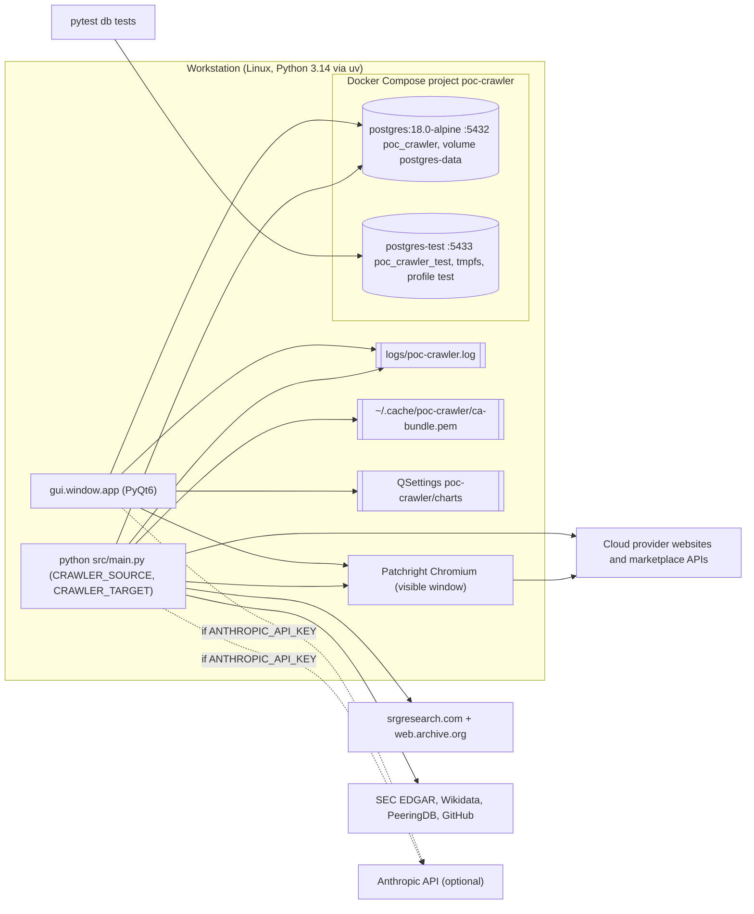
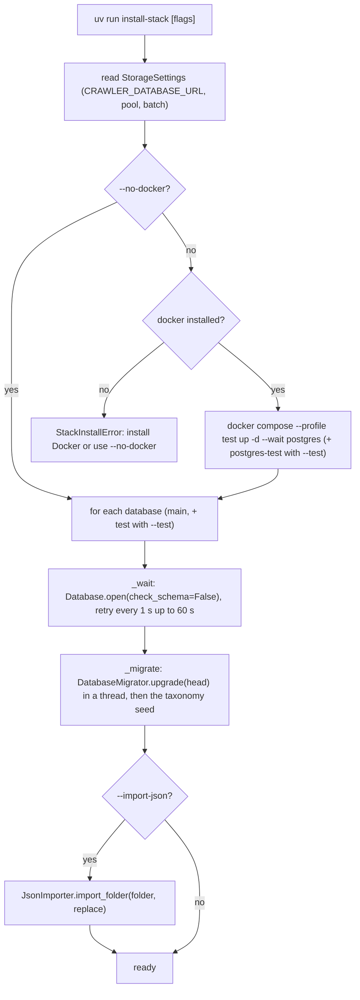

[↑ Docs index](../README.md) · Technical

# 20 — Operations: install, database, logs and troubleshooting

poc-crawler runs on a workstation. The Python application (crawlers and GUI) runs on the host through
[uv](https://docs.astral.sh/uv/), and only PostgreSQL runs in [Docker Compose](https://docs.docker.com/compose/).
`install-stack` brings the database up and migrates it, and `migrate-db` manages the Alembic migrations and the
taxonomy seed. The logs go to the console and to a rotating file. This chapter covers the deployment topology, the
install and migration commands, the Compose services, the logging, the routine operations, the troubleshooting of
the known failure modes, and the known gaps of the project.

## Contents

- [Topology](#topology)
- [Prerequisites](#prerequisites)
- [install-stack](#install-stack)
- [Compose services](#compose-services)
- [migrate-db](#migrate-db)
- [Logging](#logging)
- [Routine operations](#routine-operations)
- [Troubleshooting](#troubleshooting)
- [Known gaps](#known-gaps)
- [See also](#see-also)

## Topology



## Prerequisites

| Need | Why | Link |
|---|---|---|
| Python 3.14 and uv | `requires-python = ">=3.14"`; uv manages the virtual environment and the lock file. | [uv](https://docs.astral.sh/uv/) |
| Docker with Compose v2 | The PostgreSQL services (or `--no-docker` with your own server). | [Docker Engine](https://docs.docker.com/engine/install/) |
| Patchright Chromium | The stealth browser of the catalogue crawlers. | [Patchright](https://github.com/Kaliiiiiiiiii-Vinyzu/patchright-python) |
| A display | The browser runs with `headless=False`, and the GUI is a desktop window. | — |
| Optional keys | `ANTHROPIC_API_KEY` (AI features), `CRAWLER_SEC_USER_AGENT`, `GITHUB_TOKEN`, `PEERINGDB_API_KEY` (metrics). | [11-configuration.md](11-configuration.md) |

```bash
uv sync
uv run patchright install chromium   # the stealth browser
uv run install-stack                 # PostgreSQL + migrations + taxonomy seed
```

## install-stack

[`StackInstaller`](../../scripts/install_stack.py#L26) (`uv run install-stack`, entry
[`main`](../../scripts/install_stack.py#L254)) is idempotent: it starts what is stopped and applies the missing
migrations, so it can be run again at any time.

| Flag | Effect |
|---|---|
| `--no-docker` | Use the server of `CRAWLER_DATABASE_URL` instead of starting the Compose service. |
| `--test` | Also start and migrate the throw-away test server on port 5433, and print its `STORAGE_TEST_DATABASE_URL`. |
| `--import-json [FOLDER]` | Then import the JSON files of the former file storage (`output/` by default). |
| `--replace` | With `--import-json`, replace the stored datasets. |



## Compose services

[`compose.yaml`](../../compose.yaml) defines only the databases (the application is not containerised):

| Setting | `postgres` | `postgres-test` (profile `test`) |
|---|---|---|
| Image | `postgres:18.0-alpine` | same |
| Port | 5432 | 5433 |
| Database / user | `poc_crawler` / `crawler` | `poc_crawler_test` / `crawler` |
| Storage | named volume `postgres-data` | `tmpfs` (lost on stop) |
| Tuning | `shared_buffers=512MB`, `maintenance_work_mem=512MB`, `work_mem=32MB`, `max_wal_size=4GB`, `random_page_cost=1.1`, `default_toast_compression=lz4`, `max_connections=200` | `fsync=off`, `full_page_writes=off`, `synchronous_commit=off`, lz4, `max_connections=200` |
| Health check | `pg_isready` every 2 s, 30 retries | same |
| Restart | `unless-stopped` | — |

The tuning follows the workload: large batched upserts (WAL size, maintenance memory), JSONB version rows (lz4
TOAST compression), SSD random reads, and up to 4 parallel crawls each holding a connection beside the GUI pool. See
the [PostgreSQL configuration reference](https://www.postgresql.org/docs/current/runtime-config.html).

## migrate-db

[`DatabaseMigrator`](../../scripts/migrate_database.py#L33) builds the [Alembic](https://alembic.sqlalchemy.org/)
configuration in code (there is no `alembic.ini`). The migrations are in
[`scripts/migrations/versions/`](../../scripts/migrations/versions/), 0001 to 0008 (see
[13-storage.md](13-storage.md)), and [`env.py`](../../scripts/migrations/env.py) runs them through an asyncpg
`NullPool` engine.

| Command | Method | Effect |
|---|---|---|
| `uv run migrate-db upgrade [rev]` | [`upgrade`](../../scripts/migrate_database.py#L175) | Apply the migrations (head by default), then the taxonomy seed. |
| `uv run migrate-db seed [--force]` | [`seed`](../../scripts/migrate_database.py#L155) | Apply the taxonomy seed when its files changed (always with `--force`). |
| `uv run migrate-db downgrade base` | [`downgrade`](../../scripts/migrate_database.py#L194) | Revert down to a revision. |
| `uv run migrate-db current` | [`current`](../../scripts/migrate_database.py#L211) | The revision of the database. |
| `uv run migrate-db history` | [`history`](../../scripts/migrate_database.py#L228) | The migrations. |
| `uv run migrate-db revision -m "Add x" --autogenerate` | [`revision`](../../scripts/migrate_database.py#L239) | Write a new migration, numbered after the head, to review. |
| `uv run migrate-db check` | [`check`](../../scripts/migrate_database.py#L263) | Fail when the table definitions and the database schema differ. |

The application refuses to open a database whose `alembic_version` differs from
[`StorageSchema.REVISION`](../../src/storage/tables/schema.py#L39) (`0008`), raising `StorageSchemaError`
([database.py:135](../../src/storage/engine/database.py#L135)). A new migration must therefore bump that constant.

## Logging

[`setup_logging`](../../src/logger/__init__.py#L50) validates [`src/conf/logger.yaml`](../../src/conf/logger.yaml)
into a `LoggingConfig` model, creates the folder of every file handler, then calls
[`logging.config.dictConfig`](https://docs.python.org/3/library/logging.config.html#logging.config.dictConfig).

| Element | Setting |
|---|---|
| Formatters | `detailed` and `coloured` ([colorlog](https://github.com/borntyping/python-colorlog)), both with time, level, logger, process, thread, asyncio task, file:line and function. |
| `console` handler | stdout, DEBUG, coloured. |
| `file` handler | `RotatingFileHandler` on `logs/poc-crawler.log`, 10 MiB × 5 backups, DEBUG. |
| Quiet libraries | `asyncio`, `httpx`, `httpcore`, `urllib3` and `scrapling` at WARNING. Configuring `scrapling` drops the console handler Scrapling installs itself. |
| Root | DEBUG, handlers `console` and `file`. The GUI adds `QtLogHandler` for the Logs dock. |

The project logs every product, every skipped entry and an ERROR before every raised exception (a convention test
enforces the last one; see [19-testing-and-quality.md](19-testing-and-quality.md)). A full run therefore writes a
lot: the rotation keeps at most 60 MiB.

## Routine operations

| Task | Command |
|---|---|
| Crawl one catalogue | `CRAWLER_TARGET=scaleway uv run python src/main.py` |
| Crawl everything | `CRAWLER_SOURCE=both CRAWLER_TARGET=all uv run python src/main.py` (several hours, mostly Microsoft's ≈81,000 apps) |
| Market statistics | `CRAWLER_SOURCE=statistics uv run python src/main.py` |
| Provider metrics | `CRAWLER_SOURCE=metrics uv run python src/main.py` |
| After editing `classification.yaml` or the taxonomy seed | `CRAWLER_SOURCE=reclassify uv run python src/main.py` (about 5 minutes for 110,000 software), then `VACUUM (ANALYZE) software, products` |
| AI tasks | `export ANTHROPIC_API_KEY=…` then `CRAWLER_SOURCE=translate uv run python src/main.py` |
| Service matching only | `CRAWLER_SOURCE=correspond uv run python src/main.py` |
| Import the former JSON files | `CRAWLER_SOURCE=import-json uv run python src/main.py` (`CRAWLER_IMPORT_DIR`, `CRAWLER_IMPORT_REPLACE=1`) |
| Back up the database | `docker compose exec postgres pg_dump -U crawler -Fc poc_crawler > poc_crawler.dump` ([pg_dump](https://www.postgresql.org/docs/current/app-pgdump.html)) |
| Stop the database | `docker compose stop postgres` (the volume keeps the data) |

For a panel analysis of the rise drivers, the catalogue and marketplace crawls should run regularly (weekly), so that
every crawl adds a dated point per provider (see [analysis/rise-drivers.md](../analysis/rise-drivers.md)).

## Troubleshooting

| Symptom | Cause | Fix |
|---|---|---|
| China Mobile Cloud crawl very slow, retrying for minutes | Its website bans clients sending more than about one request per second; its crawler waits 3 s between requests. | Run it on its own (`CRAWLER_TARGET=china-mobile-cloud`) and later if a ban is active. |
| Every page of a website fails with a certificate error (e.g. scaleway.com) | An outdated system bundle in `REQUESTS_CA_BUNDLE` lacks recent roots (Sectigo). | Nothing to do normally: the crawler merges certifi's bundle with yours into `~/.cache/poc-crawler/ca-bundle.pem`. Check that this file can be written. Add a company proxy authority through `REQUESTS_CA_BUNDLE`, `CURL_CA_BUNDLE` or `SSL_CERT_FILE`. |
| `StorageSchemaError` at start-up | The database revision is not `0008`. | `uv run migrate-db upgrade` (or `uv run install-stack`). |
| "Database unavailable" in the status bar, or connection refused | PostgreSQL is stopped. | `uv run install-stack` (or `docker compose up -d --wait postgres`). |
| A crawl refuses to start: dataset locked | Another process crawls the same dataset (session advisory lock). | Wait for it. A dead process releases its lock with its connection. |
| A crawl shows as `abandoned` | A previous crawl of the dataset was still `running` when a new one started (killed process). | Nothing to do: the next crawl marks it and proceeds. |
| Items not marked deleted after a crawl | The crawl found less than half of the listed items, so it is treated as partial (`partial`). | Re-run the crawl when the website answers fully. |
| Edits refused in the GUI | The provider is being crawled (`StorageLockError`). | Wait for the crawl to end. |
| AI buttons missing in the Categories manager | No API key: nothing is ever sent to a model. | `export ANTHROPIC_API_KEY=…` before starting the GUI. |
| AI tasks stop with a budget message | The cost recorded in `llm_usage` reached `llm_budget.ceiling` (10 USD by default). | Raise the ceiling in `src/conf/llm.yaml` or set `enforce: false` (warns only). |
| Labels stuck in `pending` | Translation failed three times for them, or no key. | Name them in the Categories manager (Source labels tab). |
| Metrics source yields nothing | Throttling (PeeringDB, GitHub) or missing user agent (SEC). | Set `PEERINGDB_API_KEY`, `GITHUB_TOKEN`, `CRAWLER_SEC_USER_AGENT`. The stored values of that source are kept. |
| `CRAWLER_CONCURRENCY` warning at start | Concurrency above `pool_size + max_overflow`. | Lower it, or raise `CRAWLER_DATABASE_MAX_OVERFLOW`. |
| A crawler finds no product (`EmptyCatalogueError`, `EmptyCrawlError`) | The website changed its markup or blocked the client. | Run `uv run pytest --live -m live` to confirm, then update the crawler (see [12-crawler-framework.md](12-crawler-framework.md)). Nothing is deleted by an empty crawl. |

## Known gaps

These were found while writing this documentation; they describe the code as it is.

| Gap | Detail |
|---|---|
| `poc-crawler` console script is a stub | [`pyproject.toml`](../../pyproject.toml) maps it to `crawler:main`, and [`src/crawler/__init__.py`](../../src/crawler/__init__.py) only prints a greeting. The real entry point is [`src/main.py`](../../src/main.py) (`uv run python src/main.py`). `poc-crawler-gui`, `install-stack` and `migrate-db` work. |
| Empty `Dockerfile` | [`Dockerfile`](../../Dockerfile) and `.dockerignore` are empty: the application is not containerised, only PostgreSQL is. |
| `langgraph` unused | It is a dependency, but no module under `src/` imports it. The LLM layer uses LangChain chat models only (see [15-llm-layer.md](15-llm-layer.md)). |
| LLM retries are deferred | The "three attempts" are a database counter (`llm_attempts`): a failed batch is released and retried by a later run, not retried in-process. |
| No attempt counter for item classification | A failing classification batch is skipped and retried by every later run. |
| `manual-metrics.yaml` is empty | Six metrics (cloud revenue, regions, availability zones, countries served, GPU clusters, certifications) have no values yet. |
| Untracked files | Parts of `src/` (e.g. `src/storage/`, the Russian provider packages) are not yet tracked by git. |

## See also

- [11-configuration.md](11-configuration.md): every environment variable and configuration file.
- [13-storage.md](13-storage.md): tables, locks and migrations.
- [19-testing-and-quality.md](19-testing-and-quality.md): the test database and checks.
- [02-data-collection.md](../functional/02-data-collection.md): what each crawl source collects.

[← Previous](19-testing-and-quality.md) · [Next →](../README.md)
